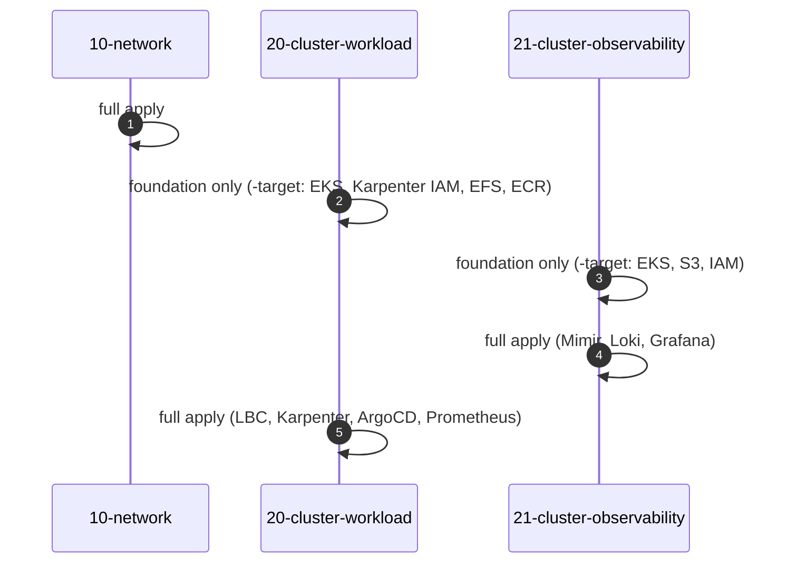

# Step 1.0 — How the Terraform is organised

:::info Step summary
**Goal:** know the three Terraform layers, the order to apply them, and the loop you use for every change.
**Run from:** `$TF_DIR` (`eks-core-terraform`).
:::

## Three layers, three states

The infrastructure is split by blast radius: a change to a cluster never touches the network.

| Layer | Creates | State key | Reads from |
|---|---|---|---|
| `10-network` | VPC `10.20.0.0/16`, public / workload / observability subnets in 3 AZs, NAT gateway, S3 endpoint, Flow Logs, discovery tags | `network/terraform.tfstate` | — |
| `20-cluster-workload` | Cluster 1 `eks-workload`, Managed Node Group `infra`, Karpenter IAM + SQS, EFS, ECR, Pod Identity; Helm releases for LBC, Karpenter, ArgoCD, Prometheus, Metrics Server | `cluster-workload/terraform.tfstate` | network, observability |
| `21-cluster-observability` | Cluster 2 `eks-observability`, node group `monitoring`, S3 buckets, internal ALB security group, private DNS; Helm releases for LBC, Prometheus, Mimir, Loki, Grafana | `cluster-observability/terraform.tfstate` | network, workload |

Each layer has the same file layout:

```text
main.tf               provider, S3 backend (completed by backend.hcl)
variables.tf          inputs
terraform.tfvars      region, sizes, versions, tags
account.auto.tfvars   your account ID (local only, gitignored)
backend.hcl           state bucket and profile (local only, gitignored)
data.tf               remote state of the other layers
locals.tf             names and derived values
vpc.tf, eks.tf, …     resources, one file per concern
helm_releases.tf      charts installed into the cluster
output.tf             values the other layers read
```

## The change loop

Use the same loop for the first apply and for every change afterwards:

```bash
L=10-network                                   # the layer you are working on
terraform -chdir="$TF_DIR/$L" init -backend-config=backend.hcl
terraform -chdir="$TF_DIR/$L" fmt -check
terraform -chdir="$TF_DIR/$L" validate
terraform -chdir="$TF_DIR/$L" plan -out="$PLAN_DIR/$L.tfplan"
terraform -chdir="$TF_DIR/$L" show "$PLAN_DIR/$L.tfplan"     # review
terraform -chdir="$TF_DIR/$L" apply "$PLAN_DIR/$L.tfplan"
```

Rules that keep the state safe:

- **Always apply a saved plan** you have reviewed. Re-plan if anything changed after the plan.
- **Read every `destroy` and `replace`** in the plan before applying. Replacing a subnet or a node group affects everything on top of it.
- **One person applies a layer at a time.** The S3 lock file blocks concurrent writes; never `force-unlock` while another apply might be running.
- Run `init -upgrade` only when you intend to upgrade providers or modules.

## First-time order

Layers 20 and 21 read each other's outputs (security group rules between the clusters), and their Helm releases need a running cluster. On an empty account, apply them in five passes:



| Pass | Where it is described |
|---|---|
| 1. Network | [Step 1.1](03-layer-10-network.md) |
| 2. Cluster 1 foundation | [Step 1.2](04-layer-20-cluster-workload.md) |
| 3–4. Cluster 2 foundation, then full | [Step 1.3](05-layer-21-cluster-observability.md) |
| 5. Cluster 1 full | [Step 1.3, last section](05-layer-21-cluster-observability.md#6-finish-cluster-1) |

`-target` is used only for this bootstrap. After it, every plan covers the whole layer.

**Next:** [1.1 Network](03-layer-10-network.md)
