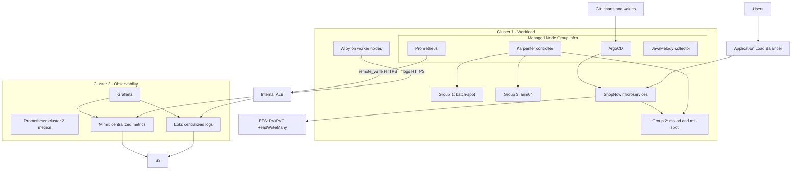

# Architecture and component responsibilities

The design separates the application environment from the system storing its operational evidence. When a ShopNow worker node is replaced, metrics and logs already shipped to cluster 2 remain queryable.

## Design decisions to understand

- The Managed Node Group provides baseline capacity so Karpenter and ArgoCD do not depend on nodes provisioned by Karpenter itself.
- Both clusters share a VPC but use separate subnets and security groups. Telemetry crosses private endpoints; sharing a VPC does not grant unrestricted connectivity.
- Mimir stores centralized metrics. Prometheus in cluster 1 scrapes and forwards them. Prometheus in cluster 2 currently scrapes that cluster; installing the same software there does not automatically deliver cluster 1 metrics to it.
- EFS provides shared directories for microservices. PostgreSQL/MySQL and monitoring WALs use EBS; do not move databases onto EFS just to demonstrate a PV.
- Replicas of **the same service** need distribution. Equal total container counts across every cluster node are not a realistic scheduler objective.

## Resource ownership

| Resource | Declaration/owner in this checkout | Update procedure |
|---|---|---|
| VPC, EKS, IAM, ECR, EFS, S3, SGs, DNS | Terraform | Edit `.tf`/tfvars → plan → review → apply |
| LBC, Karpenter controller, ArgoCD, Prometheus, Metrics Server; cluster 2 Mimir/Loki/Grafana | `helm_releases.tf` | Edit Terraform or the values it reads → apply |
| `gp3` and `efs-sc` StorageClasses | Terraform Kubernetes provider | Terraform apply; do not apply duplicate GitOps definitions |
| NodePools and EC2NodeClass | `platform/nodepools` manifests | Controlled apply in the lab; optionally move to a dedicated Application later |
| ShopNow Deployments, PVCs, PDBs, Services | ArgoCD and Helm charts | Commit changes → ArgoCD reconciliation |
| cert-manager, Alloy, JavaMelody, Rollouts | Additional bootstrap steps | Helm CLI/manifests described in the labs; record ownership |

`gitops/` contains both **Helm values** and **Kubernetes manifests**. Do not run `kubectl apply -R -f gitops/`: values lack `apiVersion/kind`, configurations target two different clusters, and duplicate StorageClass definitions have another owner.

The repository also creates Grafana/Kite in cluster 1 through Terraform. These are auxiliary tools and do not replace centralized Grafana in cluster 2 for acceptance. Removing them requires a separate change plan after the workshop.

## Evaluation principles

Two monitoring nodes do not make single-replica Mimir/Loki highly available. A PDB cannot prevent EC2 Spot reclamation. A mounted PV does not prove the application writes business data to it. Every conclusion in the report should refer to its corresponding test.

Next: [prepare tools and the environment](02-organizational-constraints-and-prerequisites.md).
