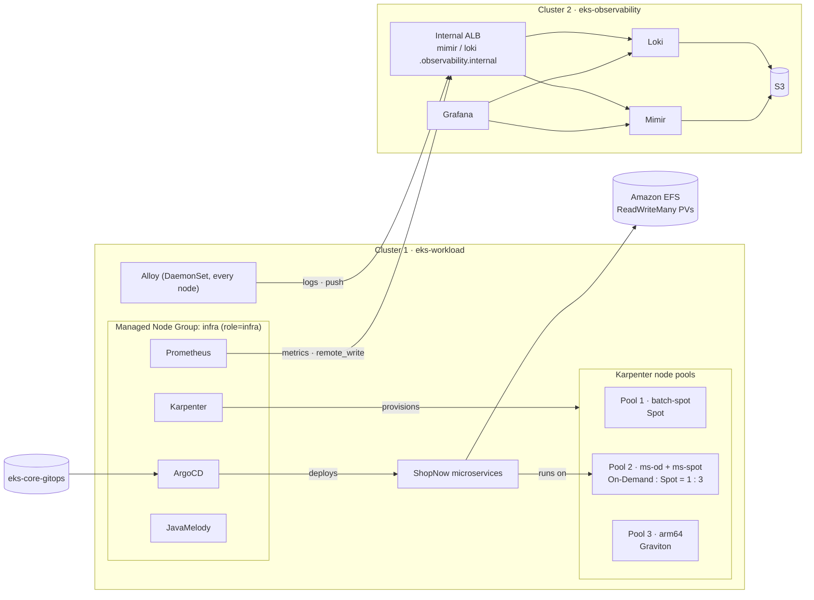

# Step 0.2 — Architecture

:::info Step summary
**Goal:** understand what you will build and which tool owns each piece, before running any command.
**Time:** about 10 minutes of reading.
:::

## The big picture

Both clusters live in **one VPC** with separate subnets and security groups. Telemetry crosses an **internal** ALB over HTTPS; nothing is exposed to the Internet.

## Cluster 1 — `eks-workload`

| Component | Runs on | Purpose |
|---|---|---|
| Managed Node Group `infra` (3 × t3.large, On-Demand) | — | Stable capacity for the platform tools, independent of Karpenter |
| ArgoCD, Karpenter, Prometheus, JavaMelody, AWS Load Balancer Controller, Metrics Server | `infra` nodes | Platform tools (requirement 1) |
| NodePool `batch-spot` | Spot EC2 | Pool 1 — Spot workloads |
| NodePools `ms-od` + `ms-spot` | On-Demand + Spot EC2 | Pool 2 — microservices, 1:3 |
| NodePool `arm64` | Graviton EC2 | Pool 3 — ARM64 workloads |
| ShopNow (6 backends + frontend) | Pool 2 | The microservices under test |
| EFS + EFS CSI driver + StorageClass `efs-sc` | — | Shared persistent volumes |
| Alloy | every node | Collects Pod logs |

## Cluster 2 — `eks-observability`

| Component | Purpose |
|---|---|
| Managed Node Group `monitoring` (2 × t3.medium) | Capacity for the observability stack |
| Mimir (distributed) | Stores metrics received from cluster 1 |
| Loki (single binary) | Stores logs received from cluster 1 |
| Grafana | One UI for both |
| S3 buckets `eks-observability-mimir-<account>`, `-loki-<account>` | Long-term storage |
| Internal ALB + private Route 53 zone `observability.internal` | The private entry point for cluster 1 senders |

## Who owns what

Every resource has exactly one owner. Change it only through that owner, otherwise the next apply or sync reverts your change.

| Resource | Owner | How you change it |
|---|---|---|
| VPC, EKS, node groups, IAM, EFS, ECR, S3, DNS | Terraform (`eks-core-terraform`) | edit → `plan` → review → `apply` |
| LBC, Karpenter, ArgoCD, Prometheus, Metrics Server (cluster 1); Mimir, Loki, Grafana (cluster 2) | Terraform `helm_releases.tf`, values from `eks-core-gitops` | edit values → `plan` → `apply` |
| StorageClasses `gp3`, `efs-sc` | Terraform | `apply` |
| EC2NodeClass and NodePools | Manifests in `eks-core-gitops/platform/nodepools` | `kubectl apply` |
| ShopNow Deployments, PVCs, PDBs, Services | ArgoCD, from `eks-core-gitops/apps` | commit → ArgoCD sync |
| cert-manager, Alloy, JavaMelody | Helm / manifests applied in the steps | `helm upgrade` / `kubectl apply` |

## Design decisions

- **The Managed Node Group exists so the platform does not depend on itself.** Karpenter and ArgoCD must keep running even when every Karpenter pool is empty.
- **Pool 2 is two NodePools.** Karpenter has no ratio setting inside one pool, so On-Demand and Spot are separate pools sharing a label and taint. Their CPU limits (24 and 72) set the 1:3 budget. See [step 2.3](../karpenter/on-demand-spot-ratio-and-limits).
- **EFS is for the microservices; databases use EBS.** PostgreSQL and MySQL stay on `gp3` volumes, which suit single-writer databases.
- **Telemetry goes to a separate cluster** so metrics and logs survive the loss of any workload node or of cluster 1 itself.

**Next:** [1.0 Terraform workflow](00-terraform-workflow.md)
