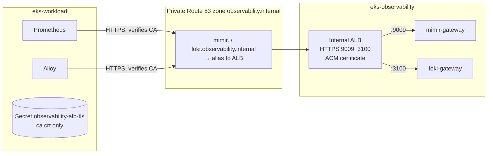

# Step 4.1 — Connect the clusters: private TLS and DNS

:::info Step summary
**Goal:** a private, certificate-verified endpoint in cluster 2 — `mimir.observability.internal:9009` and `loki.observability.internal:3100` — that cluster 1 can send to.
**Requirement:** 9 (ship telemetry to cluster 2). **Time:** about 20 minutes. **Run from:** `$GITOPS_DIR`.
:::

## The path you are building



1. cert-manager on cluster 1 creates a private CA and a certificate for both hostnames.
2. The certificate is imported into **ACM**, because an ALB can only use ACM certificates.
3. An **internal** ALB in cluster 2 terminates TLS and forwards to the Mimir and Loki gateways.
4. Route 53 aliases the two hostnames to the ALB inside the VPC.
5. Prometheus and Alloy get only the CA certificate, so they can verify the ALB.

## 1. Issue the CA and certificate

```bash
kubectl --context eks-workload apply -f "$GITOPS_DIR/platform/observability/tls/ca-issuer.yaml"
kubectl --context eks-workload -n cert-manager wait certificate/observability-ca --for=condition=Ready --timeout=3m
kubectl --context eks-workload apply -f "$GITOPS_DIR/platform/observability/tls/alb-cert.yaml"
kubectl --context eks-workload -n cert-manager wait certificate/observability-alb-tls --for=condition=Ready --timeout=3m
```

## 2. Import the certificate into ACM

The private key is written to a temporary directory that only you can read. Never copy it into a repository.

```bash
umask 077
export CERT_DIR=$(mktemp -d)
S=(kubectl --context eks-workload -n cert-manager get secret observability-alb-tls -o)
"${S[@]}" jsonpath='{.data.tls\.crt}' | base64 --decode > "$CERT_DIR/cert.pem"
"${S[@]}" jsonpath='{.data.tls\.key}' | base64 --decode > "$CERT_DIR/key.pem"
"${S[@]}" jsonpath='{.data.ca\.crt}'  | base64 --decode > "$CERT_DIR/chain.pem"
openssl x509 -in "$CERT_DIR/cert.pem" -noout -ext subjectAltName

export CERT_ARN=$(aws acm import-certificate --region "$AWS_REGION" \
  --certificate "fileb://$CERT_DIR/cert.pem" --private-key "fileb://$CERT_DIR/key.pem" \
  --certificate-chain "fileb://$CERT_DIR/chain.pem" --query CertificateArn --output text)
echo "$CERT_ARN"
```

**Expected:** the SAN list shows both `observability.internal` hostnames, and you get an ACM ARN.

## 3. Create the internal ALB

The ingress manifest has a placeholder for the certificate ARN. Fill it in and apply to cluster 2:

```bash
mkdir -p "$GITOPS_DIR/.workshop"
sed "s|certificate-arn: .*|certificate-arn: $CERT_ARN|" \
  "$GITOPS_DIR/platform/observability/ingress/internal-ingress.yaml" > "$GITOPS_DIR/.workshop/internal-ingress.yaml"
kubectl --context eks-observability apply -f "$GITOPS_DIR/.workshop/internal-ingress.yaml"
kubectl --context eks-observability -n monitoring get ingress mimir loki -w    # wait for ADDRESS, then Ctrl+C
```

The Load Balancer Controller creates one internal ALB (both Ingresses share the group `eks-observability-internal`) with the security group `eks-observability-internal-alb` that Terraform made.

## 4. Point the private DNS names at the ALB

```bash
ALB_DNS=$(kubectl --context eks-observability -n monitoring get ingress mimir -o jsonpath='{.status.loadBalancer.ingress[0].hostname}')
aws elbv2 describe-load-balancers --query "LoadBalancers[?DNSName=='$ALB_DNS'].LoadBalancerName" --output text
```

Put that **name** into `$TF_DIR/21-cluster-observability/terraform.tfvars`:

```hcl
internal_observability_alb_name = "k8s-eksobservabilityin-…"
```

Then apply layer 21, which creates the two alias records:

```bash
L=21-cluster-observability
terraform -chdir="$TF_DIR/$L" plan -out="$PLAN_DIR/$L-dns.tfplan"
terraform -chdir="$TF_DIR/$L" apply "$PLAN_DIR/$L-dns.tfplan"
```

## 5. Give the senders the CA

Prometheus and Alloy read the CA from the Secret `observability-alb-tls` in `monitoring` on cluster 1. They need only the public CA — not the private key:

```bash
kubectl --context eks-workload -n monitoring create secret generic observability-alb-tls \
  --from-file=ca.crt="$CERT_DIR/chain.pem" --dry-run=client -o yaml \
  | kubectl --context eks-workload apply -f -
kubectl --context eks-workload -n monitoring rollout restart statefulset prometheus-prometheus-kube-prometheus-prometheus
```

## Verify

Call both endpoints from a Pod on cluster 1, verifying the certificate with the CA:

```bash
kubectl --context eks-workload -n monitoring run tls-check --rm -i --restart=Never \
  --image=curlimages/curl:8.11.1 --env="CA=$(cat "$CERT_DIR/chain.pem")" \
  --overrides='{"spec":{"nodeSelector":{"role":"infra"},"tolerations":[{"key":"CriticalAddonsOnly","operator":"Exists","effect":"NoSchedule"}]}}' -- sh -c '
    printf "%s\n" "$CA" > /tmp/ca.crt
    for u in https://mimir.observability.internal:9009/ready https://loki.observability.internal:3100/; do
      curl -sS --cacert /tmp/ca.crt -o /dev/null -w "%{remote_ip} %{http_code} $u\n" "$u"
    done'
```

**Expected:** two lines with a private `10.20.x.x` address and HTTP `200`. A certificate error here means the SANs or the CA do not match. Then check the real senders:

```bash
kubectl --context eks-workload -n monitoring logs prometheus-prometheus-kube-prometheus-prometheus-0 -c prometheus --since=5m | grep -i remote
```

No `x509`, `401`, `403` or `connection refused` errors means the TLS path works. Metrics are verified end to end in [step 4.2](../observability/mimir-metrics-pipeline).

Delete the local key material when you are done: `rm -rf "$CERT_DIR"`.

**Next:** [4.2 Metrics → Mimir](../observability/mimir-metrics-pipeline)
