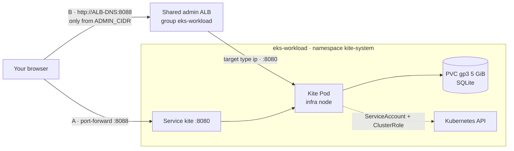

# Step 2.5 — Install the Kite dashboard and expose it

:::info Step summary
**Goal:** Kite running on the infra node group, reachable by port-forward and — optionally — through the shared admin ALB on port 8088.
**Time:** about 20 minutes. **Run from:** `$TF_DIR` (install) and `$GITOPS_DIR` (Ingress).
:::

[Kite](https://github.com/kite-org/kite) is a lightweight Kubernetes dashboard: browse every resource, read Pod logs, open a shell in a container, and see CPU and memory from Prometheus. Nothing else in the workshop depends on it.



## Part 1 — Install Kite

Kite is installed by **Terraform, layer 20**, like every other platform chart. Use option A. Option B is the same installation with Helm, for a cluster that these layers do not manage.

### 1.1 Read what Terraform will create

```bash
grep -n 'kite' "$TF_DIR/20-cluster-workload/helm_releases.tf"
sed -n '/resource "kubernetes_namespace_v1" "kite"/,/depends_on = \[kubernetes_secret_v1.kite\]/p' \
  "$TF_DIR/20-cluster-workload/helm_releases.tf"
```

The block creates four things, in this order:

| # | Resource | What it is |
|---|---|---|
| 1 | `kubernetes_namespace_v1.kite` | Namespace `kite-system` |
| 2 | `random_password.kite_jwt`, `random_password.kite_encryption` | Two random 64-character strings |
| 3 | `kubernetes_secret_v1.kite` | Secret `kite` with `JWT_SECRET`, `KITE_ENCRYPT_KEY`, `DB_TYPE=sqlite` |
| 4 | `helm_release.kite` | Chart `oci://ghcr.io/kite-org/charts/kite` version `0.15.0` with the values below |

Values passed to the chart:

| Value | Setting | Why |
|---|---|---|
| `replicaCount`, `deploymentStrategy` | `1`, `Recreate` | SQLite has one writer; `Recreate` stops the old Pod before the new one mounts the disk |
| `secret.existingSecret` | `kite` | Use the Terraform Secret instead of the chart's default encryption key |
| `db.sqlite.persistence.pvc` | `gp3`, `ReadWriteOnce`, `5Gi` | Users and settings survive restarts |
| `nodeSelector` | `role: infra` | Platform tool on the Managed Node Group |
| `resources` | requests 250m / 256Mi, limit 512Mi | — |
| `ingress.enabled` | `false` | Exposure is handled in Part 3 |

The chart also creates Service `kite` (ClusterIP, port `8080`, health check `/healthz`) and a ServiceAccount bound to a ClusterRole with all verbs on all resources.

### 1.2 Option A — install with Terraform

If you completed the full apply of [step 1.3](../architecture/layer-21-cluster-observability#6-finish-cluster-1), Kite is already installed and this plan reports **No changes**. Otherwise it installs Kite on its own:

```bash
L=20-cluster-workload
terraform -chdir="$TF_DIR/$L" plan -target=helm_release.kite -out="$PLAN_DIR/$L-kite.tfplan"
terraform -chdir="$TF_DIR/$L" apply "$PLAN_DIR/$L-kite.tfplan"
```

`-target=helm_release.kite` pulls in its dependencies (namespace, passwords, Secret, `gp3` StorageClass). Read the plan: you should see only the Kite resources being created. Helm waits up to 15 minutes for the Pod to become Ready (`wait = true`, `atomic = true`); if it fails, the release is rolled back.

### 1.3 Option B — install with Helm (clusters outside this workshop)

Do not run this against `eks-workload`: there Terraform owns the release, and two owners overwrite each other.

```bash
kubectl create namespace kite-system

kubectl -n kite-system create secret generic kite \
  --from-literal=JWT_SECRET="$(openssl rand -hex 32)" \
  --from-literal=KITE_ENCRYPT_KEY="$(openssl rand -hex 32)" \
  --from-literal=DB_TYPE=sqlite

cat > kite-values.yaml <<'VALUES'
replicaCount: 1
deploymentStrategy: { type: Recreate }
secret: { create: false, existingSecret: kite }
db:
  type: sqlite
  sqlite:
    persistence:
      pvc: { enabled: true, storageClass: gp3, accessModes: [ReadWriteOnce], size: 5Gi }
nodeSelector: { role: infra }
resources:
  requests: { cpu: 250m, memory: 256Mi }
  limits: { memory: 512Mi }
ingress: { enabled: false }
VALUES

helm template kite oci://ghcr.io/kite-org/charts/kite --version 0.15.0 \
  -n kite-system -f kite-values.yaml | grep -E '^kind:'      # review what will be created

helm upgrade --install kite oci://ghcr.io/kite-org/charts/kite --version 0.15.0 \
  -n kite-system -f kite-values.yaml --wait --timeout 10m
```

### 1.4 Verify the installation

```bash
helm --kube-context eks-workload list -n kite-system
kubectl --context eks-workload -n kite-system get deploy,pods,svc,pvc,secret -o wide
kubectl --context eks-workload -n kite-system get pod -l app.kubernetes.io/name=kite \
  -o jsonpath='{.items[0].spec.nodeName}' | xargs -I{} kubectl --context eks-workload get node {} -L role
kubectl --context eks-workload -n kite-system logs deploy/kite --tail=20
```

**Expected:**

- release `kite` `deployed`, chart `kite-0.15.0`;
- Deployment `kite` `1/1`, Pod `Running`;
- Service `kite` `ClusterIP` on `8080/TCP`;
- PVC `Bound`, class `gp3`, `5Gi`;
- Secret `kite` present;
- the node shows `role=infra`;
- no errors in the log.

## Part 2 — Open Kite and sign in

### 2.1 Port-forward

```bash
kubectl --context eks-workload -n kite-system port-forward svc/kite 8088:8080
```

Open http://localhost:8088. Port-forward needs no load balancer and exposes nothing; use it by default.

### 2.2 First sign-in

The first time Kite opens it has no users:

1. Create the first **administrator** account. Use a strong password; this account can do anything in the cluster.
2. Add the cluster Kite should manage and choose **in-cluster**. Kite then uses its own ServiceAccount; no kubeconfig is uploaded.
3. Set the Prometheus URL for the resource charts: `http://prometheus-kube-prometheus-prometheus.monitoring.svc:9090`.

### 2.3 Verify

- The workloads view lists `argocd`, `monitoring`, `shopnow`, `kite-system`.
- A ShopNow Pod shows streaming logs and CPU and memory charts.
- Restart the Pod (`kubectl --context eks-workload -n kite-system rollout restart deploy/kite`) and sign in again with the same account: the data is on the PVC.

## Part 3 — Expose Kite through the admin ALB (optional)

There is no DNS domain in this workshop, so admin tools are reached by **the ALB's own hostname**, one listener port per tool:

| Port | Tool | Defined in |
|---|---|---|
| 80 | ArgoCD | `platform/ingress/admin-ingress.yaml` |
| 9090 | Prometheus | `platform/ingress/admin-ingress.yaml` |
| 9093 | Alertmanager | `platform/ingress/admin-ingress.yaml` |
| 8081 | JavaMelody | `platform/ingress/admin-ingress.yaml` |
| 3000 | Grafana (local) | Terraform layer 20 |
| **8088** | **Kite** | `platform/ingress/kite-ingress.yaml` |

Every Ingress with `alb.ingress.kubernetes.io/group.name: eks-workload` is merged into **one** ALB by the AWS Load Balancer Controller. Adding the Kite Ingress therefore adds a listener on port 8088 to the existing ALB instead of creating a new one.

### 3.1 Read the manifest

```bash
cat "$GITOPS_DIR/platform/ingress/kite-ingress.yaml"
```

| Annotation / field | Value | Effect |
|---|---|---|
| `group.name` | `eks-workload` | Join the shared admin ALB |
| `group.order` | `60` | Rule order inside the group (after the other tools) |
| `scheme` | `internet-facing` | ALB in the public subnets |
| `target-type` | `ip` | Traffic goes straight to the Pod IP, not through a NodePort |
| `listen-ports` | `[{"HTTP": 8088}]` | New listener on port 8088 |
| `inbound-cidrs` | `<ADMIN_CIDR>` | Only this address range may connect to port 8088 |
| `healthcheck-path` | `/healthz` | Target is healthy when Kite answers here |
| backend | Service `kite`, port `8080` | Where requests go |

Kite is **not** opened to `0.0.0.0/0` like the other tools: it can change any resource and open shells in containers. `<ADMIN_CIDR>` is a placeholder you fill in when applying, so your IP never ends up in Git.

### 3.2 Check the prerequisites

```bash
kubectl --context eks-workload -n kube-system get deploy aws-load-balancer-controller
kubectl --context eks-workload get ingressclass alb
kubectl --context eks-workload get ingress -A | grep -E 'NAME|eks-workload' || true
```

**Expected:** the controller is `1/1` or `2/2` Ready and the `alb` IngressClass exists. Other admin Ingresses may already be listed; they share the ALB.

### 3.3 Fill in your address and review the result

```bash
cd "$GITOPS_DIR"
mkdir -p "$GITOPS_DIR/.workshop"
export ADMIN_CIDR="$(curl -s -4 ifconfig.me)/32"
echo "$ADMIN_CIDR"

sed "s|<ADMIN_CIDR>|$ADMIN_CIDR|" platform/ingress/kite-ingress.yaml > "$GITOPS_DIR/.workshop/kite-ingress.yaml"
grep -n 'inbound-cidrs' "$GITOPS_DIR/.workshop/kite-ingress.yaml"
kubectl --context eks-workload apply --dry-run=server -f "$GITOPS_DIR/.workshop/kite-ingress.yaml"
```

The `echo` must print your public IP followed by `/32`. The server-side dry run must answer `ingress.networking.k8s.io/kite created (server dry run)`. If you connect through a VPN or office network, use that network's CIDR instead of `ifconfig.me`.

### 3.4 Apply the Ingress

```bash
kubectl --context eks-workload apply -f "$GITOPS_DIR/.workshop/kite-ingress.yaml"
kubectl --context eks-workload -n kite-system get ingress kite -w     # wait for ADDRESS, then Ctrl+C
```

The `ADDRESS` column fills in with the shared ALB's hostname after about a minute. Behind the scenes the controller:

1. adds a listener on port 8088 to the ALB;
2. creates a target group (type `ip`) and registers the Kite Pod IP;
3. adds an inbound rule for `ADMIN_CIDR` on port 8088 to the ALB's security group;
4. adds a rule on the listener that forwards `/` to that target group.

Follow it in the controller log:

```bash
kubectl --context eks-workload -n kube-system logs deploy/aws-load-balancer-controller --since=5m \
  | grep -iE 'kite|eks-workload|error'
```

### 3.5 Check the listener and target on AWS

```bash
export ALB_DNS=$(kubectl --context eks-workload -n kite-system get ingress kite \
  -o jsonpath='{.status.loadBalancer.ingress[0].hostname}')
export ALB_ARN=$(aws elbv2 describe-load-balancers \
  --query "LoadBalancers[?DNSName=='$ALB_DNS'].LoadBalancerArn" --output text)

aws elbv2 describe-listeners --load-balancer-arn "$ALB_ARN" \
  --query 'Listeners[].{Port:Port,Protocol:Protocol}' --output table

for tg in $(aws elbv2 describe-target-groups --load-balancer-arn "$ALB_ARN" \
              --query "TargetGroups[?contains(TargetGroupName,'kitesyst')].TargetGroupArn" --output text); do
  aws elbv2 describe-target-health --target-group-arn "$tg" \
    --query 'TargetHealthDescriptions[].{IP:Target.Id,Port:Target.Port,State:TargetHealth.State}' --output table
done
```

**Expected:** a listener `8088 HTTP` next to the other tools' ports, and one target — the Kite Pod IP on port `8080` — in state `healthy`. It can show `initial` for the first 30 seconds.

### 3.6 Open Kite through the ALB

```bash
echo "http://$ALB_DNS:8088"
curl -s -o /dev/null -w '%{http_code}\n' "http://$ALB_DNS:8088/healthz"
```

`curl` from your machine returns `200`. Open the URL in the browser and sign in with the account from Part 2.

| Check | Expected |
|---|---|
| Page loads from your network | yes |
| Page from any other network (for example a phone on mobile data) | timeout — blocked by `inbound-cidrs` |
| After sign-in, open another page | still signed in |

If sign-in succeeds but the next page sends you back to the login screen or answers `401`, the session cookie is marked `Secure` and the browser does not send it over plain HTTP — the same problem Rancher had on this ALB. Remove the Ingress (3.8) and keep using port-forward.

### 3.7 When your IP changes

```bash
cd "$GITOPS_DIR"
export ADMIN_CIDR="$(curl -s -4 ifconfig.me)/32"
sed "s|<ADMIN_CIDR>|$ADMIN_CIDR|" platform/ingress/kite-ingress.yaml > "$GITOPS_DIR/.workshop/kite-ingress.yaml"
kubectl --context eks-workload apply -f "$GITOPS_DIR/.workshop/kite-ingress.yaml"
```

The controller replaces the security-group rule within a minute.

### 3.8 Remove the ALB access

```bash
kubectl --context eks-workload -n kite-system delete ingress kite
```

The controller removes the 8088 listener, the target group and the rule. The ALB itself stays as long as other Ingresses in the group exist.

Traffic through the ALB is plain HTTP: the ALB hostname is not a domain you own, so no certificate can be issued for it. Treat this listener as a lab convenience.

## Part 4 — Hardening (recommended outside a lab)

| Risk | Change |
|---|---|
| Cluster-wide write access | Narrow the chart's `rbac.rules` (below) and use Kite's own roles for users |
| Password and session over HTTP | Prefer port-forward, or put the ALB behind a domain with an ACM certificate |
| Single admin account | Create named users in Kite instead of sharing the first account |
| Data loss | Snapshot the PVC's EBS volume before upgrades |

Read-only Kubernetes access for Kite — add to the `helm_release "kite"` values in `$TF_DIR/20-cluster-workload/helm_releases.tf`:

```hcl
    rbac = {
      create = true
      rules = [{
        apiGroups = ["*"]
        resources = ["*"]
        verbs     = ["get", "list", "watch"]
      }]
    }
```

Then plan and apply layer 20. With read-only rules the terminal, edit and delete actions in Kite stop working; that is the point.

## Troubleshooting

| Symptom | Check |
|---|---|
| Helm release fails / rolls back | `kubectl -n kite-system describe pod`; PVC `Bound`; `gp3` StorageClass exists; an infra node has room |
| Pod restarting | `kubectl -n kite-system logs deploy/kite --previous`; Secret `kite` has `JWT_SECRET` and `KITE_ENCRYPT_KEY` |
| Ingress has no ADDRESS | Controller log (3.4); IngressClass `alb`; public subnets tagged `kubernetes.io/role/elb=1` |
| Target `unhealthy` | `curl` `/healthz` from inside the cluster; Pod Ready; the cluster node SG allows the ALB SG on 8080 |
| Browser times out | Your current IP is not `ADMIN_CIDR` — repeat 3.7 |
| Resource charts empty | Prometheus URL in Kite's cluster settings |

## Remove Kite

Delete the Ingress (3.8), then remove the `kite` resources (`kubernetes_namespace_v1.kite`, `random_password.kite_*`, `kubernetes_secret_v1.kite`, `helm_release.kite`) from layer 20 and apply. Deleting the namespace also deletes the PVC and Kite's data.

**Next:** [3.1 Build images](../apps-shopnow/docker-build-multi-arch-and-ci)
