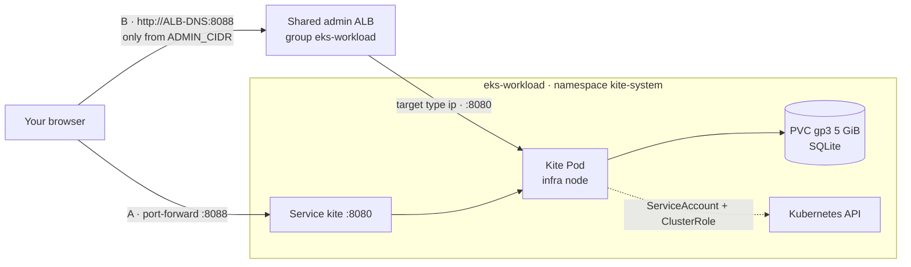
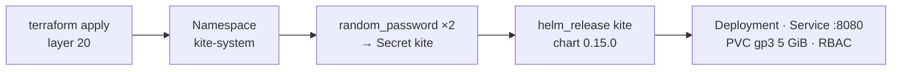

# Step 2.5 — Kite dashboard {#step-25--kite-dashboard}

:::info Step summary
**Goal:** understand how Kite was installed, check it, and open it by port-forward **or** through the shared admin ALB on port 8088.
**Time:** about 15 minutes. **Run from:** any directory with `TF_DIR`, `AWS_PROFILE`, and `AWS_REGION` exported. Terraform installs Kite; ALB access is a separate opt-in.
:::

[Kite](https://github.com/kite-org/kite) is a lightweight Kubernetes dashboard: browse every resource, read Pod logs, open a shell in a container, and see CPU and memory from Prometheus. Nothing else in the workshop depends on it.



## Part 1 — How Kite is installed {#part-1--how-kite-is-installed}

Kite is a `helm_release` in **Terraform layer 20** (`$TF_DIR/20-cluster-workload/helm_releases.tf`). It was installed when you applied that layer in [step 1.3](../architecture/layer-21-cluster-observability#6-finish-cluster-1); there is no separate install command.



| Order | Terraform resource | Result in the cluster |
|---|---|---|
| 1 | `kubernetes_namespace_v1.kite` | Namespace `kite-system` |
| 2 | `random_password.kite_jwt`, `random_password.kite_encryption` | Two random 64-character keys (kept in Terraform state) |
| 3 | `kubernetes_secret_v1.kite` | Secret `kite`: `JWT_SECRET`, `KITE_ENCRYPT_KEY`, `DB_TYPE=sqlite` |
| 4 | `helm_release.kite` | Chart `oci://ghcr.io/kite-org/charts/kite` `0.15.0`: Deployment, Service `kite` (ClusterIP `8080`), PVC, ServiceAccount + ClusterRole |

Main values passed to the chart:

| Value | Setting | Why |
|---|---|---|
| `replicaCount`, `deploymentStrategy` | `1`, `Recreate` | SQLite has one writer; the old Pod stops before the new one mounts the disk |
| `secret.existingSecret` | `kite` | Use the Terraform Secret instead of the chart's default keys |
| `db.sqlite.persistence.pvc` | `gp3`, `ReadWriteOnce`, `5Gi` | Users and settings survive restarts |
| `nodeSelector`, `tolerations` | `role: infra`, `CriticalAddonsOnly` | Runs on the infra Managed Node Group |
| `ingress.enabled` | `false` | Access is port-forward or the Ingress in Part 2 |

To change a value, edit the `helm_release "kite"` block, then plan and apply layer 20 as usual. Helm waits for the Pod (`wait`, `atomic`) and rolls back if it does not become Ready.

### Check that Kite is running {#check-that-kite-is-running}

```bash
helm --kube-context eks-workload list -n kite-system
kubectl --context eks-workload -n kite-system get deploy,pods,svc,pvc,secret -o wide
kubectl --context eks-workload -n kite-system get pod -l app.kubernetes.io/name=kite \
  -o jsonpath='{.items[0].spec.nodeName}' | xargs -I{} kubectl --context eks-workload get node {} -L role
kubectl --context eks-workload -n kite-system logs deploy/kite --tail=20
```

**Expected:**

- release `kite` `deployed`, chart `kite-0.15.0`;
- Deployment `kite` `1/1`, Pod `Running`;
- Service `kite` `ClusterIP` on `8080/TCP`;
- PVC `Bound`, class `gp3`, `5Gi`;
- Secret `kite` present;
- the node shows `role=infra`;
- no errors in the log.

## Part 2 — Access Kite {#part-2--access-kite}

Terraform owns the Kite release and its **optional** Ingress. The Helm chart keeps `ingress.enabled=false`; a separate `kubernetes_ingress_v1.kite[0]` resource in `$TF_DIR/20-cluster-workload/kite_ingress.tf` owns ALB access. Do not create a second Ingress through Helm, ArgoCD, or `kubectl apply`.

| | A · Port-forward (default) | B · Admin ALB (opt-in) |
|---|---|---|
| URL | `http://localhost:8088` | `http://<ALB-DNS>:8088` |
| Enable | `kubectl port-forward` | `kite_ingress_enabled=true` and allowed `kite_admin_cidrs`, then Terraform apply |
| Network exposure | Local machine | Only explicitly allowed IPv4 CIDRs on port 8088 |

### 2A — Port-forward {#2a--port-forward}

```bash
kubectl --context eks-workload -n kite-system port-forward svc/kite 8088:8080
```

Open http://localhost:8088, then continue with [Part 3](#part-3--first-sign-in). This does not require an Ingress.

### 2B — Through the admin ALB {#2b--through-the-admin-alb}

Use the ALB's own hostname; no custom public domain is required for this HTTP lab path. The Ingress joins the `eks-workload` group. If the group already has a compatible ALB, the controller adds listener 8088 to that ALB; otherwise it creates the group's ALB. Keep the group, scheme, other listeners, and existing routes unchanged.

| Field | Value |
|---|---|
| Terraform address | `kubernetes_ingress_v1.kite[0]` |
| Ingress | `kite-system/kite`, class `alb` |
| IngressGroup / order | `eks-workload` / `60` |
| Scheme / target type | `internet-facing` / `ip` |
| Listener | HTTP `8088` |
| Backend | Service `kite:8080`, path `/` |
| Health check | `/healthz` |

Terraform creates the Kubernetes Ingress after the Kite Helm release is ready. **AWS Load Balancer Controller**, not Terraform's AWS provider, reconciles its listener, rule, target group, and controller-managed security-group rules.

#### 2B.1 Check the environment and prerequisites {#2b1-read-the-manifest}

Load your workshop environment first ([prerequisites](../architecture/organizational-constraints-and-prerequisites#5-variables-used-in-every-step)). The commands use `TF_DIR` and `terraform -chdir`, so they work from the Terraform layer directory, GitOps repository, or any other directory. Set `AWS_PROFILE` to the profile actually used by your environment, not necessarily the sample name `eks-core`. Its identity and region must match layer 20's `aws_profile`, `account_id`, and `region` values. The S3 state region may differ from the EKS region.

The examples also require Python 3 and `jq` for validation and JSON selection.

```bash
bash <<'BASH'
set -euo pipefail
: "${TF_DIR:?Export TF_DIR from your workshop environment}"
: "${AWS_PROFILE:?Export the AWS profile used by this environment}"
: "${AWS_REGION:?Export the EKS region}"
for command in terraform kubectl helm aws curl python3 jq; do
  command -v "$command" >/dev/null
done
test -f "$TF_DIR/20-cluster-workload/kite_ingress.tf"
test -f "$TF_DIR/20-cluster-workload/backend.hcl"
aws --profile "$AWS_PROFILE" --region "$AWS_REGION" sts get-caller-identity
kubectl --context eks-workload -n kube-system get deploy aws-load-balancer-controller
kubectl --context eks-workload get ingressclass alb
kubectl --context eks-workload -n kite-system get deploy,pods,svc,pvc,endpointslices
kubectl --context eks-workload get ingress -A -o json | jq '
  .items[] | select(.metadata.annotations["alb.ingress.kubernetes.io/group.name"] == "eks-workload")
  | {namespace: .metadata.namespace, name: .metadata.name,
     annotations: .metadata.annotations, address: .status.loadBalancer}'
BASH
```

Expected: the correct AWS account; the controller Ready; class `alb`; Kite Ready; PVC Bound; a Ready EndpointSlice address on 8080. Inspect every member's ALB annotations. If `alb.ingress.kubernetes.io/security-groups` is explicitly configured, `inbound-cidrs` does **not** manage access: inspect the actual SG rules before proceeding. Confirm that listener 8088 is not already used by another application.

#### 2B.2 Configure explicit allowed CIDRs {#2b2-check-the-prerequisites}

Public access defaults to **off** (`kite_ingress_enabled=false`, `kite_admin_cidrs=[]`). Store environment values in `$TF_DIR/20-cluster-workload/kite.auto.tfvars`, which is gitignored. The `.example` file contains defaults only. This example creates a new file for your current public IPv4 address; it refuses to overwrite an existing file. If the file already exists, edit it instead. Set `ADMIN_CIDR` yourself for a VPN or office network rather than using the IP lookup.

```bash
export ADMIN_CIDR="$(curl --fail --silent --show-error --ipv4 --max-time 10 https://checkip.amazonaws.com)/32"
python3 <<'PYCONFIG'
import ipaddress, json, os
from pathlib import Path
network = ipaddress.ip_network(os.environ["ADMIN_CIDR"].strip(), strict=False)
if network.version != 4 or network.prefixlen == 0:
    raise SystemExit("Use a valid IPv4 CIDR from /1 to /32.")
layer = Path(os.environ["TF_DIR"]) / "20-cluster-workload"
if not (layer / "kite_ingress.tf").is_file():
    raise SystemExit("TF_DIR does not point to the Terraform repository.")
path = layer / "kite.auto.tfvars"
with path.open("x") as config:
    config.write("kite_ingress_enabled = true\n")
    config.write("kite_admin_cidrs = " + json.dumps([str(network)]) + "\n")
path.chmod(0o600)
print("Created", path)
PYCONFIG
```

Use only IPv4 CIDRs with a prefix from `/1` to `/32`; `/0`, empty CIDR lists when enabled, malformed CIDRs, and IPv6 are rejected. The shared ALB is configured for IPv4. CIDRs stay out of Git but are visible in Terraform state and Kubernetes/AWS configuration. A failed IP lookup must never turn into an unrestricted default.

#### 2B.3 Initialize and adopt an existing Ingress {#2b3-fill-in-your-address-and-review-the-result}

Initialize using the selected AWS profile, overriding the sample profile in `backend.hcl` without editing that file:

```bash
terraform -chdir="$TF_DIR/20-cluster-workload" init   -backend-config="$TF_DIR/20-cluster-workload/backend.hcl"   -backend-config="profile=$AWS_PROFILE"
terraform -chdir="$TF_DIR/20-cluster-workload" validate
```

If an Ingress already exists, inspect its owner before importing. A manually applied Ingress typically has `kubectl-client-side-apply` as a manager. If Helm, ArgoCD, or a different Terraform state owns it, migrate that ownership first; do not continue with competing reconcilers. An absent Ingress is normal for a fresh install.

```bash
kubectl --context eks-workload -n kite-system get ingress kite \
  --ignore-not-found --show-managed-fields -o json | jq '
  {name: .metadata.name, labels: .metadata.labels,
   annotations: .metadata.annotations,
   managers: [.metadata.managedFields[]?.manager]}'
```

After confirming that an existing Ingress is unmanaged or already belongs to this state, adopt it without deletion. The script stops on state-access or Kubernetes errors and skips an import already present in state:

```bash
bash <<'BASH'
set -euo pipefail
: "${TF_DIR:?Export TF_DIR}"
layer="$TF_DIR/20-cluster-workload"
address='kubernetes_ingress_v1.kite[0]'
state_addresses=$(terraform -chdir="$layer" state list)
existing=$(kubectl --context eks-workload -n kite-system get ingress kite \
  --ignore-not-found -o name)
if printf '%s\n' "$state_addresses" | grep -Fxq "$address"; then
  echo "Kite Ingress is already managed by this Terraform state."
elif [ -n "$existing" ]; then
  terraform -chdir="$layer" import "$address" kite-system/kite
else
  echo "No existing Kite Ingress: the reviewed apply will create it."
fi
BASH
```

The old GitOps `platform/ingress/kite-ingress.yaml` template has been removed. Do not run the former `sed ... | kubectl apply` command or enable a recursive platform app-of-apps to install Kite's Ingress.

#### 2B.4 Review the plan and apply {#2b4-apply-the-ingress}

```bash
terraform -chdir="$TF_DIR/20-cluster-workload" plan   -out="$TF_DIR/20-cluster-workload/kite-ingress.tfplan"
terraform -chdir="$TF_DIR/20-cluster-workload" show \
  "$TF_DIR/20-cluster-workload/kite-ingress.tfplan"
```

Review the full plan. Only the optional Kite Ingress and its URL output should change for this task. An imported Ingress may already match, producing no resource changes. **Do not apply a plan containing unrelated changes**, replacements, Secret/PVC changes, or modifications to other listeners. Resolve those separately without discarding someone else's edits. The saved plan can contain sensitive data; keep it local and protect it.

```bash
terraform -chdir="$TF_DIR/20-cluster-workload" apply \
  "$TF_DIR/20-cluster-workload/kite-ingress.tfplan"
terraform -chdir="$TF_DIR/20-cluster-workload" output -raw kite_url
```

`kite_url` is available after the controller populates the Ingress address. Reconciliation is asynchronous; an initial target-health state is not a guarantee of how long it will take.

#### 2B.5 Verify routing, targets, and network access {#2b5-check-the-listener-and-target-on-aws}

Resolve the target group from Kite's `TargetGroupBinding`, then prove listener 8088 forwards to it. Do not guess the target-group name. Compare listeners and SG rules with the pre-change baseline; existing services must remain reachable.

```bash
bash <<'BASH'
set -euo pipefail
: "${AWS_PROFILE:?Export AWS_PROFILE}"
: "${AWS_REGION:?Export AWS_REGION}"
ALB_DNS=$(kubectl --context eks-workload -n kite-system get ingress kite   -o jsonpath='{.status.loadBalancer.ingress[0].hostname}')
test -n "$ALB_DNS"
ALB_ARN=$(aws --profile "$AWS_PROFILE" --region "$AWS_REGION" elbv2 describe-load-balancers \
  --output json | jq -er --arg dns "$ALB_DNS" '
    [.LoadBalancers[] | select(.DNSName == $dns)]
    | if length == 1 then .[0].LoadBalancerArn else error("Expected exactly one ALB") end')
LISTENER_ARN=$(aws --profile "$AWS_PROFILE" --region "$AWS_REGION" elbv2 describe-listeners \
  --load-balancer-arn "$ALB_ARN" --output json | jq -er '
    [.Listeners[] | select(.Port == 8088 and .Protocol == "HTTP")]
    | if length == 1 then .[0].ListenerArn else error("Missing HTTP listener 8088") end')
TG_ARN=$(kubectl --context eks-workload -n kite-system get targetgroupbindings -o json | jq -er '
  [.items[] | select(.spec.serviceRef.name == "kite" and (.spec.serviceRef.port | tostring) == "8080")
   | .spec.targetGroupARN] | unique
  | if length == 1 then .[0] else error("Expected one Kite target group") end')
aws --profile "$AWS_PROFILE" --region "$AWS_REGION" elbv2 describe-rules \
  --listener-arn "$LISTENER_ARN" --output json | jq -e --arg tg "$TG_ARN" '
  .Rules[] | select(any(.Actions[]?; .Type == "forward" and
    (.TargetGroupArn == $tg or any(.ForwardConfig.TargetGroups[]?; .TargetGroupArn == $tg))))
  | {Priority, Conditions, Actions}'
aws --profile "$AWS_PROFILE" --region "$AWS_REGION" elbv2 describe-target-health \
  --target-group-arn "$TG_ARN" --query \
  'TargetHealthDescriptions[].{IP:Target.Id,Port:Target.Port,State:TargetHealth.State}' --output table
SG_IDS=$(aws --profile "$AWS_PROFILE" --region "$AWS_REGION" elbv2 describe-load-balancers \
  --load-balancer-arns "$ALB_ARN" --output json | jq -r '.LoadBalancers[0].SecurityGroups[]')
while IFS= read -r sg; do
  aws --profile "$AWS_PROFILE" --region "$AWS_REGION" ec2 describe-security-groups \
    --group-ids "$sg" --query 'SecurityGroups[].{ID:GroupId,Inbound:IpPermissions}' --output json
done <<< "$SG_IDS"
kubectl --context eks-workload -n kite-system get endpointslices,ingress
aws --profile "$AWS_PROFILE" --region "$AWS_REGION" elbv2 describe-listeners \
  --load-balancer-arn "$ALB_ARN" --query 'Listeners[].{Port:Port,Protocol:Protocol}' --output table
printf 'Kite URL: http://%s:8088\n' "$ALB_DNS"
curl --noproxy '*' --fail --silent --show-error --connect-timeout 10 --max-time 20   -o /dev/null -w 'Health HTTP status: %{http_code}\n' "http://$ALB_DNS:8088/healthz"
BASH
```

Expected: ADDRESS set; HTTP listener 8088 forwards to Kite; Ready endpoint and healthy target on 8080; every SG attached to the ALB restricts access to 8088 to the intended CIDRs; `/healthz` returns 200 from an allowed network. Review all rules that could cover 8088, including broad port ranges and all-protocol rules. If another network was not tested, record that as unverified rather than claiming it was blocked.

```bash
terraform -chdir="$TF_DIR/20-cluster-workload" plan -detailed-exitcode
```

Exit code `0` means no changes; `2` means the plan contains changes; `1` is an error. Inspect any remaining changes, including pre-existing drift, before claiming convergence.

#### 2B.6 Open Kite through the ALB {#2b6-open-kite-through-the-alb}

Open the printed `http://<ALB-DNS>:8088` URL. Health HTTP 200 proves the health endpoint, not successful authentication. Test sign-in and subsequent page requests only with your existing account. Do not create, reset, or change accounts as part of an infrastructure verification.

For a redirect loop or `401`, inspect browser Network/Cookies, forwarded scheme, and Kite logs before deciding the cause. A `Secure` cookie is one possible explanation for HTTP session problems, not a diagnosis from the status code alone. Use port-forward while investigating if needed.

Traffic to the ALB in this example is **plain HTTP**. CIDR filtering is not encryption. This workshop does not request a publicly trusted certificate for the AWS-owned ALB hostname; use port-forward or a domain you control with suitable TLS for stronger transport protection.

#### 2B.7 When your IP changes {#2b7-when-your-ip-changes}

Edit only `kite_admin_cidrs` in the existing local `kite.auto.tfvars` file, keeping the enable flag true. Validate the replacement IPv4 CIDR, repeat the full plan/review/apply steps, and verify the actual SG rules. No new Ingress or ALB is required. Do not manually patch the Kubernetes resource: Terraform would later reconcile it back.

#### 2B.8 Disable ALB access and return to port-forward {#2b8-remove-the-alb-access}

In the existing local `kite.auto.tfvars`, set:

```hcl
# In the existing gitignored kite.auto.tfvars, set:
kite_ingress_enabled = false
kite_admin_cidrs     = []
```

Repeat plan/review/apply. The intended resource change is deletion of **only** `kubernetes_ingress_v1.kite[0]`; the URL output becomes null. The controller removes listener 8088 and its associated resources if no other Ingress uses them. The shared ALB remains while other members exist. Kite's Helm release, Secret, PVC, accounts, and data remain intact. Do not use `kubectl delete ingress` for a Terraform-managed resource.

Then use the port-forward command in 2A. For reconciliation errors:

```bash
kubectl --context eks-workload -n kite-system describe ingress kite
kubectl --context eks-workload -n kube-system logs deploy/aws-load-balancer-controller --since=10m   | grep -iE 'kite|eks-workload|error' || true
```

## Part 3 — First sign-in {#part-3--first-sign-in}

The first time Kite opens it has no users:

1. Create the first **administrator** account. Use a strong password; this account can do anything in the cluster.
2. Add the cluster Kite should manage and choose **in-cluster**. Kite then uses its own ServiceAccount; no kubeconfig is uploaded.
3. Set the Prometheus URL for the resource charts: `http://prometheus-kube-prometheus-prometheus.monitoring.svc:9090`.

### Verify {#verify}

- The workloads view lists `argocd`, `monitoring`, `shopnow`, `kite-system`.
- An application Pod shows streaming logs and CPU and memory charts.
- Restart the Pod (`kubectl --context eks-workload -n kite-system rollout restart deploy/kite`) and sign in again with the same account: the data is on the PVC.

## Part 4 — Hardening (recommended outside a lab) {#part-4--hardening-recommended-outside-a-lab}

| Risk | Change |
|---|---|
| Cluster-wide write access | Narrow the chart's `rbac.rules` (below) and use Kite's own roles for users |
| Password and session over HTTP | Prefer port-forward, or put the ALB behind a domain with an ACM certificate |
| Single admin account | Create named users in Kite instead of sharing the first account |
| Data loss | Snapshot the PVC's EBS volume before upgrades |

Read-only Kubernetes access for Kite — add to the `helm_release "kite"` values in `$TF_DIR/20-cluster-workload/helm_releases.tf`:

```hcl
    rbac = {
      create = true
      rules = [{
        apiGroups = ["*"]
        resources = ["*"]
        verbs     = ["get", "list", "watch"]
      }]
    }
```

Then plan and apply layer 20. With read-only rules the terminal, edit and delete actions in Kite stop working; that is the point.

## Troubleshooting {#troubleshooting}

| Symptom | Check |
|---|---|
| Helm release fails / rolls back | `kubectl -n kite-system describe pod`; PVC `Bound`; `gp3` StorageClass exists; an infra node has room |
| Pod restarting | `kubectl -n kite-system logs deploy/kite --previous`; Secret `kite` has `JWT_SECRET` and `KITE_ENCRYPT_KEY` |
| Ingress has no ADDRESS | Controller log (2B.4); IngressClass `alb`; public subnets tagged `kubernetes.io/role/elb=1` |
| Target `unhealthy` | `curl` `/healthz` from inside the cluster; Pod Ready; the cluster node SG allows the ALB SG on 8080 |
| Browser times out | Your current IP is not `ADMIN_CIDR` — repeat 2B.7 |
| Resource charts empty | Prometheus URL in Kite's cluster settings |

## Remove Kite {#remove-kite}

Disable the Terraform-managed Ingress (2B.8), then remove the `kite` resources (`kubernetes_namespace_v1.kite`, `random_password.kite_*`, `kubernetes_secret_v1.kite`, `helm_release.kite`) from layer 20 and apply. Deleting the namespace also deletes the PVC and Kite's data.

**Next:** [3.1 Build images](../apps-shopnow/docker-build-multi-arch-and-ci)
