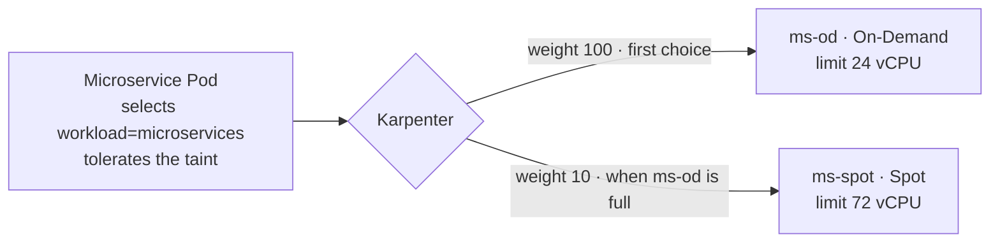

# Step 2.3 — Mixed pool: configure and measure the 1:3 ratio

:::info Step summary
**Goal:** understand how pool 2 implements On-Demand : Spot = 1 : 3, and prove it with a controlled test.
**Requirement:** 2 (mixed pool). **Time:** about 20 minutes. **Run from:** `$GITOPS_DIR`.
:::

## How the ratio is built



- Both NodePools give their nodes the label `workload=microservices` and the same taint, so a microservice Pod can run on either.
- Karpenter prefers the higher **weight**, so the first 24 vCPU come from On-Demand — a stable baseline.
- When `ms-od` reaches its **CPU limit of 24**, new capacity comes from `ms-spot`, up to **72 vCPU**.
- At full size that is 24 On-Demand vCPU : 72 Spot vCPU = **1 : 3**.

The ratio is a **capacity budget**, not a node count Karpenter enforces at every moment. With little load, all capacity is On-Demand; the 1:3 split appears when the pool scales out. Report which measure you use (vCPU or nodes).

## 1. Measure the pool at any time

```bash
kubectl --context eks-workload get nodes -l workload=microservices \
  -L karpenter.sh/nodepool,karpenter.sh/capacity-type,node.kubernetes.io/instance-type

kubectl --context eks-workload get nodes -l workload=microservices -o json | jq -r '
  [.items[] | {type: .metadata.labels["karpenter.sh/capacity-type"], cpu: (.status.capacity.cpu|tonumber)}]
  | group_by(.type) | .[] | "\(.[0].type): nodes=\(length) vCPU=\(map(.cpu)|add)"' \
  | tee "$EVIDENCE_DIR/pool2-capacity.txt"
```

## 2. Prove 1 : 3 with a controlled test

Run this **before** deploying ShopNow, while pool 2 has no nodes. It launches four 4-vCPU nodes (billable).

The test temporarily limits both pools to 4-vCPU instances and scales the budget down to 4 : 12, so the expected end state is exactly **1 On-Demand + 3 Spot** nodes.

```bash
kubectl --context eks-workload get nodes -l workload=microservices    # must be empty

kubectl --context eks-workload patch nodepool ms-od --type=json -p='[
  {"op":"add","path":"/spec/template/spec/requirements/-","value":{"key":"karpenter.k8s.aws/instance-cpu","operator":"In","values":["4"]}},
  {"op":"replace","path":"/spec/limits/cpu","value":"4"}]'
kubectl --context eks-workload patch nodepool ms-spot --type=json -p='[
  {"op":"add","path":"/spec/template/spec/requirements/-","value":{"key":"karpenter.k8s.aws/instance-cpu","operator":"In","values":["4"]}},
  {"op":"replace","path":"/spec/limits/cpu","value":"12"}]'
```

`examples/workshop/ratio-proof.yaml` creates one Pod requesting 3 vCPU, pinned to On-Demand. Each Pod needs its own 4-vCPU node.

```bash
kubectl --context eks-workload apply -f "$GITOPS_DIR/examples/workshop/ratio-proof.yaml"
kubectl --context eks-workload rollout status deployment/workshop-ratio --timeout=10m

# remove the On-Demand pin and scale to four Pods
kubectl --context eks-workload patch deployment workshop-ratio --type=merge \
  -p '{"spec":{"replicas":4,"template":{"spec":{"nodeSelector":{"capacity":null}}}}}'
kubectl --context eks-workload rollout status deployment/workshop-ratio --timeout=10m
```

## Verify

```bash
kubectl --context eks-workload get nodes -l workload=microservices \
  -L karpenter.sh/nodepool,karpenter.sh/capacity-type,node.kubernetes.io/instance-type \
  | tee "$EVIDENCE_DIR/pool2-ratio-test.txt"
```

**Expected:** 1 node from `ms-od` (`on-demand`) and 3 nodes from `ms-spot` (`spot`), each 4 vCPU, and four `Running` Pods. If Spot capacity is unavailable you will see fewer Spot nodes — record that as the result rather than changing the pools.

## 3. Restore the pools

```bash
kubectl --context eks-workload delete -f "$GITOPS_DIR/examples/workshop/ratio-proof.yaml"
kubectl --context eks-workload apply -f "$GITOPS_DIR/platform/nodepools/nodepool-2-ondemand.yaml"
kubectl --context eks-workload apply -f "$GITOPS_DIR/platform/nodepools/nodepool-2-spot.yaml"
kubectl --context eks-workload get nodepool ms-od ms-spot -o jsonpath='{range .items[*]}{.metadata.name}: {.spec.limits.cpu}{"\n"}{end}'
```

**Expected:** `ms-od: 24` and `ms-spot: 72`. The four test nodes are consolidated away within a few minutes.

**Next:** [2.4 ARM64](arm64-validation)
