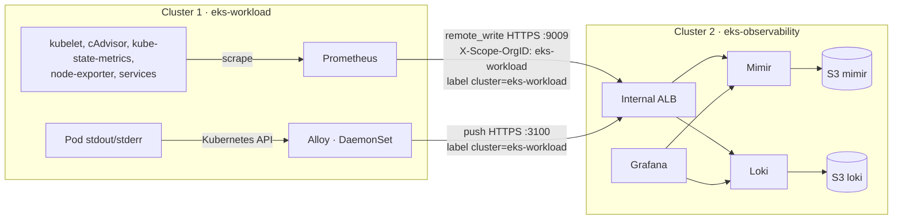

# Step 4.0 — Centralized observability: how telemetry flows

:::info Step summary
**Goal:** understand the two paths that carry cluster 1's metrics and logs into cluster 2.
**Requirements:** 8, 9. **Time:** 5 minutes of reading.
:::

| Path | Sender (cluster 1) | Receiver (cluster 2) | How to tell it is cluster 1 data |
|---|---|---|---|
| Metrics | Prometheus scrapes locally, then `remote_write` | Mimir (tenant `eks-workload`) | label `cluster="eks-workload"` |
| Logs | Alloy on every node reads Pod logs | Loki | label `cluster="eks-workload"` |

- Both paths use the internal ALB and TLS from [step 4.1](../platform-addons/cert-manager-and-internal-tls); no traffic leaves the VPC.
- Mimir and Loki keep recent data on EBS and flush it to S3, so the data outlives any node of either cluster.
- Grafana in cluster 2 is the single place to query both. Cluster 2's own Prometheus only watches cluster 2.

## Steps in this module

1. [4.1 Private TLS and DNS](../platform-addons/cert-manager-and-internal-tls) — the connection.
2. [4.2 Metrics → Mimir](mimir-metrics-pipeline).
3. [4.3 Logs → Loki](loki-logging-pipeline).
4. [4.4 Grafana](grafana-dashboards).

The module is done when a **new** cluster 1 metric and a **new** cluster 1 log line can be queried in cluster 2 Grafana.

**Next:** [4.1 Private TLS and DNS](../platform-addons/cert-manager-and-internal-tls)
