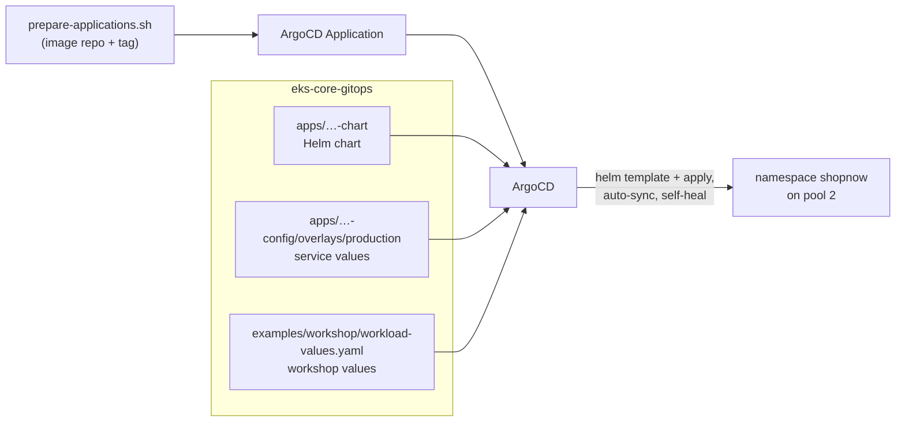

# Step 3.2 — Deploy the microservices with ArgoCD

:::info Step summary
**Goal:** microservices run on pool 2, with every service deployed and kept in sync by ArgoCD.
**Requirements:** 3 (microservices on pool 2), 7 (ArgoCD). **Time:** about 30 minutes. **Run from:** `$GITOPS_DIR`.
:::

## How a service gets deployed



Each service is one ArgoCD **Application** that renders its Helm chart with three value files, in order. The last one, `workload-values.yaml`, carries the workshop requirements for all six backends:

```yaml
replicaCount: 2
persistence:            # requirement 4 — EFS volume at /data
  enabled: true
  storageClass: efs-sc
  size: 5Gi
  mountPath: /data
nodeSelector:           # requirement 3 — run on pool 2
  workload: microservices
tolerations:
  - key: workload
    operator: Equal
    value: microservices
    effect: NoSchedule
podDisruptionBudget:    # requirement 6
  enabled: true
  maxUnavailable: 1
```

Eureka (discovery) additionally uses `discovery-values.yaml`: one replica and no PDB, because this Eureka setup has no peer replication.

Applications use automated sync with `prune` and `selfHeal`: ArgoCD reverts manual `kubectl` edits to anything it manages. Change Git instead.

## 1. Create the AppProject

```bash
kubectl --context eks-workload apply -f "$GITOPS_DIR/platform/addons/argocd/appproject-shopnow.yaml"
```

The `shopnow` project allows deploying into the `shopnow` namespace only.

## 2. Render the Applications

The script fills in your Git URL, revision, ECR image repository and tag. It writes files only; it does not apply or push anything.

```bash
cd "$GITOPS_DIR"
export WORKSHOP_REPO_URL=https://github.com/tranvix0910/eks-core-gitops.git   # repo ArgoCD reads (or your fork)
export WORKSHOP_REVISION=main                                                # branch, tag or commit to deploy
export IMAGE_TAG=workshop-v1                                                 # same tag as step 3.1
bash examples/workshop/prepare-applications.sh
ls .workshop/applications
```

**Expected:** nine files — `shopnow-database-services`, `discovery-server`, `config-server`, `product-service`, `cart-service`, `user-service`, `api-gateway`, `frontend`, and `workshop-proof.json`.

## 3. Log in to ArgoCD

In a separate terminal: `kubectl --context eks-workload -n argocd port-forward svc/argocd-server 8080:80`

```bash
argocd login localhost:8080 --plaintext --username admin \
  --password "$(kubectl --context eks-workload -n argocd get secret argocd-initial-admin-secret -o jsonpath='{.data.password}' | base64 --decode)"
```

## 4. Deploy in dependency order

Each group must be Healthy before the next one starts — the services need their databases, then Eureka and the config server.

```bash
A=.workshop/applications
deploy() { for app in "$@"; do kubectl --context eks-workload apply -f "$A/$app.yaml"; done
           for app in "$@"; do argocd app wait "$app" --sync --health --timeout 900; done; }

deploy shopnow-database-services                         # PostgreSQL, MySQL, Keycloak
deploy shopnow-discovery-server shopnow-config-server    # Eureka, Spring Cloud Config
deploy shopnow-product-service shopnow-cart-service shopnow-user-service shopnow-api-gateway
deploy shopnow-frontend
```

While the backends start, watch Karpenter create pool 2 nodes:

```bash
kubectl --context eks-workload get nodeclaims -w
```

The frontend is a blue-green Argo Rollout with manual promotion; on first deployment it becomes Healthy directly. Later updates wait for promotion ([blue-green](blue-green-argo-rollouts)).

## Verify — ArgoCD (requirement 7)

```bash
argocd app list -p shopnow
```

**Expected:** every Application `Synced` and `Healthy`, pointing at your repository and revision.

## Verify — microservices on pool 2 (requirement 3)

```bash
kubectl --context eks-workload -n shopnow get pods -o json | jq -r '.items[]
  | select(.metadata.labels.app // "" | test("service|gateway|server|frontend"))
  | [.metadata.name, .spec.nodeName] | @tsv' \
| while IFS=$'\t' read -r pod node; do
    printf '%-60s %s\n' "$pod" "$(kubectl --context eks-workload get node "$node" \
      -o jsonpath='{.metadata.labels.karpenter\.sh/nodepool}/{.metadata.labels.karpenter\.sh/capacity-type}')"
  done
```

**Expected:** every backend and frontend Pod shows `ms-od/on-demand` or `ms-spot/spot`. None is on an `infra`, `batch-spot` or `arm64` node.

## Verify — the application works

```bash
kubectl --context eks-workload -n shopnow port-forward svc/shopnow-api-gateway-service 5860:5860   # terminal 1
curl -fsS http://localhost:5860/product                                                           # terminal 2
kubectl --context eks-workload -n shopnow port-forward svc/shopnow-frontend-service 8082:80          # terminal 3
```

`/product` returns JSON (an empty list `[]` is fine on a fresh database). Open http://localhost:8082 for the shop.

| Symptom | Check |
|---|---|
| `ImagePullBackOff` | Image tag in the Application (`argocd app manifests <app> \| grep image:`); the tag exists in ECR |
| Pod `Pending`, no NodeClaim | Pod selector/toleration vs pool 2 labels; Karpenter logs |
| Backend `CrashLoopBackOff` at start | Database or Eureka not ready yet; `kubectl -n shopnow logs <pod>` |
| Application `OutOfSync` forever | `argocd app diff <app>`; a resource kind not allowed by the AppProject |
| PVC `Pending` | [Step 3.3](efs-persistent-volumes) troubleshooting |

## Changing a service later

1. Edit the chart or values in your fork of `eks-core-gitops`, commit and push.
2. ArgoCD detects the commit and syncs (or run `argocd app sync <app>`).
3. For a new image: rebuild with a new `IMAGE_TAG`, rerun `prepare-applications.sh`, and apply the changed Application file.

To roll back, `git revert` the commit and push; auto-sync applies the previous state. (`argocd app rollback` is refused while auto-sync is enabled.) `argocd app history <app>` shows which revision is deployed.

**Next:** [3.3 EFS persistent volumes](efs-persistent-volumes)
