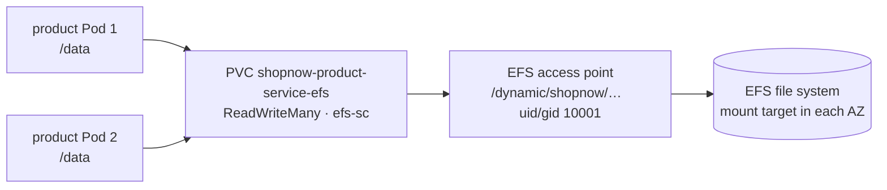

# Step 3.3 — Persistent volumes on EFS

:::info Step summary
**Goal:** prove the microservices use EFS volumes that are shared between replicas and survive Pod replacement.
**Requirement:** 4. **Time:** about 15 minutes. **Run from:** `$GITOPS_DIR`.
:::

## How storage is wired



| Piece | Owner | Details |
|---|---|---|
| EFS file system + mount targets | Terraform layer 20 | One mount target per workload subnet; NFS 2049 open from the nodes |
| EFS CSI driver | EKS add-on, Pod Identity for `efs-csi-controller-sa` | Creates an access point per PVC |
| StorageClass `efs-sc` | Terraform | `provisioningMode: efs-ap`, `uid/gid 10001`, `basePath /dynamic` |
| PVC `<service>-efs` | Each backend chart (`pvc-efs.yaml`) | `ReadWriteMany`, mounted at `/data` |

`ReadWriteMany` lets every replica of a service, on any node and in any AZ, mount the same directory. Databases keep their own `gp3` (EBS) volumes.

## 1. Check the storage layer

```bash
kubectl --context eks-workload get storageclass efs-sc
kubectl --context eks-workload -n shopnow get pvc
aws efs describe-mount-targets \
  --file-system-id "$(terraform -chdir="$TF_DIR/20-cluster-workload" output -raw efs_file_system_id)" \
  --query 'MountTargets[].[AvailabilityZoneName,LifeCycleState]' --output table
```

**Expected:** six `*-efs` PVCs `Bound` with access mode `RWX` and class `efs-sc`; one `available` mount target per AZ.

## 2. Shared between replicas

Write a file from one product Pod and read it from the other:

```bash
read -r WRITER READER < <(kubectl --context eks-workload -n shopnow get pods -l app=shopnow-product-service \
  --field-selector=status.phase=Running -o jsonpath='{.items[0].metadata.name} {.items[1].metadata.name}')

kubectl --context eks-workload -n shopnow exec "$WRITER" -- sh -c 'echo "efs-test $(date -u +%FT%TZ)" > /data/efs-test.txt'
kubectl --context eks-workload -n shopnow exec "$READER" -- cat /data/efs-test.txt
```

**Expected:** the reader prints the line the writer wrote. The two Pods are on different nodes (see [step 3.4](pod-placement)), so this proves the volume is shared across nodes.

## 3. Survives Pod replacement

```bash
kubectl --context eks-workload -n shopnow delete pod "$WRITER"
kubectl --context eks-workload -n shopnow rollout status deployment/shopnow-product-service-deployment --timeout=10m
NEW=$(kubectl --context eks-workload -n shopnow get pods -l app=shopnow-product-service -o jsonpath='{.items[0].metadata.name}')
kubectl --context eks-workload -n shopnow exec "$NEW" -- cat /data/efs-test.txt | tee "$EVIDENCE_DIR/efs-persistence.txt"
```

**Expected:** the same line, read from a Pod that did not exist when it was written.

Clean up the test file:

```bash
kubectl --context eks-workload -n shopnow exec "$NEW" -- rm /data/efs-test.txt
```

## 4. Deploy the proof workload

The next two steps use `workshop-proof`: three replicas sharing one EFS claim, with a 2-of-3 PDB. It lets you test placement and evictions without disturbing ShopNow.

```bash
kubectl --context eks-workload apply -f "$GITOPS_DIR/.workshop/applications/workshop-proof.json"
argocd app wait workshop-proof --sync --health --timeout 900
kubectl --context eks-workload -n shopnow get pods -l app=workshop-proof -o wide
```

## Troubleshooting

| Symptom | Check |
|---|---|
| PVC `Pending` | `kubectl -n shopnow describe pvc <name>`; EFS CSI controller logs; StorageClass `fileSystemId` |
| Pod stuck `ContainerCreating`, mount timeout | Security group allows TCP 2049 from the node SG; a mount target exists in the Pod's AZ |
| `Permission denied` writing `/data` | Container user must be 10001 (matches the access point uid/gid) |

**Next:** [3.4 Even distribution](pod-placement)
