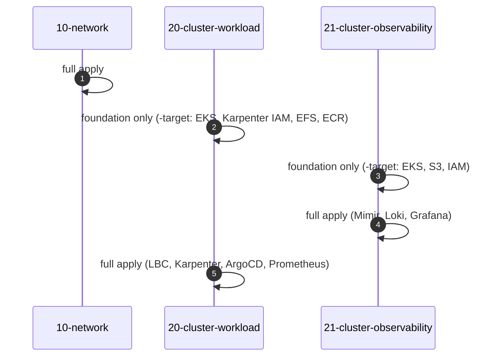

# Bước 1.0 — Cách tổ chức Terraform {#step-10--how-the-terraform-is-organised}

:::info Tóm tắt bước thực hành
**Mục tiêu:** hiểu ba lớp Terraform, thứ tự apply và quy trình dùng cho mọi thay đổi.
**Chạy từ:** `$TF_DIR` (`eks-core-terraform`).
:::

## Ba lớp, ba state {#three-layers-three-states}

Hạ tầng được tách theo phạm vi ảnh hưởng: thay đổi cluster không tác động đến network.

| Lớp | Tạo tài nguyên | State key | Đọc từ |
|---|---|---|---|
| `10-network` | VPC `10.20.0.0/16`, subnet public / workload / observability tại 3 AZ, NAT gateway, S3 endpoint, Flow Logs, discovery tags | `network/terraform.tfstate` | — |
| `20-cluster-workload` | Cluster 1 `eks-workload`, Managed Node Group `infra`, Karpenter IAM + SQS, EFS, ECR, Pod Identity; Helm release cho LBC, Karpenter, ArgoCD, Prometheus, Metrics Server | `cluster-workload/terraform.tfstate` | network, observability |
| `21-cluster-observability` | Cluster 2 `eks-observability`, node group `monitoring`, S3 bucket, security group cho ALB nội bộ, private DNS; Helm release cho LBC, Prometheus, Mimir, Loki, Grafana | `cluster-observability/terraform.tfstate` | network, workload |

Mỗi lớp có cùng cách bố trí tệp:

```text
main.tf               provider, S3 backend (completed by backend.hcl)
variables.tf          inputs
terraform.tfvars      region, sizes, versions, tags
account.auto.tfvars   your account ID (local only, gitignored)
backend.hcl           state bucket and profile (local only, gitignored)
data.tf               remote state of the other layers
locals.tf             names and derived values
vpc.tf, eks.tf, …     resources, one file per concern
helm_releases.tf      charts installed into the cluster
output.tf             values the other layers read
```

## Quy trình thay đổi {#the-change-loop}

Dùng cùng một quy trình cho lần apply đầu tiên và mọi thay đổi sau đó:

```bash
L=10-network                                   # the layer you are working on
terraform -chdir="$TF_DIR/$L" init -backend-config=backend.hcl
terraform -chdir="$TF_DIR/$L" fmt -check
terraform -chdir="$TF_DIR/$L" validate
terraform -chdir="$TF_DIR/$L" plan -out="$PLAN_DIR/$L.tfplan"
terraform -chdir="$TF_DIR/$L" show "$PLAN_DIR/$L.tfplan"     # review
terraform -chdir="$TF_DIR/$L" apply "$PLAN_DIR/$L.tfplan"
```

Các nguyên tắc bảo vệ state:

- **Luôn apply saved plan** đã được kiểm tra. Tạo lại plan nếu có thay đổi sau khi lập plan.
- **Đọc mọi hành động `destroy` và `replace`** trước khi apply. Thay thế subnet hoặc node group ảnh hưởng đến mọi tài nguyên chạy trên đó.
- **Mỗi lớp chỉ có một người apply tại một thời điểm.** S3 lock file chặn ghi đồng thời; không `force-unlock` khi có thể vẫn còn một lượt apply đang chạy.
- Chỉ chạy `init -upgrade` khi có chủ đích nâng cấp provider hoặc module.

## Thứ tự triển khai lần đầu {#first-time-order}

Lớp 20 và 21 đọc output của nhau để cấu hình security group giữa hai cluster; các Helm release cần cluster đã hoạt động. Với tài khoản chưa có hạ tầng, apply theo năm lượt:



| Lượt | Hướng dẫn |
|---|---|
| 1. Network | [Bước 1.1](03-layer-10-network.md) |
| 2. Hạ tầng nền cluster 1 | [Bước 1.2](04-layer-20-cluster-workload.md) |
| 3–4. Hạ tầng nền cluster 2, sau đó apply đầy đủ | [Bước 1.3](05-layer-21-cluster-observability.md) |
| 5. Apply đầy đủ cluster 1 | [Bước 1.3, phần cuối](05-layer-21-cluster-observability.md#6-finish-cluster-1) |

Chỉ dùng `-target` cho lần bootstrap này. Sau đó, mọi plan phải bao quát toàn bộ lớp.

**Tiếp theo:** [1.1 Network](03-layer-10-network.md)
