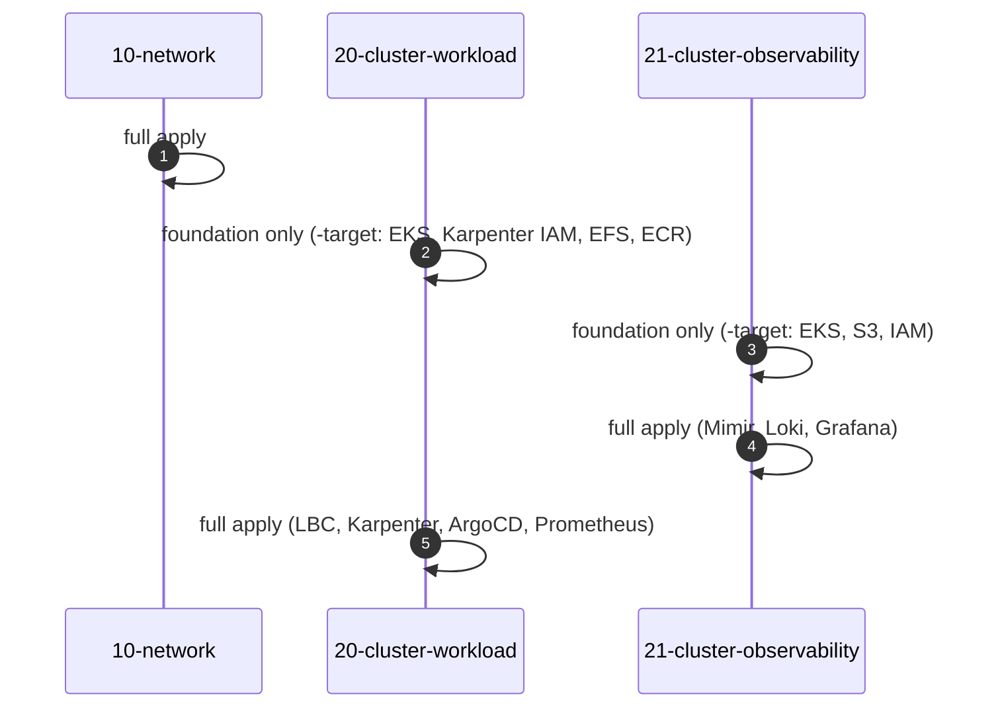

# Bước 1.0 — Cấu trúc Terraform {#step-10--how-the-terraform-is-organised}

:::info Nội dung thực hiện
**Mục tiêu:** nắm cấu trúc 3 Terraform Layer, thứ tự Apply và cách quản lý thay đổi.
**Chạy từ:** `$TF_DIR` (`eks-core-terraform`).
:::

## 3 Layer, 3 State {#three-layers-three-states}

Terraform chia hạ tầng thành 3 Layer. Mỗi Layer có state riêng để quản lý Network và EKS Cluster độc lập.

| Layer | Tạo tài nguyên | State key | Đọc từ |
|---|---|---|---|
| `10-network` | VPC `10.20.0.0/16`, subnet public / workload / observability tại 3 AZ, NAT gateway, S3 endpoint, Flow Logs, discovery tags | `network/terraform.tfstate` | — |
| `20-cluster-workload` | Cluster 1 `eks-workload`, Managed Node Group `infra`, Karpenter IAM + SQS, EFS, ECR, Pod Identity; Helm release cho LBC, Karpenter, ArgoCD, Prometheus, Metrics Server | `cluster-workload/terraform.tfstate` | network, observability |
| `21-cluster-observability` | Cluster 2 `eks-observability`, node group `monitoring`, S3 bucket, security group cho ALB nội bộ, private DNS; Helm release cho LBC, Prometheus, Mimir, Loki, Grafana | `cluster-observability/terraform.tfstate` | network, workload |

Cấu trúc file trong mỗi Layer:

```text
main.tf               provider, S3 backend (completed by backend.hcl)
variables.tf          inputs
terraform.tfvars      region, sizes, versions, tags
account.auto.tfvars   your account ID (local only, gitignored)
backend.hcl           state bucket and profile (local only, gitignored)
data.tf               remote state of the other layers
locals.tf             names and derived values
vpc.tf, eks.tf, …     resources, one file per concern
helm_releases.tf      charts installed into the cluster
output.tf             values the other layers read
```

[](/img/workshop/terraform/repository-layers.png)

*Cấu trúc repo và các file của Network Layer trong lần thực hành. Bấm vào ảnh để xem đầy đủ.*

## Quy trình Plan và Apply {#the-change-loop}

Mỗi lần tạo hoặc cập nhật hạ tầng, thực hiện theo thứ tự sau:

```bash
L=10-network                                   # the layer you are working on
terraform -chdir="$TF_DIR/$L" init -backend-config=backend.hcl
terraform -chdir="$TF_DIR/$L" fmt -check
terraform -chdir="$TF_DIR/$L" validate
terraform -chdir="$TF_DIR/$L" plan -out="$PLAN_DIR/$L.tfplan"
terraform -chdir="$TF_DIR/$L" show "$PLAN_DIR/$L.tfplan"     # review
terraform -chdir="$TF_DIR/$L" apply "$PLAN_DIR/$L.tfplan"
```

Khi làm việc với Terraform state:

- **Apply đúng file plan đã kiểm tra.** Nếu sửa cấu hình sau khi Plan, tạo lại plan trước khi Apply.
- **Kiểm tra các resource có `destroy` hoặc `replace`.** Thay subnet hoặc Node Group có thể ảnh hưởng workload đang chạy.
- **Mỗi Layer chỉ có một lượt Apply tại một thời điểm.** S3 lock file khóa state khi đang ghi. Chỉ `force-unlock` sau khi xác nhận lượt Apply trước đã dừng.
- Chỉ chạy `init -upgrade` khi có chủ đích nâng cấp provider hoặc module.

## Thứ tự triển khai lần đầu {#first-time-order}

Layer 20 và 21 đọc output của nhau để cấu hình Security Group giữa hai cluster. Helm cũng cần EKS Cluster hoạt động trước khi cài chart. Vì vậy, lần đầu triển khai cần thực hiện 5 lượt:



| Lượt | Hướng dẫn |
|---|---|
| 1. Network | [Bước 1.1](03-layer-10-network.md) |
| 2. AWS Foundation cluster 1 | [Bước 1.2](04-layer-20-cluster-workload.md) |
| 3–4. AWS Foundation cluster 2, sau đó apply đầy đủ | [Bước 1.3](05-layer-21-cluster-observability.md) |
| 5. Apply đầy đủ cluster 1 | [Bước 1.3, phần cuối](05-layer-21-cluster-observability.md#6-finish-cluster-1) |

`-target` chỉ dùng để bootstrap AWS Foundation lần đầu. Các lần cập nhật sau chạy Plan cho toàn bộ Layer, rồi Apply file plan đã kiểm tra.

**Tiếp theo:** [1.1 Network](03-layer-10-network.md)
