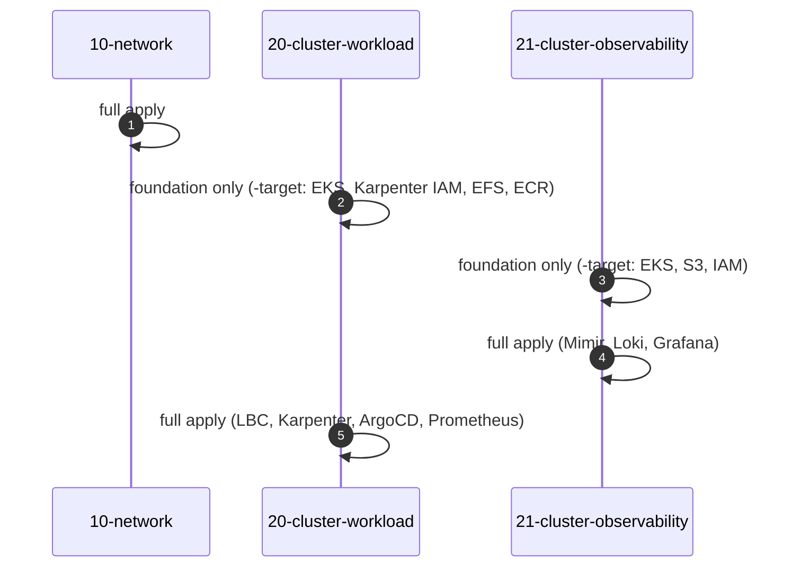

# Bước 1.0 — Cấu trúc Terraform {#step-10--how-the-terraform-is-organised}

Trước khi tạo hạ tầng, chúng ta sẽ xem cách tổ chức repo Terraform và thứ tự chạy từng layer. Phần này cũng giải thích vì sao lần đầu cần bootstrap cluster trước khi cài các Helm chart.

**Chạy từ:** `$TF_DIR` (`eks-core-terraform`).

## Terraform, state và bootstrap {#terraform-basics}

### Terraform dùng để làm gì?

Terraform cho phép khai báo hạ tầng bằng code. Trong workshop, các file `.tf` mô tả VPC, EKS, IAM, EFS, ECR và một số Helm release. Bạn sửa cấu hình, xem plan rồi apply để Terraform tạo hoặc cập nhật các resource tương ứng.

Provider thực hiện thao tác với hệ thống đích, chẳng hạn AWS API, Kubernetes API hoặc Helm. Module gom một nhóm cấu hình để dùng lại. Các file `terraform.tfvars` và `*.auto.tfvars` truyền giá trị như region, kích thước node và account ID vào cấu hình đó.

### Vì sao cần state?

State lưu mối liên hệ giữa địa chỉ resource trong Terraform và resource thật. Ví dụ, `module.eks` trong cấu hình cần được đối chiếu với đúng EKS cluster của môi trường đang quản lý. Repo có code giống nhau nhưng dùng state khác nhau có thể quản lý hai môi trường khác nhau.

workshop lưu state trên S3. Mỗi layer dùng một key riêng, còn S3 lock file hỗ trợ tránh các lượt ghi state đồng thời. State có thể chứa dữ liệu nhạy cảm, nên không commit file này hoặc bản sao của nó lên Git.

### Init, plan và apply khác nhau thế nào?

| Lệnh | Công việc |
|---|---|
| `init` | Kết nối backend, tải provider và module |
| `validate` | Kiểm tra cấu hình Terraform hợp lệ; không thay thế việc kiểm tra quyền hoặc kết nối thực tế |
| `plan` | Đọc state, kiểm tra resource hiện tại và đề xuất thay đổi |
| `apply` | Thực hiện các thay đổi trong plan |

Khi dùng `plan -out=...`, bạn có thể đọc lại và apply đúng file plan đó. Plan chỉ phản ánh lần tính toán đã lưu; nếu cấu hình thay đổi, cần tạo lại plan.

### Vì sao không apply tất cả ngay lần đầu?

Trong repo này, một layer vừa tạo EKS vừa cài Helm chart vào cluster đó. Helm cần Kubernetes API sẵn sàng để hoạt động. Layer 20 và 21 còn đọc output của nhau để tạo security group rule giữa hai cluster.

Vì vậy, lần đầu chúng ta dùng `-target` để bootstrap phần AWS trước. Sau khi các phụ thuộc đã tồn tại, chạy full plan và apply để hoàn tất layer. Đây là cách xử lý cấu trúc repo hiện tại; các lần cập nhật thông thường vẫn cần plan toàn bộ layer.

Đọc thêm: [Terraform state](https://developer.hashicorp.com/terraform/language/state).

## Ba layer với state riêng {#three-layers-three-states}

Repo Terraform được chia thành ba layer: network, workload cluster và observability cluster. Mỗi layer lưu state riêng. Nhờ vậy, khi cập nhật một Helm release, chúng ta chỉ cần làm việc với layer của cluster đó.

| layer | Tạo tài nguyên | State key | Đọc từ |
|---|---|---|---|
| `10-network` | VPC `10.20.0.0/16`, subnet public / workload / observability tại 3 AZ, NAT gateway, S3 endpoint, Flow Logs, discovery tags | `network/terraform.tfstate` | — |
| `20-cluster-workload` | Cluster 1 `eks-workload`, Managed Node Group `infra`, Karpenter IAM + SQS, EFS, ECR, Pod Identity; Helm release cho LBC, Karpenter, ArgoCD, Prometheus, Metrics Server | `cluster-workload/terraform.tfstate` | network, observability |
| `21-cluster-observability` | Cluster 2 `eks-observability`, node group `monitoring`, S3 bucket, security group cho ALB nội bộ, private DNS; Helm release cho LBC, Prometheus, Mimir, Loki, Grafana | `cluster-observability/terraform.tfstate` | network, workload |

Cấu trúc file trong mỗi layer:

```text
main.tf               provider, S3 backend (completed by backend.hcl)
variables.tf          inputs
terraform.tfvars      region, sizes, versions, tags
account.auto.tfvars   your account ID (local only, gitignored)
backend.hcl           state bucket and profile (local only, gitignored)
data.tf               remote state of the other layers
locals.tf             names and derived values
vpc.tf, eks.tf, …     resources, one file per concern
helm_releases.tf      charts installed into the cluster
output.tf             values the other layers read
```

[](/img/workshop/terraform/repository-layers.png)

*Cấu trúc repo và các file của network layer trong lần thực hành. Bấm vào ảnh để xem đầy đủ.*

## Quy trình plan và apply {#the-change-loop}

Mỗi lần tạo hoặc cập nhật hạ tầng, thực hiện theo thứ tự sau:

```bash
L=10-network                                   # the layer you are working on
terraform -chdir="$TF_DIR/$L" init -backend-config=backend.hcl
terraform -chdir="$TF_DIR/$L" fmt -check
terraform -chdir="$TF_DIR/$L" validate
terraform -chdir="$TF_DIR/$L" plan -out="$PLAN_DIR/$L.tfplan"
terraform -chdir="$TF_DIR/$L" show "$PLAN_DIR/$L.tfplan"     # review
terraform -chdir="$TF_DIR/$L" apply "$PLAN_DIR/$L.tfplan"
```

Sau khi đọc plan, apply đúng file đã lưu. Nếu sửa cấu hình sau khi tạo plan thì cần chạy plan lại.

Mỗi layer chỉ nên có một lượt apply đang chạy. S3 lock file giúp khóa state trong quá trình này; chỉ dùng `force-unlock` khi đã xác nhận lượt chạy trước dừng hẳn. Với các thay đổi có `destroy` hoặc `replace`, kiểm tra resource bị ảnh hưởng trước khi tiếp tục. Chỉ dùng `init -upgrade` khi cần nâng phiên bản provider hoặc module.

- **apply đúng file plan đã kiểm tra.** Nếu sửa cấu hình sau khi plan, tạo lại plan trước khi apply.
- **Kiểm tra các resource có `destroy` hoặc `replace`.** Thay subnet hoặc Node Group có thể ảnh hưởng workload đang chạy.
- **Mỗi layer chỉ có một lượt apply tại một thời điểm.** S3 lock file khóa state khi đang ghi. Chỉ `force-unlock` sau khi xác nhận lượt apply trước đã dừng.
- Chỉ chạy `init -upgrade` khi có chủ đích nâng cấp provider hoặc module.

## Thứ tự triển khai lần đầu {#first-time-order}

layer 20 và 21 đọc output của nhau để cấu hình security group giữa hai cluster. Ngoài ra, Helm cần kết nối được tới Kubernetes API trước khi cài chart. Vì vậy, lần đầu chúng ta tạo phần AWS trước, rồi mới apply đầy đủ các resource trong cluster theo thứ tự dưới đây:



| Lượt | Hướng dẫn |
|---|---|
| 1. Network | [Bước 1.1](03-layer-10-network.md) |
| 2. Hạ tầng AWS cluster 1 | [Bước 1.2](04-layer-20-cluster-workload.md) |
| 3–4. Hạ tầng AWS cluster 2, sau đó apply đầy đủ | [Bước 1.3](05-layer-21-cluster-observability.md) |
| 5. Apply đầy đủ cluster 1 | [Bước 1.3, phần cuối](05-layer-21-cluster-observability.md#6-finish-cluster-1) |

Các lệnh `-target` chỉ dùng trong lần bootstrap này. Khi hai cluster đã hoạt động, chạy plan cho toàn bộ layer để Terraform kiểm tra cả các resource còn lại.

**Tiếp theo:** [1.1 Network](03-layer-10-network.md)
