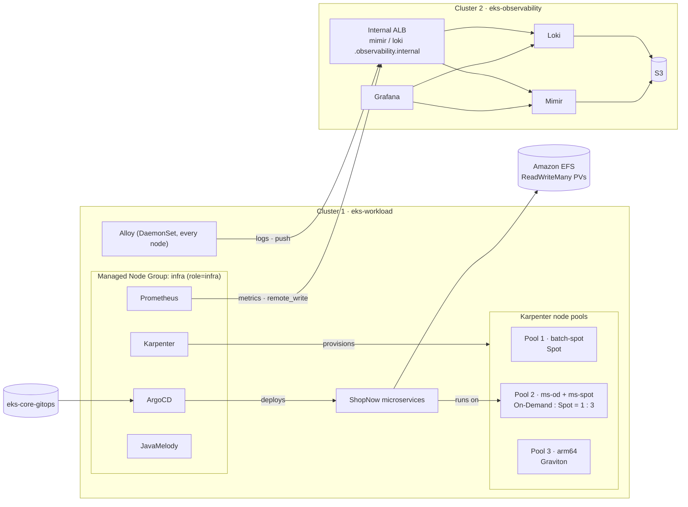

# Bước 0.2 — Kiến trúc {#step-02--architecture}

:::info Tóm tắt bước thực hành
**Mục tiêu:** hiểu hệ thống sẽ xây dựng và công cụ quản lý từng thành phần trước khi chạy lệnh.
**Thời gian:** khoảng 10 phút đọc.
:::

## Bức tranh tổng thể {#the-big-picture}

Chín sơ đồ chi tiết — mạng, từng cluster, Karpenter, telemetry, ShopNow, quy trình triển khai, Terraform — nằm ở trang [Sơ đồ kiến trúc](07-architecture-diagrams.md). Sơ đồ logic:

Hai cluster nằm trong **cùng một VPC**, với subnet và security group riêng. Telemetry đi qua ALB **nội bộ** bằng HTTPS; không công khai ra Internet.

## Cluster 1 — `eks-workload` {#cluster-1--eks-workload}

| Thành phần | Chạy trên | Mục đích |
|---|---|---|
| Managed Node Group `infra` (3 × t3.large, On-Demand) | — | Capacity ổn định cho công cụ nền tảng, độc lập với Karpenter |
| ArgoCD, Karpenter, Prometheus, JavaMelody, AWS Load Balancer Controller, Metrics Server | Node `infra` | Công cụ nền tảng (yêu cầu 1) |
| NodePool `batch-spot` | EC2 Spot | Pool 1 — workload Spot |
| NodePool `ms-od` + `ms-spot` | EC2 On-Demand + Spot | Pool 2 — microservices, 1:3 |
| NodePool `arm64` | EC2 Graviton | Pool 3 — workload ARM64 |
| ShopNow (6 backend + frontend) | Pool 2 | Các microservice dùng trong bài kiểm thử |
| EFS + EFS CSI driver + StorageClass `efs-sc` | — | Persistent volume dùng chung |
| Alloy | Mọi node | Thu thập log Pod |

## Cluster 2 — `eks-observability` {#cluster-2--eks-observability}

| Thành phần | Mục đích |
|---|---|
| Managed Node Group `monitoring` (2 × t3.medium) | Capacity cho bộ công cụ observability |
| Mimir (distributed) | Lưu metrics nhận từ cluster 1 |
| Loki (single binary) | Lưu logs nhận từ cluster 1 |
| Grafana | Một giao diện cho cả hai nguồn dữ liệu |
| S3 bucket `eks-observability-mimir-<account>`, `-loki-<account>` | Lưu trữ dài hạn |
| ALB nội bộ + private Route 53 zone `observability.internal` | Điểm nhận dữ liệu nội bộ từ cluster 1 |

## Công cụ nào quản lý tài nguyên nào {#who-owns-what}

Mỗi tài nguyên chỉ có một công cụ quản lý. Thực hiện thay đổi qua đúng công cụ đó; nếu không, lần apply hoặc sync tiếp theo sẽ hoàn tác thay đổi.

| Tài nguyên | Công cụ quản lý | Cách thay đổi |
|---|---|---|
| VPC, EKS, node group, IAM, EFS, ECR, S3, DNS | Terraform (`eks-core-terraform`) | sửa → `plan` → kiểm tra → `apply` |
| LBC, Karpenter, ArgoCD, Prometheus, Metrics Server (cluster 1); Mimir, Loki, Grafana (cluster 2) | Terraform `helm_releases.tf`, values từ `eks-core-gitops` | sửa values → `plan` → `apply` |
| StorageClass `gp3`, `efs-sc` | Terraform | `apply` |
| EC2NodeClass và NodePool | Manifest tại `eks-core-gitops/platform/nodepools` | `kubectl apply` |
| Deployment, PVC, PDB, Service của ShopNow | ArgoCD, từ `eks-core-gitops/apps` | commit → ArgoCD sync |
| cert-manager, Alloy, JavaMelody | Helm / manifest được apply trong từng bước | `helm upgrade` / `kubectl apply` |

## Các quyết định thiết kế {#design-decisions}

- **Managed Node Group giúp nền tảng không phụ thuộc vào chính nó.** Karpenter và ArgoCD phải tiếp tục chạy ngay cả khi mọi pool Karpenter đều trống.
- **Pool 2 gồm hai NodePool.** Karpenter không có cấu hình tỷ lệ bên trong một pool, vì vậy On-Demand và Spot được tách thành hai pool dùng chung label và taint. Giới hạn CPU 24 và 72 đặt ngân sách 1:3. Xem [bước 2.3](../karpenter/on-demand-spot-ratio-and-limits).
- **EFS dành cho microservices; database dùng EBS.** PostgreSQL và MySQL dùng volume `gp3`, phù hợp với database có một writer.
- **Telemetry chuyển sang cluster riêng** để metrics và logs còn tồn tại khi mất bất kỳ workload node nào hoặc toàn bộ cluster 1.

**Tiếp theo:** [0.3 Sơ đồ kiến trúc](07-architecture-diagrams.md), sau đó [1.0 Quy trình Terraform](00-terraform-workflow.md)
