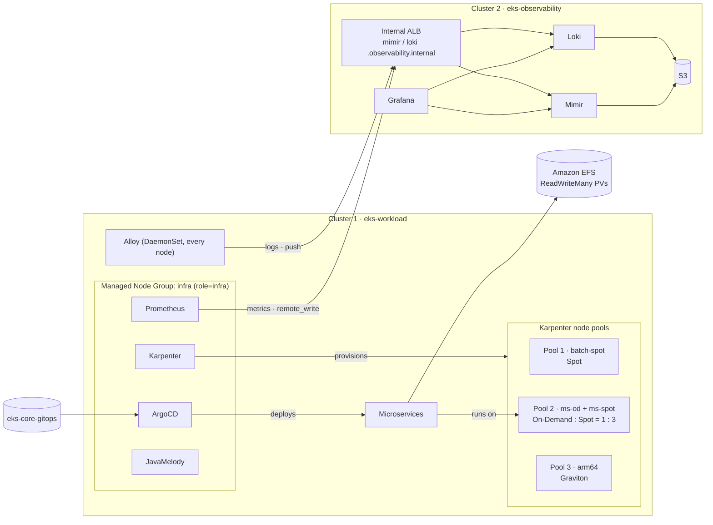

# Bước 0.2 — Kiến Trúc {#step-02--architecture}

Trong phần này, chúng ta sẽ tìm hiểu các thành phần của EKS và cách chúng được sử dụng trong workshop. Sau đó, cùng xem kiến trúc hai cluster trước khi bắt đầu tạo hạ tầng.

**Thời gian:** khoảng 10 phút đọc.

## Kubernetes Và Amazon EKS {#kubernetes-and-eks}

Phần này đi từ câu hỏi "Kubernetes là gì" đến "EKS khác Kubernetes tự dựng ở đâu". Nếu đã quen Kubernetes, bạn có thể đọc lướt tới mục 5.

### 1. Kubernetes Giải Quyết Vấn Đề Gì?

Với một ứng dụng nhỏ, bạn có thể SSH vào một máy chủ rồi chạy `docker run`. Cách này nhanh nhưng mọi việc đều làm tay: container chết thì phải tự chạy lại, máy chủ hỏng thì phải chuyển container sang máy khác, muốn thêm bản sao để chịu tải thì phải tự chọn máy còn trống CPU, RAM.

Ứng dụng trong workshop có 6 service backend, 1 frontend và 2 database, chạy trên nhiều EC2 instance. Làm tay những việc trên cho chừng ấy container là không khả thi. **Kubernetes là hệ thống làm thay các việc đó**: bạn mô tả trạng thái mong muốn, Kubernetes tự đưa hệ thống về trạng thái đó và giữ nguyên như vậy.

Cách làm việc này gọi là **khai báo** (declarative). Bạn không ra lệnh "chạy container A trên máy B", mà viết "service product cần 2 bản sao, mỗi bản 256Mi RAM". Kubernetes liên tục so sánh **trạng thái mong muốn** với **trạng thái thực tế** và sửa phần chênh lệch. Vòng lặp so sánh và sửa này gọi là **reconcile**, và là ý tưởng quan trọng nhất cần nhớ.

### 2. Một Kubernetes Cluster Gồm Những Gì?

Một cluster có hai phần: **control plane** (bộ não, ra quyết định) và **worker node** (tay chân, chạy container).

**Control plane** gồm bốn thành phần chính:

| Thành phần | Làm gì | Ví dụ dễ hình dung |
|---|---|---|
| API server | Cửa vào duy nhất của cluster. `kubectl`, ArgoCD, Karpenter đều gửi yêu cầu tới đây | Quầy lễ tân: mọi yêu cầu đều đi qua đây |
| etcd | Cơ sở dữ liệu lưu toàn bộ trạng thái mong muốn và thực tế của cluster | Sổ ghi chép của cả hệ thống |
| Scheduler | Chọn node cho Pod mới dựa trên CPU, RAM còn trống, label, taint | Người xếp chỗ ngồi |
| Controller manager | Chạy các controller, mỗi controller canh một loại object và reconcile nó | Người quản lý ca, thấy thiếu người thì gọi thêm |

**Worker node** là máy chạy container; trong workshop là EC2 instance. Mỗi node có:

| Thành phần | Làm gì |
|---|---|
| kubelet | Agent trên node: nhận danh sách Pod được giao, khởi động container và báo trạng thái về API server |
| Container runtime (containerd) | Thực sự kéo image và chạy container |
| kube-proxy | Cấu hình mạng trên node để địa chỉ của Service chuyển tới đúng Pod |

### 3. Các Object Bạn Sẽ Gặp Trong Workshop

Trạng thái mong muốn được viết dưới dạng **object** (thường là file YAML). Đây là các object chính, kèm ví dụ trong chính workshop này:

| Object | Ý nghĩa | Trong workshop |
|---|---|---|
| Pod | Đơn vị nhỏ nhất Kubernetes chạy: một hoặc vài container dùng chung IP và volume | Mỗi bản sao của product service là một Pod |
| Deployment | Khai báo "cần N bản sao của Pod này" và cách cập nhật phiên bản. Nó tạo ReplicaSet, ReplicaSet tạo Pod | Hầu hết backend là Deployment 2 replica (discovery-server chạy 1) |
| Service | Một địa chỉ cố định đứng trước nhóm Pod. Pod bị thay thì IP đổi, nhưng tên Service giữ nguyên | API gateway gọi product qua tên Service, không qua IP Pod |
| Ingress | Quy tắc đưa traffic HTTP từ ngoài vào Service. AWS Load Balancer Controller biến Ingress thành ALB | ArgoCD, Grafana, frontend được mở qua ALB |
| ConfigMap, Secret | Cấu hình và dữ liệu bí mật tách khỏi image | Cấu hình Spring, mật khẩu database |
| PersistentVolumeClaim (PVC) | Yêu cầu một ổ đĩa; Kubernetes cấp volume thật (EBS, EFS) | Backend mount EFS tại `/data`, database dùng EBS `gp3` |
| DaemonSet | Chạy đúng một Pod trên mỗi node | Alloy thu log trên từng node |
| StatefulSet | Giống Deployment nhưng Pod có tên và ổ đĩa cố định | JavaMelody collector |
| Namespace | Chia cluster thành các vùng để nhóm resource | `shopnow`, `argocd`, `monitoring`, `kube-system` |
| Label, taint | Label là nhãn để chọn object; taint trên node để chặn Pod không có toleration | `role=infra`, `workload=microservices` |

### 4. Điều Gì Xảy Ra Khi Bạn Triển Khai Một Ứng Dụng?

Lấy ví dụ ArgoCD apply Deployment của product service với 2 replica:

1. ArgoCD gửi Deployment tới **API server**; API server kiểm tra quyền rồi lưu vào **etcd**.
2. **Deployment controller** thấy chưa có Pod nào, tạo ReplicaSet; ReplicaSet controller tạo 2 Pod ở trạng thái `Pending`.
3. **Scheduler** tìm node phù hợp cho từng Pod: còn đủ CPU, RAM, khớp `nodeSelector`, có toleration cho taint, và thỏa topology spread (hai Pod khác node, khác zone).
4. Nếu không có node nào phù hợp, Pod vẫn `Pending`. Lúc này **Karpenter** thấy Pod chờ, tạo EC2 instance mới trong pool phù hợp, node mới tham gia cluster.
5. **kubelet** trên node được chọn kéo image từ ECR và khởi động container; Pod chuyển sang `Running`.
6. Từ đây vòng reconcile tiếp tục chạy: Pod chết thì ReplicaSet tạo Pod mới; node mất thì Pod được xếp sang node khác.

Toàn bộ phần thực hành phía sau đều là biến thể của 6 bước này: bạn thay đổi trạng thái mong muốn (bằng Terraform, `kubectl` hoặc Git), còn Kubernetes và các controller lo phần còn lại.

### 5. Các Cách Chạy Kubernetes

Kubernetes là phần mềm mã nguồn mở, nên có nhiều cách để có một cluster. Điểm khác nhau chính là **ai vận hành control plane**:

| Cách chạy | Ví dụ | Ai lo control plane | Phù hợp khi |
|---|---|---|---|
| Chạy trên máy cá nhân | kind, minikube, Docker Desktop | Bạn, nhưng chỉ một máy | Học và thử nghiệm |
| Tự dựng (self-managed) | kubeadm, k3s, RKE trên máy ảo hoặc máy vật lý | Bạn: cài đặt, nâng cấp, backup etcd, cấp chứng chỉ, đảm bảo HA | Cần toàn quyền hoặc chạy on-premise |
| Dịch vụ managed của cloud | **Amazon EKS**, Google GKE, Azure AKS | Nhà cung cấp cloud | Muốn tập trung vào ứng dụng thay vì vận hành control plane |

Tự dựng một control plane đạt chuẩn production cần ít nhất 3 máy cho etcd, theo dõi chứng chỉ hết hạn và nâng cấp từng version cẩn thận. Đó là phần việc EKS nhận thay bạn.

### 6. Amazon EKS Đảm Nhiệm Phần Nào?

**Amazon EKS là Kubernetes chuẩn, với control plane do AWS vận hành.** Bạn vẫn dùng `kubectl`, Helm, YAML như mọi cluster khác; điểm khác là không phải tự chạy API server và etcd.

| Phần việc | AWS lo | Bạn lo (trong workshop: qua Terraform, GitOps) |
|---|---|---|
| API server, etcd, scheduler, controller manager | Chạy trên 3 Availability Zone, tự thay khi lỗi, backup etcd | Chọn phiên bản Kubernetes (`1.34`) và lên lịch nâng cấp |
| Worker node | Cung cấp AMI tối ưu cho EKS; Managed Node Group hỗ trợ tạo và cập nhật node | Chọn instance type, số node; ở workshop là node group `infra` và Karpenter |
| Mạng Pod | VPC CNI cấp cho mỗi Pod một IP thật trong VPC | Thiết kế VPC, subnet đủ IP |
| Quyền truy cập | Gắn IAM với Kubernetes: access entry cho người dùng, Pod Identity cho Pod | Quyết định ai và Pod nào được quyền gì |
| Load balancer, ổ đĩa | Các add-on: AWS Load Balancer Controller, EBS CSI, EFS CSI | Cài, cấu hình và khai báo Ingress, StorageClass |
| Ứng dụng | — | Toàn bộ: image, Deployment, Service, scaling, giám sát |

Có nhiều cách cấp worker node cho EKS, workshop dùng hai cách đầu:

- **Managed Node Group**: một nhóm EC2 node có kích thước cố định, EKS hỗ trợ tạo và thay node khi nâng cấp. Node group `infra` (3 × `t3.large`) chạy ArgoCD, Karpenter, Prometheus và các công cụ vận hành, nên các công cụ này luôn có chỗ chạy kể cả khi chưa có node Karpenter nào.
- **Karpenter**: không có nhóm node cố định; Karpenter nhìn Pod đang chờ rồi tạo đúng loại EC2 cần (Spot, On-Demand, ARM64) và xóa node khi không còn dùng. Ứng dụng chạy trên node do Karpenter tạo.
- Ngoài ra còn self-managed node (tự quản lý Auto Scaling Group) và Fargate (mỗi Pod một máy ảo riêng, không thấy node); workshop không dùng hai cách này.

Lưu ý: tạo xong EKS cluster mới chỉ có control plane. Cluster chưa có node, chưa có ứng dụng và chưa tự động có HA cho ứng dụng; các phần đó là nội dung của những bước tiếp theo.

### 7. Vì Sao Sử Dụng Hai Cluster?

Workload cluster chạy ứng dụng. Observability cluster nhận metrics, logs và cung cấp Grafana. Cách tách này giúp chúng ta thực hành luồng gửi dữ liệu giữa hai cluster và giữ dữ liệu đã thu thập riêng với workload: nếu workload cluster gặp sự cố, metrics và logs để điều tra vẫn còn ở cluster 2.

Hai cluster vẫn dùng chung VPC. Chúng ta sẽ tách subnet, security group và Kubernetes context, rồi cấu hình internal ALB để kết nối luồng telemetry. Sơ đồ bên dưới cho biết từng thành phần nằm ở đâu.

Đọc thêm: [Amazon EKS](https://docs.aws.amazon.com/eks/latest/userguide/what-is-eks.html).

## Tổng quan kiến trúc {#the-big-picture}

Xem 9 sơ đồ về Network, EKS, Karpenter, Telemetry, ứng dụng, GitOps và Terraform tại [Sơ đồ kiến trúc](07-architecture-diagrams.md). Luồng tổng quan:

Hai cluster nằm trong cùng một VPC nhưng sử dụng subnet và security group riêng. Workload cluster gửi metrics, logs sang observability cluster qua internal ALB. Kết nối này dùng HTTPS và private DNS.

## Cluster 1 — `eks-workload` {#cluster-1--eks-workload}

| Thành phần | Chạy trên | Mục đích |
|---|---|---|
| Managed Node Group `infra` (3 × t3.large, On-Demand) | — | capacity ổn định cho công cụ vận hành, độc lập với Karpenter |
| ArgoCD, Karpenter, Prometheus, JavaMelody, AWS Load Balancer Controller, Metrics Server | Node `infra` | công cụ vận hành (yêu cầu 1) |
| NodePool `batch-spot` | EC2 Spot | Pool 1 — workload Spot |
| NodePool `ms-od` + `ms-spot` | EC2 On-Demand + Spot | Pool 2 — microservices, 1:3 |
| NodePool `arm64` | EC2 Graviton | Pool 3 — workload ARM64 |
| Microservices (6 backend + frontend) | Pool 2 | Các service dùng trong bài thực hành |
| EFS + EFS CSI driver + StorageClass `efs-sc` | — | Persistent volume dùng chung |
| Alloy | Mọi node | Thu thập log Pod |

## Cluster 2 — `eks-observability` {#cluster-2--eks-observability}

| Thành phần | Mục đích |
|---|---|
| Managed Node Group `monitoring` (2 × t3.medium) | capacity cho bộ công cụ observability |
| Mimir (distributed) | Lưu metrics nhận từ cluster 1 |
| Loki (single binary) | Lưu logs nhận từ cluster 1 |
| Grafana | Một giao diện cho cả hai nguồn dữ liệu |
| S3 bucket `eks-observability-mimir-<account>`, `-loki-<account>` | Lưu trữ dài hạn |
| ALB nội bộ + private Route 53 zone `observability.internal` | Điểm nhận dữ liệu nội bộ từ cluster 1 |

## Quản lý resource {#who-owns-what}

Mỗi resource được cập nhật bằng công cụ đang quản lý nó. Ví dụ, thay đổi replica của ứng dụng trong Git để ArgoCD sync; thay kích thước Managed Node Group trong Terraform rồi plan và apply.

| Tài nguyên | Công cụ quản lý | Cách thay đổi |
|---|---|---|
| VPC, EKS, node group, IAM, EFS, ECR, S3, DNS | Terraform (`eks-core-terraform`) | sửa → `plan` → kiểm tra → `apply` |
| LBC, Karpenter, ArgoCD, Prometheus, Metrics Server (cluster 1); Mimir, Loki, Grafana (cluster 2) | Terraform `helm_releases.tf`, values từ `eks-core-gitops` | sửa values → `plan` → `apply` |
| StorageClass `gp3`, `efs-sc` | Terraform | `apply` |
| EC2NodeClass và NodePool | Manifest tại `eks-core-gitops/platform/nodepools` | `kubectl apply` |
| Deployment, PVC, PDB, Service của ứng dụng | ArgoCD, từ `eks-core-gitops/apps` | commit → ArgoCD sync |
| cert-manager, Alloy, JavaMelody | Helm / manifest được apply trong từng bước | `helm upgrade` / `kubectl apply` |

## Các điểm chính trong kiến trúc {#design-decisions}

Managed Node Group `infra` giữ ArgoCD, Karpenter và các công cụ vận hành hoạt động ngay cả khi chưa có node Karpenter nào. Microservices chạy ở mixed pool, gồm `ms-od` và `ms-spot`. Hai NodePool này dùng chung label và taint, có CPU limit lần lượt 24 và 72 vCPU. Cách đo tỷ lệ được trình bày ở [bước 2.3](../karpenter/on-demand-spot-ratio-and-limits).

Các backend mount EFS để thực hành shared storage; PostgreSQL và MySQL sử dụng EBS `gp3`. Metrics và logs đã gửi sang cluster 2 được lưu riêng với workload cluster.

**Tiếp theo:** [0.3 Sơ đồ kiến trúc](07-architecture-diagrams.md), sau đó [1.0 Quy trình Terraform](00-terraform-workflow.md)
