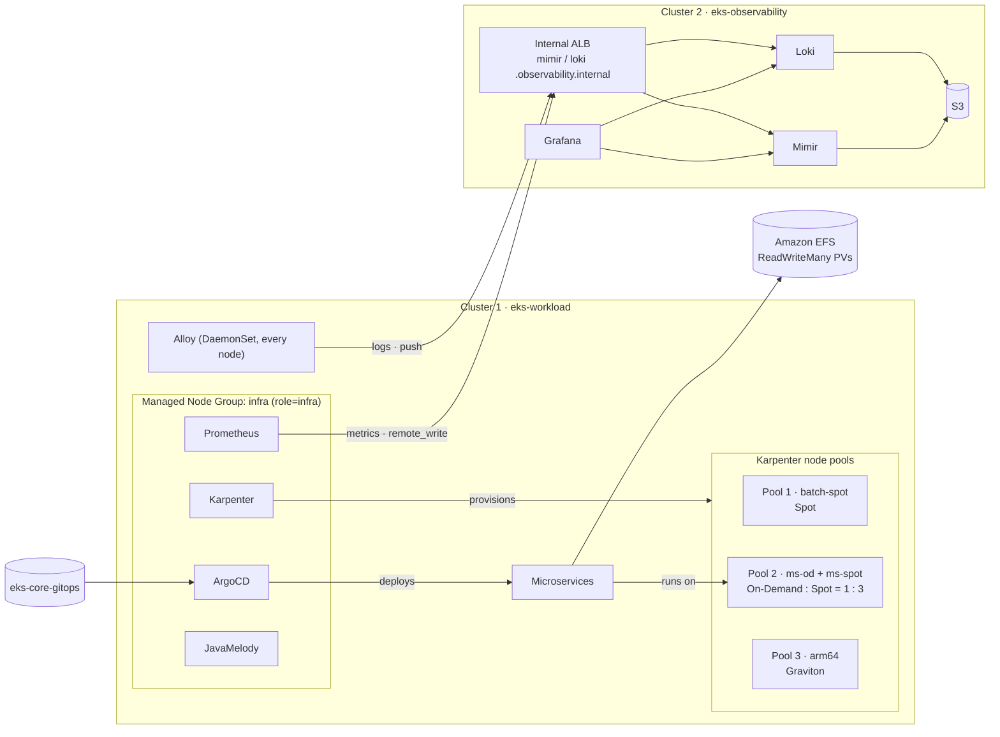

# Bước 0.2 — Kiến trúc {#step-02--architecture}

Trong phần này, chúng ta sẽ tìm hiểu các thành phần của EKS và cách chúng được sử dụng trong workshop. Sau đó, cùng xem kiến trúc hai cluster trước khi bắt đầu tạo hạ tầng.

**Thời gian:** khoảng 10 phút đọc.

## Kubernetes và Amazon EKS {#kubernetes-and-eks}

### Kubernetes quản lý ứng dụng như thế nào?

Khi chạy container trên một máy, bạn có thể dùng Docker để khởi động và dừng ứng dụng. Khi ứng dụng có nhiều service, chạy trên nhiều máy, chúng ta cần thêm cách chọn máy cho container, khởi động lại khi lỗi và cập nhật phiên bản. Kubernetes quản lý các công việc này thông qua cấu hình khai báo.

Chẳng hạn, bạn khai báo Product Service cần hai replica. Deployment controller duy trì số replica đó, còn scheduler chọn node phù hợp cho các Pod mới. Nếu một Pod bị mất, controller tạo Pod thay thế. Pod mới có thể có tên và IP khác, nên các service thường truy cập nhau qua Kubernetes Service thay vì ghi cố định IP của Pod.

| Thành phần | Vai trò trong workshop |
|---|---|
| Cluster | Môi trường Kubernetes gồm control plane và các worker node |
| Control plane | Cung cấp Kubernetes API, lưu trạng thái và chạy các controller, scheduler |
| Worker node | Máy chạy Pod; ở đây là EC2 instance |
| Pod | Đơn vị để Kubernetes schedule một hoặc nhiều container cùng nhau |
| Deployment | Khai báo replica và cách cập nhật các Pod của backend |
| Service | Cung cấp địa chỉ truy cập tới nhóm Pod được chọn bằng label |
| Namespace | Nhóm resource theo phạm vi, ví dụ `shopnow`, `argocd`, `monitoring` |

### Amazon EKS đảm nhiệm phần nào?

Amazon EKS cung cấp Kubernetes control plane do AWS quản lý. Trong mô hình sử dụng ở workshop này, chúng ta vẫn chọn cấu hình worker node, cài add-on và quản lý ứng dụng. Việc tạo được EKS cluster chưa có nghĩa ứng dụng đã được triển khai hoặc có HA.

Managed Node Group là nhóm EC2 node được EKS hỗ trợ quản lý vòng đời. Workshop dùng node group `infra` cho ArgoCD, Karpenter, Prometheus và các công cụ vận hành. Karpenter tạo thêm node cho ứng dụng theo nhu cầu của Pod.

### Vì sao sử dụng hai cluster?

Workload cluster chạy ứng dụng. Observability cluster nhận metrics, logs và cung cấp Grafana. Cách tách này giúp chúng ta thực hành luồng gửi dữ liệu giữa hai cluster và giữ dữ liệu đã thu thập riêng với workload.

Hai cluster vẫn dùng chung VPC. Chúng ta sẽ tách subnet, security group và Kubernetes context, rồi cấu hình internal ALB để kết nối luồng telemetry. Sơ đồ bên dưới cho biết từng thành phần nằm ở đâu.

Đọc thêm: [Amazon EKS](https://docs.aws.amazon.com/eks/latest/userguide/what-is-eks.html).

## Tổng quan kiến trúc {#the-big-picture}

Xem 9 sơ đồ về Network, EKS, Karpenter, Telemetry, ứng dụng, GitOps và Terraform tại [Sơ đồ kiến trúc](07-architecture-diagrams.md). Luồng tổng quan:

Hai cluster nằm trong cùng một VPC nhưng sử dụng subnet và security group riêng. Workload cluster gửi metrics, logs sang observability cluster qua internal ALB. Kết nối này dùng HTTPS và private DNS.

## Cluster 1 — `eks-workload` {#cluster-1--eks-workload}

| Thành phần | Chạy trên | Mục đích |
|---|---|---|
| Managed Node Group `infra` (3 × t3.large, On-Demand) | — | capacity ổn định cho công cụ vận hành, độc lập với Karpenter |
| ArgoCD, Karpenter, Prometheus, JavaMelody, AWS Load Balancer Controller, Metrics Server | Node `infra` | công cụ vận hành (yêu cầu 1) |
| NodePool `batch-spot` | EC2 Spot | Pool 1 — workload Spot |
| NodePool `ms-od` + `ms-spot` | EC2 On-Demand + Spot | Pool 2 — microservices, 1:3 |
| NodePool `arm64` | EC2 Graviton | Pool 3 — workload ARM64 |
| Microservices (6 backend + frontend) | Pool 2 | Các service dùng trong bài thực hành |
| EFS + EFS CSI driver + StorageClass `efs-sc` | — | Persistent volume dùng chung |
| Alloy | Mọi node | Thu thập log Pod |

## Cluster 2 — `eks-observability` {#cluster-2--eks-observability}

| Thành phần | Mục đích |
|---|---|
| Managed Node Group `monitoring` (2 × t3.medium) | capacity cho bộ công cụ observability |
| Mimir (distributed) | Lưu metrics nhận từ cluster 1 |
| Loki (single binary) | Lưu logs nhận từ cluster 1 |
| Grafana | Một giao diện cho cả hai nguồn dữ liệu |
| S3 bucket `eks-observability-mimir-<account>`, `-loki-<account>` | Lưu trữ dài hạn |
| ALB nội bộ + private Route 53 zone `observability.internal` | Điểm nhận dữ liệu nội bộ từ cluster 1 |

## Quản lý resource {#who-owns-what}

Mỗi resource được cập nhật bằng công cụ đang quản lý nó. Ví dụ, thay đổi replica của ứng dụng trong Git để ArgoCD sync; thay kích thước Managed Node Group trong Terraform rồi plan và apply.

| Tài nguyên | Công cụ quản lý | Cách thay đổi |
|---|---|---|
| VPC, EKS, node group, IAM, EFS, ECR, S3, DNS | Terraform (`eks-core-terraform`) | sửa → `plan` → kiểm tra → `apply` |
| LBC, Karpenter, ArgoCD, Prometheus, Metrics Server (cluster 1); Mimir, Loki, Grafana (cluster 2) | Terraform `helm_releases.tf`, values từ `eks-core-gitops` | sửa values → `plan` → `apply` |
| StorageClass `gp3`, `efs-sc` | Terraform | `apply` |
| EC2NodeClass và NodePool | Manifest tại `eks-core-gitops/platform/nodepools` | `kubectl apply` |
| Deployment, PVC, PDB, Service của ứng dụng | ArgoCD, từ `eks-core-gitops/apps` | commit → ArgoCD sync |
| cert-manager, Alloy, JavaMelody | Helm / manifest được apply trong từng bước | `helm upgrade` / `kubectl apply` |

## Các điểm chính trong kiến trúc {#design-decisions}

Managed Node Group `infra` giữ ArgoCD, Karpenter và các công cụ vận hành hoạt động ngay cả khi chưa có node Karpenter nào. Microservices chạy ở mixed pool, gồm `ms-od` và `ms-spot`. Hai NodePool này dùng chung label và taint, có CPU limit lần lượt 24 và 72 vCPU. Cách đo tỷ lệ được trình bày ở [bước 2.3](../karpenter/on-demand-spot-ratio-and-limits).

Các backend mount EFS để thực hành shared storage; PostgreSQL và MySQL sử dụng EBS `gp3`. Metrics và logs đã gửi sang cluster 2 được lưu riêng với workload cluster.

**Tiếp theo:** [0.3 Sơ đồ kiến trúc](07-architecture-diagrams.md), sau đó [1.0 Quy trình Terraform](00-terraform-workflow.md)
