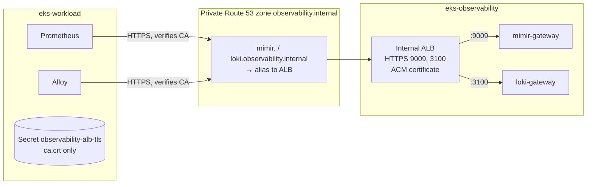

# Bước 4.1 — Kết nối cluster: TLS và DNS nội bộ {#step-41--connect-the-clusters-private-tls-and-dns}

:::info Tóm tắt bước thực hành
**Mục tiêu:** endpoint riêng trong cluster 2, có xác minh chứng chỉ — `mimir.observability.internal:9009` và `loki.observability.internal:3100` — để cluster 1 gửi dữ liệu.
**Yêu cầu:** 9 (chuyển telemetry sang cluster 2). **Thời gian:** khoảng 20 phút. **Chạy từ:** `$GITOPS_DIR`.
:::

## Đường kết nối cần xây dựng {#the-path-you-are-building}



1. cert-manager trên cluster 1 tạo private CA và chứng chỉ cho cả hai hostname.
2. Chứng chỉ được import vào **ACM**, vì ALB chỉ dùng được chứng chỉ ACM.
3. ALB **nội bộ** trong cluster 2 kết thúc TLS và chuyển tiếp tới gateway Mimir/Loki.
4. Route 53 tạo alias hai hostname tới ALB bên trong VPC.
5. Prometheus và Alloy chỉ nhận chứng chỉ CA để xác minh ALB.

## 1. Cấp CA và chứng chỉ {#1-issue-the-ca-and-certificate}

```bash
kubectl --context eks-workload apply -f "$GITOPS_DIR/platform/observability/tls/ca-issuer.yaml"
kubectl --context eks-workload -n cert-manager wait certificate/observability-ca --for=condition=Ready --timeout=3m
kubectl --context eks-workload apply -f "$GITOPS_DIR/platform/observability/tls/alb-cert.yaml"
kubectl --context eks-workload -n cert-manager wait certificate/observability-alb-tls --for=condition=Ready --timeout=3m
```

## 2. Import chứng chỉ vào ACM {#2-import-the-certificate-into-acm}

Private key được ghi vào thư mục tạm chỉ bạn có quyền đọc. Không sao chép key vào repo.

```bash
umask 077
export CERT_DIR=$(mktemp -d)
S=(kubectl --context eks-workload -n cert-manager get secret observability-alb-tls -o)
"${S[@]}" jsonpath='{.data.tls\.crt}' | base64 --decode > "$CERT_DIR/cert.pem"
"${S[@]}" jsonpath='{.data.tls\.key}' | base64 --decode > "$CERT_DIR/key.pem"
"${S[@]}" jsonpath='{.data.ca\.crt}'  | base64 --decode > "$CERT_DIR/chain.pem"
openssl x509 -in "$CERT_DIR/cert.pem" -noout -ext subjectAltName

export CERT_ARN=$(aws acm import-certificate --region "$AWS_REGION" \
  --certificate "fileb://$CERT_DIR/cert.pem" --private-key "fileb://$CERT_DIR/key.pem" \
  --certificate-chain "fileb://$CERT_DIR/chain.pem" --query CertificateArn --output text)
echo "$CERT_ARN"
```

**Kết quả mong đợi:** SAN có cả hai hostname `observability.internal` và bạn nhận được ACM ARN.

## 3. Tạo ALB nội bộ {#3-create-the-internal-alb}

Manifest ingress có vị trí giữ chỗ cho ARN chứng chỉ. Điền ARN và apply vào cluster 2:

```bash
mkdir -p "$GITOPS_DIR/.workshop"
sed "s|certificate-arn: .*|certificate-arn: $CERT_ARN|" \
  "$GITOPS_DIR/platform/observability/ingress/internal-ingress.yaml" > "$GITOPS_DIR/.workshop/internal-ingress.yaml"
kubectl --context eks-observability apply -f "$GITOPS_DIR/.workshop/internal-ingress.yaml"
kubectl --context eks-observability -n monitoring get ingress mimir loki -w    # wait for ADDRESS, then Ctrl+C
```

Load Balancer Controller tạo một ALB nội bộ; hai Ingress dùng chung group `eks-observability-internal` và security group `eks-observability-internal-alb` do Terraform tạo.

## 4. Trỏ private DNS tới ALB {#4-point-the-private-dns-names-at-the-alb}

```bash
ALB_DNS=$(kubectl --context eks-observability -n monitoring get ingress mimir -o jsonpath='{.status.loadBalancer.ingress[0].hostname}')
aws elbv2 describe-load-balancers --query "LoadBalancers[?DNSName=='$ALB_DNS'].LoadBalancerName" --output text
```

Đưa **tên** đó vào `$TF_DIR/21-cluster-observability/terraform.tfvars`:

```hcl
internal_observability_alb_name = "k8s-eksobservabilityin-…"
```

Sau đó apply lớp 21 để tạo hai alias record:

```bash
L=21-cluster-observability
terraform -chdir="$TF_DIR/$L" plan -out="$PLAN_DIR/$L-dns.tfplan"
terraform -chdir="$TF_DIR/$L" apply "$PLAN_DIR/$L-dns.tfplan"
```

## 5. Cấp CA cho bên gửi {#5-give-the-senders-the-ca}

Prometheus và Alloy đọc CA từ Secret `observability-alb-tls` trong `monitoring` trên cluster 1. Chúng chỉ cần CA công khai, không cần private key:

```bash
kubectl --context eks-workload -n monitoring create secret generic observability-alb-tls \
  --from-file=ca.crt="$CERT_DIR/chain.pem" --dry-run=client -o yaml \
  | kubectl --context eks-workload apply -f -
kubectl --context eks-workload -n monitoring rollout restart statefulset prometheus-prometheus-kube-prometheus-prometheus
```

## Kiểm chứng {#verify}

Gọi cả hai endpoint từ Pod trên cluster 1, xác minh chứng chỉ bằng CA:

```bash
kubectl --context eks-workload -n monitoring run tls-check --rm -i --restart=Never \
  --image=curlimages/curl:8.11.1 --env="CA=$(cat "$CERT_DIR/chain.pem")" \
  --overrides='{"spec":{"nodeSelector":{"role":"infra"}}}' -- sh -c '
    printf "%s\n" "$CA" > /tmp/ca.crt
    for u in https://mimir.observability.internal:9009/ready https://loki.observability.internal:3100/; do
      curl -sS --cacert /tmp/ca.crt -o /dev/null -w "%{remote_ip} %{http_code} $u\n" "$u"
    done'
```

**Kết quả mong đợi:** hai dòng có địa chỉ riêng `10.20.x.x` và HTTP `200`. Lỗi chứng chỉ cho thấy SAN hoặc CA không khớp. Tiếp tục kiểm tra các thành phần gửi thực tế:

```bash
kubectl --context eks-workload -n monitoring logs prometheus-prometheus-kube-prometheus-prometheus-0 -c prometheus --since=5m | grep -i remote
```

Không có lỗi `x509`, `401`, `403` hoặc `connection refused` nghĩa là đường TLS hoạt động. Kiểm chứng metrics đầu cuối tại [bước 4.2](../observability/mimir-metrics-pipeline).

Xóa key cục bộ khi hoàn tất: `rm -rf "$CERT_DIR"`.

**Tiếp theo:** [4.2 Metrics → Mimir](../observability/mimir-metrics-pipeline)
