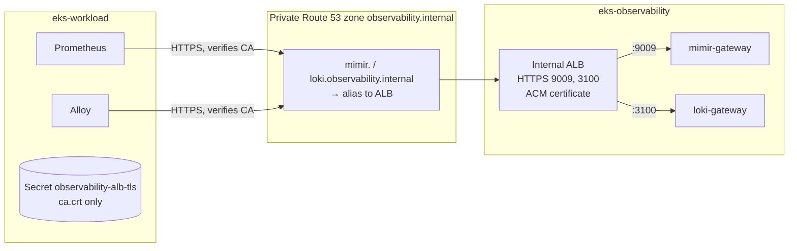

# Bước 4.1 — Cấu hình Private TLS và DNS {#step-41--connect-the-clusters-private-tls-and-dns}

Để gửi metrics và logs giữa hai cluster, chúng ta sẽ tạo endpoint HTTPS nội bộ cho Mimir và Loki. Phần này gồm cấp certificate, import vào ACM, tạo internal ALB và cấu hình private DNS.

**Thời gian:** khoảng 20 phút. **Chạy từ:** `$GITOPS_DIR`.

## Luồng kết nối {#the-path-you-are-building}



cert-manager trên cluster 1 tạo CA và certificate cho hai hostname. Sau đó, chúng ta import certificate vào ACM để gắn với listener của internal ALB trên cluster 2.

Route 53 trỏ các hostname tới ALB. Prometheus và Alloy dùng CA certificate để xác minh endpoint trước khi gửi dữ liệu. Private key không cần đưa sang các Pod gửi metrics và logs.

## 1. Tạo CA và certificate {#1-issue-the-ca-and-certificate}

```bash
kubectl --context eks-workload apply -f "$GITOPS_DIR/platform/observability/tls/ca-issuer.yaml"
kubectl --context eks-workload -n cert-manager wait certificate/observability-ca --for=condition=Ready --timeout=3m
kubectl --context eks-workload apply -f "$GITOPS_DIR/platform/observability/tls/alb-cert.yaml"
kubectl --context eks-workload -n cert-manager wait certificate/observability-alb-tls --for=condition=Ready --timeout=3m
```

## 2. Import certificate vào ACM {#2-import-the-certificate-into-acm}

Xuất private key vào thư mục tạm, giới hạn quyền đọc cho user hiện tại. Không lưu key trong repo.

```bash
umask 077
export CERT_DIR=$(mktemp -d)
S=(kubectl --context eks-workload -n cert-manager get secret observability-alb-tls -o)
"${S[@]}" jsonpath='{.data.tls\.crt}' | base64 --decode > "$CERT_DIR/cert.pem"
"${S[@]}" jsonpath='{.data.tls\.key}' | base64 --decode > "$CERT_DIR/key.pem"
"${S[@]}" jsonpath='{.data.ca\.crt}'  | base64 --decode > "$CERT_DIR/chain.pem"
openssl x509 -in "$CERT_DIR/cert.pem" -noout -ext subjectAltName

export CERT_ARN=$(aws acm import-certificate --region "$AWS_REGION" \
  --certificate "fileb://$CERT_DIR/cert.pem" --private-key "fileb://$CERT_DIR/key.pem" \
  --certificate-chain "fileb://$CERT_DIR/chain.pem" --query CertificateArn --output text)
echo "$CERT_ARN"
```

**Kết quả:** SAN có cả hai hostname `observability.internal` và bạn nhận được ACM ARN.

## 3. Tạo ALB nội bộ {#3-create-the-internal-alb}

Thay certificate ARN trong Ingress mẫu, rồi apply vào observability cluster:

```bash
mkdir -p "$GITOPS_DIR/.workshop"
sed "s|certificate-arn: .*|certificate-arn: $CERT_ARN|" \
  "$GITOPS_DIR/platform/observability/ingress/internal-ingress.yaml" > "$GITOPS_DIR/.workshop/internal-ingress.yaml"
kubectl --context eks-observability apply -f "$GITOPS_DIR/.workshop/internal-ingress.yaml"
kubectl --context eks-observability -n monitoring get ingress mimir loki -w    # wait for ADDRESS, then Ctrl+C
```

tải Balancer controller tạo một ALB nội bộ; hai Ingress dùng chung group `eks-observability-internal` và security group `eks-observability-internal-alb` do Terraform tạo.

## 4. Tạo private DNS Record cho ALB {#4-point-the-private-dns-names-at-the-alb}

```bash
ALB_DNS=$(kubectl --context eks-observability -n monitoring get ingress mimir -o jsonpath='{.status.loadBalancer.ingress[0].hostname}')
aws elbv2 describe-load-balancers --query "LoadBalancers[?DNSName=='$ALB_DNS'].LoadBalancerName" --output text
```

Thêm **tên ALB** vừa lấy vào `$TF_DIR/21-cluster-observability/terraform.tfvars`:

```hcl
internal_observability_alb_name = "k8s-eksobservabilityin-…"
```

Sau đó apply layer 21 để tạo hai alias record:

```bash
L=21-cluster-observability
terraform -chdir="$TF_DIR/$L" plan -out="$PLAN_DIR/$L-dns.tfplan"
terraform -chdir="$TF_DIR/$L" apply "$PLAN_DIR/$L-dns.tfplan"
```

## 5. Cấu hình CA cho Prometheus và Alloy {#5-give-the-senders-the-ca}

Prometheus và Alloy đọc CA từ Secret `observability-alb-tls` trong namespace `monitoring` của workload cluster. Tạo Secret chứa CA certificate như sau:

```bash
kubectl --context eks-workload -n monitoring create secret generic observability-alb-tls \
  --from-file=ca.crt="$CERT_DIR/chain.pem" --dry-run=client -o yaml \
  | kubectl --context eks-workload apply -f -
kubectl --context eks-workload -n monitoring rollout restart statefulset prometheus-prometheus-kube-prometheus-prometheus
```

## Kiểm tra {#verify}

Từ Pod trên workload cluster, gọi 2 endpoint và dùng CA để kiểm tra certificate:

```bash
kubectl --context eks-workload -n monitoring run tls-check --rm -i --restart=Never \
  --image=curlimages/curl:8.11.1 --env="CA=$(cat "$CERT_DIR/chain.pem")" \
  --overrides='{"spec":{"nodeSelector":{"role":"infra"}}}' -- sh -c '
    printf "%s\n" "$CA" > /tmp/ca.crt
    for u in https://mimir.observability.internal:9009/ready https://loki.observability.internal:3100/; do
      curl -sS --cacert /tmp/ca.crt -o /dev/null -w "%{remote_ip} %{http_code} $u\n" "$u"
    done'
```

**Kết quả:** hai dòng có địa chỉ riêng `10.20.x.x` và HTTP `200`. Lỗi chứng chỉ cho thấy SAN hoặc CA không khớp. Tiếp tục kiểm tra các thành phần gửi thực tế:

```bash
kubectl --context eks-workload -n monitoring logs prometheus-prometheus-kube-prometheus-prometheus-0 -c prometheus --since=5m | grep -i remote
```

Kiểm tra log không còn lỗi `x509`, `401`, `403` hoặc `connection refused`, đồng thời xác nhận kết quả gọi endpoint. Kiểm tra metrics xuyên suốt tại [bước 4.2](../observability/mimir-metrics-pipeline).

Xóa key cục bộ khi hoàn tất: `rm -rf "$CERT_DIR"`.

**Tiếp theo:** [4.2 Metrics → Mimir](../observability/mimir-metrics-pipeline)
