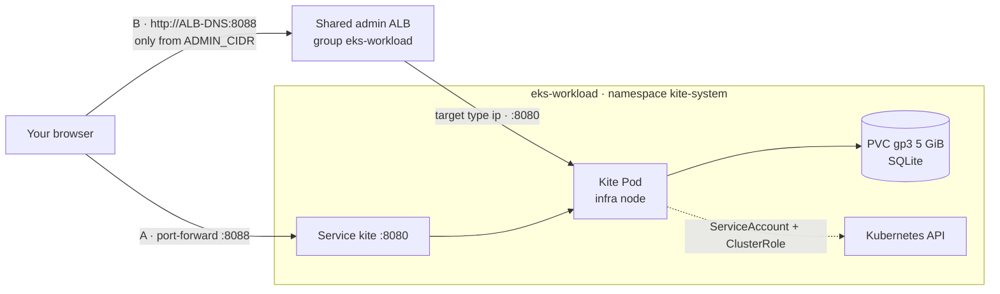
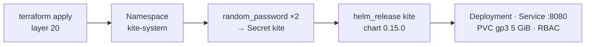

# Bước 2.5 — Kite dashboard {#step-25--kite-dashboard}

:::info Tóm tắt bước thực hành
**Mục tiêu:** hiểu Kite đã được cài như thế nào, kiểm tra nó, rồi mở bằng port-forward **hoặc** qua ALB quản trị dùng chung ở port 8088.
**Thời gian:** khoảng 15 phút. **Chạy từ:** thư mục bất kỳ khi đã export `TF_DIR`, `AWS_PROFILE`, `AWS_REGION`. Terraform cài Kite; truy cập ALB cần chủ động bật.
:::

[Kite](https://github.com/kite-org/kite) là một dashboard Kubernetes gọn nhẹ: xem mọi resource, đọc log Pod, mở shell vào container và xem CPU, memory lấy từ Prometheus. Không thành phần nào khác trong workshop phụ thuộc vào nó.



## Phần 1 — Kite được cài như thế nào {#part-1--how-kite-is-installed}

Kite là một `helm_release` trong **Terraform layer 20** (`$TF_DIR/20-cluster-workload/helm_releases.tf`). Nó đã được cài khi bạn apply layer đó ở [bước 1.3](../architecture/layer-21-cluster-observability#6-finish-cluster-1); không có lệnh cài riêng.



| Thứ tự | Resource Terraform | Kết quả trong cluster |
|---|---|---|
| 1 | `kubernetes_namespace_v1.kite` | Namespace `kite-system` |
| 2 | `random_password.kite_jwt`, `random_password.kite_encryption` | Hai key ngẫu nhiên 64 ký tự (lưu trong Terraform state) |
| 3 | `kubernetes_secret_v1.kite` | Secret `kite`: `JWT_SECRET`, `KITE_ENCRYPT_KEY`, `DB_TYPE=sqlite` |
| 4 | `helm_release.kite` | Chart `oci://ghcr.io/kite-org/charts/kite` `0.15.0`: Deployment, Service `kite` (ClusterIP `8080`), PVC, ServiceAccount + ClusterRole |

Các values chính truyền vào chart:

| Value | Thiết lập | Lý do |
|---|---|---|
| `replicaCount`, `deploymentStrategy` | `1`, `Recreate` | SQLite chỉ có một tiến trình ghi; Pod cũ dừng trước khi Pod mới gắn ổ đĩa |
| `secret.existingSecret` | `kite` | Dùng Secret do Terraform tạo thay cho key mặc định của chart |
| `db.sqlite.persistence.pvc` | `gp3`, `ReadWriteOnce`, `5Gi` | User và cấu hình còn nguyên khi khởi động lại |
| `nodeSelector`, `tolerations` | `role: infra`, `CriticalAddonsOnly` | Chạy trên Managed Node Group infra |
| `ingress.enabled` | `false` | Truy cập bằng port-forward hoặc Ingress ở Phần 2 |

Muốn đổi value, sửa khối `helm_release "kite"` rồi plan và apply layer 20 như bình thường. Helm chờ Pod Ready (`wait`, `atomic`) và tự rollback nếu Pod không lên.

### Kiểm tra Kite đang chạy {#check-that-kite-is-running}

```bash
helm --kube-context eks-workload list -n kite-system
kubectl --context eks-workload -n kite-system get deploy,pods,svc,pvc,secret -o wide
kubectl --context eks-workload -n kite-system get pod -l app.kubernetes.io/name=kite \
  -o jsonpath='{.items[0].spec.nodeName}' | xargs -I{} kubectl --context eks-workload get node {} -L role
kubectl --context eks-workload -n kite-system logs deploy/kite --tail=20
```

**Kết quả mong đợi:**

- release `kite` ở trạng thái `deployed`, chart `kite-0.15.0`;
- Deployment `kite` `1/1`, Pod `Running`;
- Service `kite` kiểu `ClusterIP` trên `8080/TCP`;
- PVC `Bound`, class `gp3`, `5Gi`;
- có Secret `kite`;
- node hiển thị `role=infra`;
- log không có lỗi.

## Phần 2 — Truy cập Kite {#part-2--access-kite}

Terraform quản lý Helm release Kite và Ingress **tuỳ chọn**. Chart Helm vẫn đặt `ingress.enabled=false`; resource `kubernetes_ingress_v1.kite[0]` riêng trong `$TF_DIR/20-cluster-workload/kite_ingress.tf` quản lý truy cập qua ALB. Không tạo thêm Ingress bằng Helm, ArgoCD hoặc `kubectl apply`.

| | A · Port-forward (mặc định) | B · ALB quản trị (chủ động bật) |
|---|---|---|
| URL | `http://localhost:8088` | `http://<ALB-DNS>:8088` |
| Bật | `kubectl port-forward` | `kite_ingress_enabled=true` và `kite_admin_cidrs` được phép, sau đó Terraform apply |
| Phạm vi mạng | Máy cục bộ | Chỉ các CIDR IPv4 được cho phép rõ ràng trên port 8088 |

### 2A — Port-forward {#2a--port-forward}

```bash
kubectl --context eks-workload -n kite-system port-forward svc/kite 8088:8080
```

Mở http://localhost:8088 rồi chuyển sang [Phần 3](#part-3--first-sign-in). Cách này không cần Ingress.

### 2B — Qua ALB quản trị {#2b--through-the-admin-alb}

Dùng hostname của ALB; đường truy cập HTTP của lab không cần domain public riêng. Ingress tham gia group `eks-workload`. Nếu group đã có ALB phù hợp, controller thêm listener 8088 vào ALB đó; nếu chưa có thì tạo ALB của group. Giữ nguyên group, scheme, các listener khác và routing hiện tại.

| Field | Value |
|---|---|
| Terraform address | `kubernetes_ingress_v1.kite[0]` |
| Ingress | `kite-system/kite`, class `alb` |
| IngressGroup / order | `eks-workload` / `60` |
| Scheme / target type | `internet-facing` / `ip` |
| Listener | HTTP `8088` |
| Backend | Service `kite:8080`, path `/` |
| Health check | `/healthz` |

Terraform tạo Kubernetes Ingress sau khi Helm release Kite sẵn sàng. **AWS Load Balancer Controller**, không phải AWS provider của Terraform, tạo và cập nhật listener, rule, target group cùng các rule security group do controller quản lý.

#### 2B.1 Kiểm tra môi trường và điều kiện trước {#2b1-read-the-manifest}

Nạp biến môi trường workshop trước ([điều kiện bắt đầu](../architecture/organizational-constraints-and-prerequisites#5-variables-used-in-every-step)). Các lệnh dùng `TF_DIR` và `terraform -chdir`, nên chạy được từ thư mục Terraform, repo GitOps hoặc thư mục khác. Đặt `AWS_PROFILE` theo profile thực tế của môi trường, không nhất thiết là tên mẫu `eks-core`. Identity và region phải khớp `aws_profile`, `account_id`, `region` của layer 20. Region lưu state S3 có thể khác region EKS.

Các ví dụ cũng cần Python 3 và `jq` để kiểm tra dữ liệu và chọn trường JSON.

```bash
bash <<'BASH'
set -euo pipefail
: "${TF_DIR:?Export TF_DIR from your workshop environment}"
: "${AWS_PROFILE:?Export the AWS profile used by this environment}"
: "${AWS_REGION:?Export the EKS region}"
for command in terraform kubectl helm aws curl python3 jq; do
  command -v "$command" >/dev/null
done
test -f "$TF_DIR/20-cluster-workload/kite_ingress.tf"
test -f "$TF_DIR/20-cluster-workload/backend.hcl"
aws --profile "$AWS_PROFILE" --region "$AWS_REGION" sts get-caller-identity
kubectl --context eks-workload -n kube-system get deploy aws-load-balancer-controller
kubectl --context eks-workload get ingressclass alb
kubectl --context eks-workload -n kite-system get deploy,pods,svc,pvc,endpointslices
kubectl --context eks-workload get ingress -A -o json | jq '
  .items[] | select(.metadata.annotations["alb.ingress.kubernetes.io/group.name"] == "eks-workload")
  | {namespace: .metadata.namespace, name: .metadata.name,
     annotations: .metadata.annotations, address: .status.loadBalancer}'
BASH
```

Kết quả mong đợi: đúng AWS account; controller Ready; có class `alb`; Kite Ready; PVC Bound; EndpointSlice có địa chỉ Ready trên port 8080. Kiểm tra annotation của tất cả thành viên group. Nếu khai báo `alb.ingress.kubernetes.io/security-groups` tường minh, `inbound-cidrs` **không** quản lý quyền truy cập: phải kiểm tra rule SG thực tế trước khi tiếp tục. Xác nhận port 8088 chưa được ứng dụng khác sử dụng.

#### 2B.2 Khai báo CIDR được phép {#2b2-check-the-prerequisites}

Truy cập public mặc định **tắt** (`kite_ingress_enabled=false`, `kite_admin_cidrs=[]`). Lưu cấu hình riêng tại `$TF_DIR/20-cluster-workload/kite.auto.tfvars`, file đã được gitignore. File `.example` chỉ chứa giá trị mặc định. Ví dụ sau tạo file mới với IPv4 public hiện tại và từ chối ghi đè file có sẵn. Nếu file đã tồn tại, chỉnh sửa file đó. Với VPN hoặc mạng công ty, tự đặt `ADMIN_CIDR` thay vì lấy IP qua dịch vụ bên ngoài.

```bash
export ADMIN_CIDR="$(curl --fail --silent --show-error --ipv4 --max-time 10 https://checkip.amazonaws.com)/32"
python3 <<'PYCONFIG'
import ipaddress, json, os
from pathlib import Path
network = ipaddress.ip_network(os.environ["ADMIN_CIDR"].strip(), strict=False)
if network.version != 4 or network.prefixlen == 0:
    raise SystemExit("Use a valid IPv4 CIDR from /1 to /32.")
layer = Path(os.environ["TF_DIR"]) / "20-cluster-workload"
if not (layer / "kite_ingress.tf").is_file():
    raise SystemExit("TF_DIR does not point to the Terraform repository.")
path = layer / "kite.auto.tfvars"
with path.open("x") as config:
    config.write("kite_ingress_enabled = true\n")
    config.write("kite_admin_cidrs = " + json.dumps([str(network)]) + "\n")
path.chmod(0o600)
print("Created", path)
PYCONFIG
```

Chỉ dùng CIDR IPv4 từ `/1` đến `/32`; cấu hình `/0`, danh sách trống khi đã bật, CIDR sai định dạng và IPv6 đều bị từ chối. ALB dùng chung đang cấu hình IPv4. CIDR không vào Git nhưng vẫn xuất hiện trong Terraform state và cấu hình Kubernetes/AWS. Lấy IP thất bại không được dẫn tới mặc định mở toàn Internet.

#### 2B.3 Khởi tạo và nhận quản lý Ingress có sẵn {#2b3-fill-in-your-address-and-review-the-result}

Khởi tạo bằng AWS profile đã chọn, ghi đè tên profile mẫu trong `backend.hcl` mà không sửa file này:

```bash
terraform -chdir="$TF_DIR/20-cluster-workload" init   -backend-config="$TF_DIR/20-cluster-workload/backend.hcl"   -backend-config="profile=$AWS_PROFILE"
terraform -chdir="$TF_DIR/20-cluster-workload" validate
```

Nếu Ingress đã tồn tại, kiểm tra công cụ đang quản lý trước khi import. Ingress apply bằng tay thường có manager `kubectl-client-side-apply`. Nếu thuộc Helm, ArgoCD hoặc Terraform state khác, phải chuyển quyền quản lý trước; không để nhiều công cụ cùng reconcile. Chưa có Ingress là trạng thái bình thường khi cài mới.

```bash
kubectl --context eks-workload -n kite-system get ingress kite \
  --ignore-not-found --show-managed-fields -o json | jq '
  {name: .metadata.name, labels: .metadata.labels,
   annotations: .metadata.annotations,
   managers: [.metadata.managedFields[]?.manager]}'
```

Sau khi xác nhận Ingress chưa được công cụ khác quản lý hoặc đã thuộc state này, nhận quản lý mà không xoá. Script dừng khi đọc state/Kubernetes bị lỗi và bỏ qua import nếu địa chỉ đã có trong state:

```bash
bash <<'BASH'
set -euo pipefail
: "${TF_DIR:?Export TF_DIR}"
layer="$TF_DIR/20-cluster-workload"
address='kubernetes_ingress_v1.kite[0]'
state_addresses=$(terraform -chdir="$layer" state list)
existing=$(kubectl --context eks-workload -n kite-system get ingress kite \
  --ignore-not-found -o name)
if printf '%s\n' "$state_addresses" | grep -Fxq "$address"; then
  echo "Kite Ingress is already managed by this Terraform state."
elif [ -n "$existing" ]; then
  terraform -chdir="$layer" import "$address" kite-system/kite
else
  echo "No existing Kite Ingress: the reviewed apply will create it."
fi
BASH
```

Template GitOps cũ `platform/ingress/kite-ingress.yaml` đã được gỡ. Không chạy lại `sed ... | kubectl apply` hoặc bật app-of-apps đệ quy toàn platform chỉ để cài Ingress Kite.

#### 2B.4 Kiểm tra plan và apply {#2b4-apply-the-ingress}

```bash
terraform -chdir="$TF_DIR/20-cluster-workload" plan   -out="$TF_DIR/20-cluster-workload/kite-ingress.tfplan"
terraform -chdir="$TF_DIR/20-cluster-workload" show \
  "$TF_DIR/20-cluster-workload/kite-ingress.tfplan"
```

Đọc toàn bộ plan. Trong tác vụ này chỉ Ingress Kite tuỳ chọn và output URL được thay đổi. Ingress đã import có thể khớp hoàn toàn và không phát sinh thay đổi resource. **Không apply plan có thay đổi ngoài phạm vi**, replace, thay đổi Secret/PVC hoặc các listener khác. Xử lý riêng các thay đổi đó mà không bỏ công việc của người khác. Saved plan có thể chứa dữ liệu nhạy cảm; giữ cục bộ và bảo vệ file.

```bash
terraform -chdir="$TF_DIR/20-cluster-workload" apply \
  "$TF_DIR/20-cluster-workload/kite-ingress.tfplan"
terraform -chdir="$TF_DIR/20-cluster-workload" output -raw kite_url
```

`kite_url` xuất hiện sau khi controller điền địa chỉ Ingress. Reconcile diễn ra bất đồng bộ; trạng thái target ban đầu không đảm bảo thời gian hoàn thành cụ thể.

#### 2B.5 Kiểm chứng routing, target và truy cập mạng {#2b5-check-the-listener-and-target-on-aws}

Lấy target group từ `TargetGroupBinding` của Kite, sau đó kiểm chứng listener 8088 forward tới đúng group. Không đoán tên target group. So sánh listener và rule SG với trước khi thay đổi; dịch vụ cũ phải tiếp tục truy cập được.

```bash
bash <<'BASH'
set -euo pipefail
: "${AWS_PROFILE:?Export AWS_PROFILE}"
: "${AWS_REGION:?Export AWS_REGION}"
ALB_DNS=$(kubectl --context eks-workload -n kite-system get ingress kite   -o jsonpath='{.status.loadBalancer.ingress[0].hostname}')
test -n "$ALB_DNS"
ALB_ARN=$(aws --profile "$AWS_PROFILE" --region "$AWS_REGION" elbv2 describe-load-balancers \
  --output json | jq -er --arg dns "$ALB_DNS" '
    [.LoadBalancers[] | select(.DNSName == $dns)]
    | if length == 1 then .[0].LoadBalancerArn else error("Expected exactly one ALB") end')
LISTENER_ARN=$(aws --profile "$AWS_PROFILE" --region "$AWS_REGION" elbv2 describe-listeners \
  --load-balancer-arn "$ALB_ARN" --output json | jq -er '
    [.Listeners[] | select(.Port == 8088 and .Protocol == "HTTP")]
    | if length == 1 then .[0].ListenerArn else error("Missing HTTP listener 8088") end')
TG_ARN=$(kubectl --context eks-workload -n kite-system get targetgroupbindings -o json | jq -er '
  [.items[] | select(.spec.serviceRef.name == "kite" and (.spec.serviceRef.port | tostring) == "8080")
   | .spec.targetGroupARN] | unique
  | if length == 1 then .[0] else error("Expected one Kite target group") end')
aws --profile "$AWS_PROFILE" --region "$AWS_REGION" elbv2 describe-rules \
  --listener-arn "$LISTENER_ARN" --output json | jq -e --arg tg "$TG_ARN" '
  .Rules[] | select(any(.Actions[]?; .Type == "forward" and
    (.TargetGroupArn == $tg or any(.ForwardConfig.TargetGroups[]?; .TargetGroupArn == $tg))))
  | {Priority, Conditions, Actions}'
aws --profile "$AWS_PROFILE" --region "$AWS_REGION" elbv2 describe-target-health \
  --target-group-arn "$TG_ARN" --query \
  'TargetHealthDescriptions[].{IP:Target.Id,Port:Target.Port,State:TargetHealth.State}' --output table
SG_IDS=$(aws --profile "$AWS_PROFILE" --region "$AWS_REGION" elbv2 describe-load-balancers \
  --load-balancer-arns "$ALB_ARN" --output json | jq -r '.LoadBalancers[0].SecurityGroups[]')
while IFS= read -r sg; do
  aws --profile "$AWS_PROFILE" --region "$AWS_REGION" ec2 describe-security-groups \
    --group-ids "$sg" --query 'SecurityGroups[].{ID:GroupId,Inbound:IpPermissions}' --output json
done <<< "$SG_IDS"
kubectl --context eks-workload -n kite-system get endpointslices,ingress
aws --profile "$AWS_PROFILE" --region "$AWS_REGION" elbv2 describe-listeners \
  --load-balancer-arn "$ALB_ARN" --query 'Listeners[].{Port:Port,Protocol:Protocol}' --output table
printf 'Kite URL: http://%s:8088\n' "$ALB_DNS"
curl --noproxy '*' --fail --silent --show-error --connect-timeout 10 --max-time 20   -o /dev/null -w 'Health HTTP status: %{http_code}\n' "http://$ALB_DNS:8088/healthz"
BASH
```

Kết quả mong đợi: có ADDRESS; listener HTTP 8088 forward tới Kite; endpoint Ready và target healthy trên 8080; mọi SG gắn với ALB chỉ cho phép CIDR dự kiến truy cập 8088; `/healthz` trả 200 từ mạng được phép. Đọc cả rule có thể bao phủ port 8088, gồm dải port rộng hoặc mọi protocol. Nếu chưa thử từ mạng khác, ghi rõ chưa kiểm chứng thay vì khẳng định đã chặn.

```bash
terraform -chdir="$TF_DIR/20-cluster-workload" plan -detailed-exitcode
```

Exit code `0` là không có thay đổi; `2` là plan có thay đổi; `1` là lỗi. Đọc mọi thay đổi còn lại, kể cả drift đã tồn tại trước đó, rồi mới kết luận môi trường hội tụ.

#### 2B.6 Mở Kite qua ALB {#2b6-open-kite-through-the-alb}

Mở URL `http://<ALB-DNS>:8088` vừa in ra. HTTP 200 của health endpoint không chứng minh đăng nhập thành công. Chỉ kiểm tra đăng nhập và request tiếp theo bằng tài khoản có sẵn. Không tạo, reset hoặc sửa tài khoản để kiểm tra hạ tầng.

Nếu lặp chuyển hướng hoặc gặp `401`, kiểm tra Network/Cookies trong trình duyệt, forwarded scheme và log Kite trước khi kết luận. Cookie `Secure` là một nguyên nhân có thể xảy ra với session qua HTTP, không thể chẩn đoán chỉ từ status code. Có thể dùng port-forward trong lúc tìm lỗi.

Ví dụ này truy cập ALB bằng **HTTP thuần**. Giới hạn CIDR không mã hoá kết nối. Workshop không xin chứng chỉ được public CA tin cậy cho hostname ALB thuộc AWS; dùng port-forward hoặc domain bạn sở hữu với TLS phù hợp khi cần bảo vệ đường truyền tốt hơn.

#### 2B.7 Khi IP thay đổi {#2b7-when-your-ip-changes}

Chỉ sửa `kite_admin_cidrs` trong file local `kite.auto.tfvars` có sẵn, giữ cờ bật ở true. Kiểm tra CIDR IPv4 mới, chạy lại đầy đủ plan/review/apply và kiểm chứng rule SG thực tế. Không cần Ingress hay ALB mới. Không patch Kubernetes resource bằng tay vì Terraform sẽ reconcile về cấu hình đã khai báo.

#### 2B.8 Tắt truy cập ALB và quay lại port-forward {#2b8-remove-the-alb-access}

Trong file local `kite.auto.tfvars` có sẵn, đặt:

```hcl
# In the existing gitignored kite.auto.tfvars, set:
kite_ingress_enabled = false
kite_admin_cidrs     = []
```

Chạy lại plan/review/apply. Thay đổi resource dự kiến là xoá **duy nhất** `kubernetes_ingress_v1.kite[0]`; output URL trở thành null. Controller gỡ listener 8088 và các resource liên quan nếu không còn Ingress khác dùng chúng. ALB dùng chung còn tồn tại khi vẫn còn thành viên khác. Helm release, Secret, PVC, tài khoản và dữ liệu Kite được giữ nguyên. Không dùng `kubectl delete ingress` với resource do Terraform quản lý.

Sau đó dùng port-forward ở 2A. Khi gặp lỗi reconcile:

```bash
kubectl --context eks-workload -n kite-system describe ingress kite
kubectl --context eks-workload -n kube-system logs deploy/aws-load-balancer-controller --since=10m   | grep -iE 'kite|eks-workload|error' || true
```

## Phần 3 — Đăng nhập lần đầu {#part-3--first-sign-in}

Lần đầu mở, Kite chưa có user nào:

1. Tạo tài khoản **quản trị** đầu tiên. Dùng mật khẩu mạnh; tài khoản này làm được mọi thứ trong cluster.
2. Thêm cluster mà Kite sẽ quản lý và chọn **in-cluster**. Kite sẽ dùng ServiceAccount của chính nó; không cần tải kubeconfig lên.
3. Đặt Prometheus URL cho biểu đồ tài nguyên: `http://prometheus-kube-prometheus-prometheus.monitoring.svc:9090`.

### Kiểm tra {#verify}

- Màn hình workload liệt kê `argocd`, `monitoring`, `shopnow`, `kite-system`.
- Một Pod ShopNow hiển thị log liên tục và biểu đồ CPU, memory.
- Khởi động lại Pod (`kubectl --context eks-workload -n kite-system rollout restart deploy/kite`) rồi đăng nhập lại bằng đúng tài khoản cũ: dữ liệu nằm trên PVC.

## Phần 4 — Tăng cường bảo mật (khuyến nghị ngoài lab) {#part-4--hardening-recommended-outside-a-lab}

| Rủi ro | Thay đổi |
|---|---|
| Quyền ghi trên toàn cluster | Thu hẹp `rbac.rules` của chart (bên dưới) và dùng role của Kite cho từng user |
| Mật khẩu và phiên đi qua HTTP | Ưu tiên port-forward, hoặc đặt ALB sau tên miền có chứng chỉ ACM |
| Chỉ một tài khoản quản trị | Tạo user riêng trong Kite thay vì dùng chung tài khoản đầu tiên |
| Mất dữ liệu | Snapshot volume EBS của PVC trước khi nâng cấp |

Quyền Kubernetes chỉ đọc cho Kite — thêm vào values của `helm_release "kite"` trong `$TF_DIR/20-cluster-workload/helm_releases.tf`:

```hcl
    rbac = {
      create = true
      rules = [{
        apiGroups = ["*"]
        resources = ["*"]
        verbs     = ["get", "list", "watch"]
      }]
    }
```

Sau đó plan và apply layer 20. Với quyền chỉ đọc, các thao tác terminal, sửa và xoá trong Kite sẽ không hoạt động; đó chính là mục đích.

## Xử lý sự cố {#troubleshooting}

| Triệu chứng | Kiểm tra |
|---|---|
| Helm release thất bại / rollback | `kubectl -n kite-system describe pod`; PVC `Bound`; có StorageClass `gp3`; node infra còn chỗ |
| Pod khởi động lại liên tục | `kubectl -n kite-system logs deploy/kite --previous`; Secret `kite` có `JWT_SECRET` và `KITE_ENCRYPT_KEY` |
| Ingress không có ADDRESS | Log controller (2B.4); IngressClass `alb`; public subnet có tag `kubernetes.io/role/elb=1` |
| Target `unhealthy` | `curl` `/healthz` từ trong cluster; Pod Ready; SG của node cho phép SG của ALB ở 8080 |
| Trình duyệt timeout | IP hiện tại của bạn không thuộc `ADMIN_CIDR` — làm lại 2B.7 |
| Biểu đồ tài nguyên trống | Prometheus URL trong phần cấu hình cluster của Kite |

## Gỡ Kite {#remove-kite}

Tắt Ingress do Terraform quản lý (2B.8), rồi bỏ các resource `kite` (`kubernetes_namespace_v1.kite`, `random_password.kite_*`, `kubernetes_secret_v1.kite`, `helm_release.kite`) khỏi layer 20 và apply. Xoá namespace cũng xoá luôn PVC và dữ liệu của Kite.

**Tiếp theo:** [3.1 Build image](../apps-shopnow/docker-build-multi-arch-and-ci)
