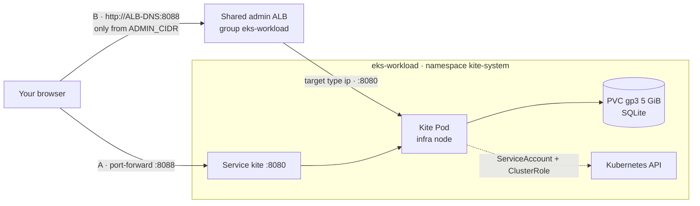

# Bước 2.5 — Cài Kite dashboard và mở truy cập {#step-25--install-the-kite-dashboard-and-expose-it}

:::info Tóm tắt bước thực hành
**Mục tiêu:** Kite chạy trên node group infra, truy cập được bằng port-forward và — tùy chọn — qua ALB quản trị dùng chung ở port 8088.
**Thời gian:** khoảng 20 phút. **Chạy từ:** `$TF_DIR` (cài đặt) và `$GITOPS_DIR` (Ingress).
:::

[Kite](https://github.com/kite-org/kite) là một dashboard Kubernetes gọn nhẹ: xem mọi resource, đọc log Pod, mở shell vào container và xem CPU, memory lấy từ Prometheus. Không thành phần nào khác trong workshop phụ thuộc vào nó.



## Phần 1 — Cài Kite {#part-1--install-kite}

Kite được cài bằng **Terraform, layer 20**, giống mọi chart nền tảng khác. Hãy dùng phương án A. Phương án B là cùng cấu hình đó nhưng cài bằng Helm, dành cho cluster không do các layer này quản lý.

### 1.1 Đọc những gì Terraform sẽ tạo {#11-read-what-terraform-will-create}

```bash
grep -n 'kite' "$TF_DIR/20-cluster-workload/helm_releases.tf"
sed -n '/resource "kubernetes_namespace_v1" "kite"/,/depends_on = \[kubernetes_secret_v1.kite\]/p' \
  "$TF_DIR/20-cluster-workload/helm_releases.tf"
```

Khối cấu hình tạo bốn thứ, theo thứ tự:

| # | Resource | Là gì |
|---|---|---|
| 1 | `kubernetes_namespace_v1.kite` | Namespace `kite-system` |
| 2 | `random_password.kite_jwt`, `random_password.kite_encryption` | Hai chuỗi ngẫu nhiên 64 ký tự |
| 3 | `kubernetes_secret_v1.kite` | Secret `kite` chứa `JWT_SECRET`, `KITE_ENCRYPT_KEY`, `DB_TYPE=sqlite` |
| 4 | `helm_release.kite` | Chart `oci://ghcr.io/kite-org/charts/kite` phiên bản `0.15.0` với các values bên dưới |

Values truyền vào chart:

| Value | Thiết lập | Lý do |
|---|---|---|
| `replicaCount`, `deploymentStrategy` | `1`, `Recreate` | SQLite chỉ có một tiến trình ghi; `Recreate` dừng Pod cũ trước khi Pod mới gắn ổ đĩa |
| `secret.existingSecret` | `kite` | Dùng Secret do Terraform tạo thay cho encryption key mặc định của chart |
| `db.sqlite.persistence.pvc` | `gp3`, `ReadWriteOnce`, `5Gi` | User và cấu hình còn nguyên khi khởi động lại |
| `nodeSelector` | `role: infra` | Công cụ nền tảng chạy trên Managed Node Group |
| `resources` | request 250m / 256Mi, limit 512Mi | — |
| `ingress.enabled` | `false` | Việc mở truy cập nằm ở Phần 3 |

Chart cũng tạo Service `kite` (ClusterIP, port `8080`, health check `/healthz`) và một ServiceAccount gắn ClusterRole có mọi verb trên mọi resource.

### 1.2 Phương án A — cài bằng Terraform {#12-option-a--install-with-terraform}

Nếu bạn đã apply đầy đủ ở [bước 1.3](../architecture/layer-21-cluster-observability#6-finish-cluster-1), Kite đã được cài và plan này báo **No changes**. Nếu chưa, lệnh này cài riêng Kite:

```bash
L=20-cluster-workload
terraform -chdir="$TF_DIR/$L" plan -target=helm_release.kite -out="$PLAN_DIR/$L-kite.tfplan"
terraform -chdir="$TF_DIR/$L" apply "$PLAN_DIR/$L-kite.tfplan"
```

`-target=helm_release.kite` tự kéo theo các phụ thuộc (namespace, password, Secret, StorageClass `gp3`). Đọc kỹ plan: chỉ có các resource của Kite được tạo. Helm chờ tối đa 15 phút để Pod Ready (`wait = true`, `atomic = true`); nếu thất bại, release sẽ tự rollback.

### 1.3 Phương án B — cài bằng Helm (cluster ngoài workshop) {#13-option-b--install-with-helm-clusters-outside-this-workshop}

Đừng chạy phần này trên `eks-workload`: ở đó Terraform quản lý release, hai bên sẽ ghi đè lẫn nhau.

```bash
kubectl create namespace kite-system

kubectl -n kite-system create secret generic kite \
  --from-literal=JWT_SECRET="$(openssl rand -hex 32)" \
  --from-literal=KITE_ENCRYPT_KEY="$(openssl rand -hex 32)" \
  --from-literal=DB_TYPE=sqlite

cat > kite-values.yaml <<'VALUES'
replicaCount: 1
deploymentStrategy: { type: Recreate }
secret: { create: false, existingSecret: kite }
db:
  type: sqlite
  sqlite:
    persistence:
      pvc: { enabled: true, storageClass: gp3, accessModes: [ReadWriteOnce], size: 5Gi }
nodeSelector: { role: infra }
resources:
  requests: { cpu: 250m, memory: 256Mi }
  limits: { memory: 512Mi }
ingress: { enabled: false }
VALUES

helm template kite oci://ghcr.io/kite-org/charts/kite --version 0.15.0 \
  -n kite-system -f kite-values.yaml | grep -E '^kind:'      # review what will be created

helm upgrade --install kite oci://ghcr.io/kite-org/charts/kite --version 0.15.0 \
  -n kite-system -f kite-values.yaml --wait --timeout 10m
```

### 1.4 Kiểm tra cài đặt {#14-verify-the-installation}

```bash
helm --kube-context eks-workload list -n kite-system
kubectl --context eks-workload -n kite-system get deploy,pods,svc,pvc,secret -o wide
kubectl --context eks-workload -n kite-system get pod -l app.kubernetes.io/name=kite \
  -o jsonpath='{.items[0].spec.nodeName}' | xargs -I{} kubectl --context eks-workload get node {} -L role
kubectl --context eks-workload -n kite-system logs deploy/kite --tail=20
```

**Kết quả mong đợi:**

- release `kite` ở trạng thái `deployed`, chart `kite-0.15.0`;
- Deployment `kite` `1/1`, Pod `Running`;
- Service `kite` kiểu `ClusterIP` trên `8080/TCP`;
- PVC `Bound`, class `gp3`, `5Gi`;
- có Secret `kite`;
- node hiển thị `role=infra`;
- log không có lỗi.

## Phần 2 — Mở Kite và đăng nhập {#part-2--open-kite-and-sign-in}

### 2.1 Port-forward {#21-port-forward}

```bash
kubectl --context eks-workload -n kite-system port-forward svc/kite 8088:8080
```

Mở http://localhost:8088. Port-forward không cần load balancer và không mở gì ra ngoài; hãy dùng cách này làm mặc định.

### 2.2 Đăng nhập lần đầu {#22-first-sign-in}

Lần đầu mở, Kite chưa có user nào:

1. Tạo tài khoản **quản trị** đầu tiên. Dùng mật khẩu mạnh; tài khoản này làm được mọi thứ trong cluster.
2. Thêm cluster mà Kite sẽ quản lý và chọn **in-cluster**. Kite sẽ dùng ServiceAccount của chính nó; không cần tải kubeconfig lên.
3. Đặt Prometheus URL cho biểu đồ tài nguyên: `http://prometheus-kube-prometheus-prometheus.monitoring.svc:9090`.

### 2.3 Kiểm tra {#23-verify}

- Màn hình workload liệt kê `argocd`, `monitoring`, `shopnow`, `kite-system`.
- Một Pod ShopNow hiển thị log liên tục và biểu đồ CPU, memory.
- Khởi động lại Pod (`kubectl --context eks-workload -n kite-system rollout restart deploy/kite`) rồi đăng nhập lại bằng đúng tài khoản cũ: dữ liệu nằm trên PVC.

## Phần 3 — Mở Kite qua ALB quản trị (tùy chọn) {#part-3--expose-kite-through-the-admin-alb-optional}

Workshop không có tên miền DNS, nên các công cụ quản trị được truy cập bằng **hostname của chính ALB**, mỗi công cụ một port listener:

| Port | Công cụ | Khai báo ở |
|---|---|---|
| 80 | ArgoCD | `platform/ingress/admin-ingress.yaml` |
| 9090 | Prometheus | `platform/ingress/admin-ingress.yaml` |
| 9093 | Alertmanager | `platform/ingress/admin-ingress.yaml` |
| 8081 | JavaMelody | `platform/ingress/admin-ingress.yaml` |
| 3000 | Grafana (cục bộ) | Terraform layer 20 |
| **8088** | **Kite** | `platform/ingress/kite-ingress.yaml` |

Mọi Ingress có `alb.ingress.kubernetes.io/group.name: eks-workload` được AWS Load Balancer Controller gộp vào **một** ALB. Vì vậy thêm Ingress của Kite chỉ thêm một listener port 8088 vào ALB đang có, không tạo ALB mới.

### 3.1 Đọc manifest {#31-read-the-manifest}

```bash
cat "$GITOPS_DIR/platform/ingress/kite-ingress.yaml"
```

| Annotation / trường | Giá trị | Tác dụng |
|---|---|---|
| `group.name` | `eks-workload` | Tham gia ALB quản trị dùng chung |
| `group.order` | `60` | Thứ tự rule trong nhóm (sau các công cụ khác) |
| `scheme` | `internet-facing` | ALB đặt ở public subnet |
| `target-type` | `ip` | Traffic đi thẳng tới IP của Pod, không qua NodePort |
| `listen-ports` | `[{"HTTP": 8088}]` | Listener mới ở port 8088 |
| `inbound-cidrs` | `<ADMIN_CIDR>` | Chỉ dải địa chỉ này được kết nối tới port 8088 |
| `healthcheck-path` | `/healthz` | Target healthy khi Kite trả lời ở đây |
| backend | Service `kite`, port `8080` | Nơi nhận request |

Kite **không** mở cho `0.0.0.0/0` như các công cụ khác: nó sửa được mọi resource và mở shell vào container. `<ADMIN_CIDR>` là placeholder bạn điền khi apply, nên IP của bạn không bao giờ nằm trong Git.

### 3.2 Kiểm tra điều kiện cần {#32-check-the-prerequisites}

```bash
kubectl --context eks-workload -n kube-system get deploy aws-load-balancer-controller
kubectl --context eks-workload get ingressclass alb
kubectl --context eks-workload get ingress -A | grep -E 'NAME|eks-workload' || true
```

**Kết quả mong đợi:** controller `1/1` hoặc `2/2` Ready và có IngressClass `alb`. Các Ingress quản trị khác có thể đã xuất hiện; chúng dùng chung ALB.

### 3.3 Điền địa chỉ của bạn và kiểm tra trước {#33-fill-in-your-address-and-review-the-result}

```bash
cd "$GITOPS_DIR"
mkdir -p "$GITOPS_DIR/.workshop"
export ADMIN_CIDR="$(curl -s -4 ifconfig.me)/32"
echo "$ADMIN_CIDR"

sed "s|<ADMIN_CIDR>|$ADMIN_CIDR|" platform/ingress/kite-ingress.yaml > "$GITOPS_DIR/.workshop/kite-ingress.yaml"
grep -n 'inbound-cidrs' "$GITOPS_DIR/.workshop/kite-ingress.yaml"
kubectl --context eks-workload apply --dry-run=server -f "$GITOPS_DIR/.workshop/kite-ingress.yaml"
```

Lệnh `echo` phải in ra IP công khai của bạn kèm `/32`. Dry run phía server phải trả về `ingress.networking.k8s.io/kite created (server dry run)`. Nếu bạn kết nối qua VPN hoặc mạng văn phòng, dùng CIDR của mạng đó thay cho `ifconfig.me`.

### 3.4 Apply Ingress {#34-apply-the-ingress}

```bash
kubectl --context eks-workload apply -f "$GITOPS_DIR/.workshop/kite-ingress.yaml"
kubectl --context eks-workload -n kite-system get ingress kite -w     # wait for ADDRESS, then Ctrl+C
```

Cột `ADDRESS` hiện hostname của ALB dùng chung sau khoảng một phút. Phía sau, controller sẽ:

1. thêm listener port 8088 vào ALB;
2. tạo target group (kiểu `ip`) và đăng ký IP của Pod Kite;
3. thêm rule inbound cho `ADMIN_CIDR` ở port 8088 vào security group của ALB;
4. thêm rule trên listener chuyển `/` tới target group đó.

Theo dõi trong log của controller:

```bash
kubectl --context eks-workload -n kube-system logs deploy/aws-load-balancer-controller --since=5m \
  | grep -iE 'kite|eks-workload|error'
```

### 3.5 Kiểm tra listener và target trên AWS {#35-check-the-listener-and-target-on-aws}

```bash
export ALB_DNS=$(kubectl --context eks-workload -n kite-system get ingress kite \
  -o jsonpath='{.status.loadBalancer.ingress[0].hostname}')
export ALB_ARN=$(aws elbv2 describe-load-balancers \
  --query "LoadBalancers[?DNSName=='$ALB_DNS'].LoadBalancerArn" --output text)

aws elbv2 describe-listeners --load-balancer-arn "$ALB_ARN" \
  --query 'Listeners[].{Port:Port,Protocol:Protocol}' --output table

for tg in $(aws elbv2 describe-target-groups --load-balancer-arn "$ALB_ARN" \
              --query "TargetGroups[?contains(TargetGroupName,'kitesyst')].TargetGroupArn" --output text); do
  aws elbv2 describe-target-health --target-group-arn "$tg" \
    --query 'TargetHealthDescriptions[].{IP:Target.Id,Port:Target.Port,State:TargetHealth.State}' --output table
done
```

**Kết quả mong đợi:** có listener `8088 HTTP` bên cạnh port của các công cụ khác, và một target — IP của Pod Kite ở port `8080` — trạng thái `healthy`. Trong 30 giây đầu có thể là `initial`.

### 3.6 Mở Kite qua ALB {#36-open-kite-through-the-alb}

```bash
echo "http://$ALB_DNS:8088"
curl -s -o /dev/null -w '%{http_code}\n' "http://$ALB_DNS:8088/healthz"
```

`curl` từ máy bạn trả về `200`. Mở URL trên trình duyệt và đăng nhập bằng tài khoản đã tạo ở Phần 2.

| Kiểm tra | Kết quả mong đợi |
|---|---|
| Trang mở được từ mạng của bạn | có |
| Mở từ mạng khác (ví dụ điện thoại dùng 4G) | timeout — bị chặn bởi `inbound-cidrs` |
| Sau khi đăng nhập, mở trang khác | vẫn giữ phiên |

Nếu đăng nhập thành công nhưng sang trang tiếp theo lại bị đưa về màn hình đăng nhập hoặc nhận `401`, nghĩa là cookie phiên có cờ `Secure` và trình duyệt không gửi nó qua HTTP thường — đúng vấn đề Rancher từng gặp trên ALB này. Hãy xoá Ingress (3.8) và tiếp tục dùng port-forward.

### 3.7 Khi IP của bạn thay đổi {#37-when-your-ip-changes}

```bash
cd "$GITOPS_DIR"
export ADMIN_CIDR="$(curl -s -4 ifconfig.me)/32"
sed "s|<ADMIN_CIDR>|$ADMIN_CIDR|" platform/ingress/kite-ingress.yaml > "$GITOPS_DIR/.workshop/kite-ingress.yaml"
kubectl --context eks-workload apply -f "$GITOPS_DIR/.workshop/kite-ingress.yaml"
```

Controller thay rule của security group trong vòng một phút.

### 3.8 Gỡ truy cập qua ALB {#38-remove-the-alb-access}

```bash
kubectl --context eks-workload -n kite-system delete ingress kite
```

Controller gỡ listener 8088, target group và rule. ALB vẫn còn chừng nào trong nhóm còn Ingress khác.

Traffic qua ALB là HTTP thường: hostname của ALB không phải tên miền của bạn nên không cấp được chứng chỉ. Hãy coi listener này là tiện ích cho lab.

## Phần 4 — Tăng cường bảo mật (khuyến nghị ngoài lab) {#part-4--hardening-recommended-outside-a-lab}

| Rủi ro | Thay đổi |
|---|---|
| Quyền ghi trên toàn cluster | Thu hẹp `rbac.rules` của chart (bên dưới) và dùng role của Kite cho từng user |
| Mật khẩu và phiên đi qua HTTP | Ưu tiên port-forward, hoặc đặt ALB sau tên miền có chứng chỉ ACM |
| Chỉ một tài khoản quản trị | Tạo user riêng trong Kite thay vì dùng chung tài khoản đầu tiên |
| Mất dữ liệu | Snapshot volume EBS của PVC trước khi nâng cấp |

Quyền Kubernetes chỉ đọc cho Kite — thêm vào values của `helm_release "kite"` trong `$TF_DIR/20-cluster-workload/helm_releases.tf`:

```hcl
    rbac = {
      create = true
      rules = [{
        apiGroups = ["*"]
        resources = ["*"]
        verbs     = ["get", "list", "watch"]
      }]
    }
```

Sau đó plan và apply layer 20. Với quyền chỉ đọc, các thao tác terminal, sửa và xoá trong Kite sẽ không hoạt động; đó chính là mục đích.

## Xử lý sự cố {#troubleshooting}

| Triệu chứng | Kiểm tra |
|---|---|
| Helm release thất bại / rollback | `kubectl -n kite-system describe pod`; PVC `Bound`; có StorageClass `gp3`; node infra còn chỗ |
| Pod khởi động lại liên tục | `kubectl -n kite-system logs deploy/kite --previous`; Secret `kite` có `JWT_SECRET` và `KITE_ENCRYPT_KEY` |
| Ingress không có ADDRESS | Log controller (3.4); IngressClass `alb`; public subnet có tag `kubernetes.io/role/elb=1` |
| Target `unhealthy` | `curl` `/healthz` từ trong cluster; Pod Ready; SG của node cho phép SG của ALB ở 8080 |
| Trình duyệt timeout | IP hiện tại của bạn không thuộc `ADMIN_CIDR` — làm lại 3.7 |
| Biểu đồ tài nguyên trống | Prometheus URL trong phần cấu hình cluster của Kite |

## Gỡ Kite {#remove-kite}

Xoá Ingress (3.8), rồi bỏ các resource `kite` (`kubernetes_namespace_v1.kite`, `random_password.kite_*`, `kubernetes_secret_v1.kite`, `helm_release.kite`) khỏi layer 20 và apply. Xoá namespace cũng xoá luôn PVC và dữ liệu của Kite.

**Tiếp theo:** [3.1 Build image](../apps-shopnow/docker-build-multi-arch-and-ci)
