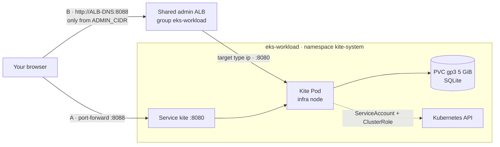
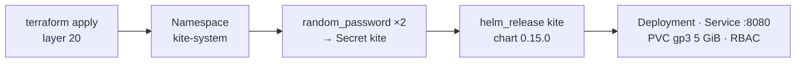

# Bước 2.5 — Kite dashboard {#step-25--kite-dashboard}

Kite đã được Terraform cài ở bước 1.3. Bây giờ chúng ta sẽ kiểm tra release, mở dashboard bằng port-forward và cấu hình thêm Ingress nếu muốn truy cập qua hostname của ALB.

**Thời gian:** khoảng 15 phút. **Chạy từ:** terminal đã source `workshop.env`.

[Kite](https://github.com/kite-org/kite) là dashboard để xem resource trong Kubernetes, đọc Pod log và mở shell trong container. Kite cũng có thể hiển thị CPU, memory từ Prometheus. Chúng ta dùng nó để theo dõi workload cluster trong quá trình làm workshop.



## Phần 1 · Cài đặt Kite {#part-1--how-kite-is-installed}

Terraform quản lý Kite qua `helm_release` trong **layer 20**, file `$TF_DIR/20-cluster-workload/helm_releases.tf`. Kite được cài khi full apply tại [bước 1.3](../architecture/layer-21-cluster-observability#6-finish-cluster-1); không cần cài thêm release bằng tay.



| Thứ tự | resource Terraform | Kết quả trong cluster |
|---|---|---|
| 1 | `kubernetes_namespace_v1.kite` | Namespace `kite-system` |
| 2 | `random_password.kite_jwt`, `random_password.kite_encryption` | Hai key ngẫu nhiên 64 ký tự (lưu trong Terraform state) |
| 3 | `kubernetes_secret_v1.kite` | Secret `kite`: `JWT_SECRET`, `KITE_ENCRYPT_KEY`, `DB_TYPE=sqlite` |
| 4 | `helm_release.kite` | Chart `oci://ghcr.io/kite-org/charts/kite` `0.15.0`: Deployment, Service `kite` (ClusterIP `8080`), PVC, ServiceAccount + ClusterRole |

Các values chính truyền vào chart:

| Value | Thiết lập | Lý do |
|---|---|---|
| `replicaCount`, `deploymentStrategy` | `1`, `Recreate` | SQLite chỉ có một tiến trình ghi; Pod cũ dừng trước khi Pod mới gắn ổ đĩa |
| `secret.existingSecret` | `kite` | Dùng Secret do Terraform tạo thay cho key mặc định của chart |
| `db.sqlite.persistence.pvc` | `gp3`, `ReadWriteOnce`, `5Gi` | User và cấu hình còn nguyên khi khởi động lại |
| `nodeSelector`, `tolerations` | `role: infra`, `CriticalAddonsOnly` | Chạy trên Managed Node Group infra |
| `ingress.enabled` | `false` | Truy cập bằng port-forward hoặc Ingress ở Phần 2 |

Để cập nhật Kite, sửa values trong `helm_release "kite"`, rồi plan và apply layer 20. Với `wait` và `atomic`, Helm chờ Pod Ready và rollback nếu cài đặt thất bại.

### Kiểm tra Kite đang chạy {#check-that-kite-is-running}

```bash
helm --kube-context eks-workload list -n kite-system
kubectl --context eks-workload -n kite-system get deploy,pods,svc,pvc,secret -o wide
kubectl --context eks-workload -n kite-system get pod -l app.kubernetes.io/name=kite \
  -o jsonpath='{.items[0].spec.nodeName}' | xargs -I{} kubectl --context eks-workload get node {} -L role
kubectl --context eks-workload -n kite-system logs deploy/kite --tail=20
```

**Kết quả:**

- release `kite` ở trạng thái `deployed`, chart `kite-0.15.0`;
- Deployment `kite` `1/1`, Pod `Running`;
- Service `kite` kiểu `ClusterIP` trên `8080/TCP`;
- PVC `Bound`, class `gp3`, `5Gi`;
- có Secret `kite`;
- node hiển thị `role=infra`;
- log không có lỗi.

[](/img/workshop/platform/kite-release-and-storage.png)

*Kiểm tra release, Pod, Service, PVC và node `role=infra` của Kite. Resource ID và IP là giá trị tại thời điểm capture. Bấm vào ảnh để xem đầy đủ.*

## Phần 2 · Truy cập Kite {#part-2--access-kite}

Terraform quản lý Helm release và Ingress của Kite. Chart giữ `ingress.enabled=false`; khi bật truy cập ALB, resource `kubernetes_ingress_v1.kite[0]` trong `$TF_DIR/20-cluster-workload/kite_ingress.tf` sẽ tạo Ingress. Vì vậy, các thay đổi ở bước này đều đi qua Terraform.

| | A · port-forward (mặc định) | B · ALB quản trị (chủ động bật) |
|---|---|---|
| URL | `http://localhost:8088` | `http://<ALB-DNS>:8088` |
| Bật | `kubectl port-forward` | `kite_ingress_enabled=true` và `kite_admin_cidrs` được phép, sau đó Terraform apply |
| Phạm vi mạng | Máy cục bộ | Chỉ các CIDR IPv4 được cho phép rõ ràng trên port 8088 |

### 2A — port-forward {#2a--port-forward}

```bash
kubectl --context eks-workload -n kite-system port-forward svc/kite 8088:8080
```

Mở http://localhost:8088 rồi chuyển sang [Phần 3](#part-3--first-sign-in). Cách này không cần Ingress.

### 2B — Qua ALB quản trị {#2b--through-the-admin-alb}

Truy cập bằng `http://<ALB-DNS>:8088`, dùng trực tiếp hostname ALB. Ingress thuộc group `eks-workload`: controller thêm listener 8088 vào ALB của group hoặc tạo ALB nếu chưa có. Giữ các listener và routing đang dùng cho dịch vụ khác.

| Field | Value |
|---|---|
| Terraform address | `kubernetes_ingress_v1.kite[0]` |
| Ingress | `kite-system/kite`, class `alb` |
| IngressGroup / order | `eks-workload` / `60` |
| Scheme / target type | `internet-facing` / `ip` |
| listener | HTTP `8088` |
| backend | Service `kite:8080`, path `/` |
| Health check | `/healthz` |

Terraform tạo Ingress sau khi Helm release Kite sẵn sàng. AWS Load Balancer Controller đọc Ingress này và cấu hình listener, rule, target group cùng các security group rule do controller quản lý trên AWS.

#### 2B.1 Kiểm tra Environment {#2b1-read-the-manifest}

Source `workshop.env` theo [bước Cấu hình môi trường](../architecture/organizational-constraints-and-prerequisites#5-variables-used-in-every-step). Lệnh dùng `TF_DIR` và `terraform -chdir`, nên có thể chạy từ thư mục bất kỳ. Kiểm tra `AWS_PROFILE`, account ID và region khớp cấu hình layer 20. Dùng profile thực tế trên máy; `eks-core` chỉ là tên mẫu. S3 backend có thể dùng region riêng.

Chuẩn bị Python 3 và `jq` cho các lệnh kiểm tra bên dưới.

```bash
bash <<'BASH'
set -euo pipefail
: "${TF_DIR:?Export TF_DIR from your workshop environment}"
: "${AWS_PROFILE:?Export the AWS profile used by this environment}"
: "${AWS_REGION:?Export the EKS region}"
for command in terraform kubectl helm aws curl python3 jq; do
  command -v "$command" >/dev/null
done
test -f "$TF_DIR/20-cluster-workload/kite_ingress.tf"
test -f "$TF_DIR/20-cluster-workload/backend.hcl"
aws --profile "$AWS_PROFILE" --region "$AWS_REGION" sts get-caller-identity
kubectl --context eks-workload -n kube-system get deploy aws-load-balancer-controller
kubectl --context eks-workload get ingressclass alb
kubectl --context eks-workload -n kite-system get deploy,pods,svc,pvc,endpointslices
kubectl --context eks-workload get ingress -A -o json | jq '
  .items[] | select(.metadata.annotations["alb.ingress.kubernetes.io/group.name"] == "eks-workload")
  | {namespace: .metadata.namespace, name: .metadata.name,
     annotations: .metadata.annotations, address: .status.loadBalancer}'
BASH
```

Kết quả: đúng AWS account; controller Ready; có class `alb`; Kite Ready; PVC Bound; EndpointSlice có địa chỉ Ready trên port 8080. Kiểm tra annotation của tất cả thành viên group. Nếu khai báo `alb.ingress.kubernetes.io/security-groups` tường minh, `inbound-cidrs` **không** quản lý quyền truy cập: phải kiểm tra rule SG thực tế trước khi tiếp tục. Xác nhận port 8088 chưa được ứng dụng khác sử dụng.

[](/img/workshop/platform/kite-alb-prerequisites.png)

*Preflight: controller Ready và có IngressClass `alb`. Danh sách Ingress trống trong ảnh là trạng thái trước khi bật Kite Ingress. Bấm vào ảnh để xem đầy đủ.*

#### 2B.2 Cấu hình Admin CIDR {#2b2-check-the-prerequisites}

Mặc định, truy cập ALB **tắt**: `kite_ingress_enabled=false`, `kite_admin_cidrs=[]`. Tạo file local `$TF_DIR/20-cluster-workload/kite.auto.tfvars` đã được gitignore để bật và khai báo CIDR. Lệnh dưới lấy public IPv4 hiện tại, tạo file mới và dừng nếu file đã tồn tại. Nếu đã có file, sửa trực tiếp file đó. Khi dùng VPN hoặc mạng công ty, tự đặt `ADMIN_CIDR` theo IP được phép.

```bash
export ADMIN_CIDR="$(curl --fail --silent --show-error --ipv4 --max-time 10 https://checkip.amazonaws.com)/32"
python3 <<'PYCONFIG'
import ipaddress, json, os
from pathlib import Path
network = ipaddress.ip_network(os.environ["ADMIN_CIDR"].strip(), strict=False)
if network.version != 4 or network.prefixlen == 0:
    raise SystemExit("Use a valid IPv4 CIDR from /1 to /32.")
layer = Path(os.environ["TF_DIR"]) / "20-cluster-workload"
if not (layer / "kite_ingress.tf").is_file():
    raise SystemExit("TF_DIR does not point to the Terraform repository.")
path = layer / "kite.auto.tfvars"
with path.open("x") as config:
    config.write("kite_ingress_enabled = true\n")
    config.write("kite_admin_cidrs = " + json.dumps([str(network)]) + "\n")
path.chmod(0o600)
print("Created", path)
PYCONFIG
```

ALB dùng IPv4; cấu hình chỉ nhận CIDR từ `/1` đến `/32`. Terraform từ chối `/0`, IPv6, CIDR sai định dạng hoặc danh sách trống khi đã bật Ingress. CIDR được lưu trong Terraform state và cấu hình Kubernetes/AWS. Nếu không lấy được public IP, dừng để kiểm tra và không thay bằng `0.0.0.0/0`.

#### 2B.3 Terraform Init và import Ingress có sẵn {#2b3-fill-in-your-address-and-review-the-result}

Khởi tạo bằng AWS profile đã chọn, ghi đè tên profile mẫu trong `backend.hcl` mà không sửa file này:

```bash
terraform -chdir="$TF_DIR/20-cluster-workload" init   -backend-config="$TF_DIR/20-cluster-workload/backend.hcl"   -backend-config="profile=$AWS_PROFILE"
terraform -chdir="$TF_DIR/20-cluster-workload" validate
```

Nếu đã có Ingress, kiểm tra công cụ quản lý trước khi import. Ingress apply bằng tay thường có manager `kubectl-client-side-apply`. Nếu Helm, ArgoCD hoặc Terraform state khác đang quản lý, chuyển quyền quản lý trước. Với cài đặt mới, chưa có Ingress là bình thường.

```bash
kubectl --context eks-workload -n kite-system get ingress kite \
  --ignore-not-found --show-managed-fields -o json | jq '
  {name: .metadata.name, labels: .metadata.labels,
   annotations: .metadata.annotations,
   managers: [.metadata.managedFields[]?.manager]}'
```

Sau khi xác nhận Ingress chưa được công cụ khác quản lý hoặc đã thuộc state này, nhận quản lý mà không xoá. Script dừng khi đọc state/Kubernetes bị lỗi và bỏ qua import nếu địa chỉ đã có trong state:

```bash
bash <<'BASH'
set -euo pipefail
: "${TF_DIR:?Export TF_DIR}"
layer="$TF_DIR/20-cluster-workload"
address='kubernetes_ingress_v1.kite[0]'
state_addresses=$(terraform -chdir="$layer" state list)
existing=$(kubectl --context eks-workload -n kite-system get ingress kite \
  --ignore-not-found -o name)
if printf '%s\n' "$state_addresses" | grep -Fxq "$address"; then
  echo "Kite Ingress is already managed by this Terraform state."
elif [ -n "$existing" ]; then
  terraform -chdir="$layer" import "$address" kite-system/kite
else
  echo "No existing Kite Ingress: the reviewed apply will create it."
fi
BASH
```

Ingress Kite đã chuyển sang Terraform. File cũ `platform/ingress/kite-ingress.yaml` đã được gỡ; bỏ lệnh `sed ... | kubectl apply` trong hướng dẫn cũ. Không cần bật app-of-apps cho toàn platform để tạo Ingress này.

#### 2B.4 Terraform plan và apply {#2b4-apply-the-ingress}

```bash
terraform -chdir="$TF_DIR/20-cluster-workload" plan   -out="$TF_DIR/20-cluster-workload/kite-ingress.tfplan"
terraform -chdir="$TF_DIR/20-cluster-workload" show \
  "$TF_DIR/20-cluster-workload/kite-ingress.tfplan"
```

Kiểm tra toàn bộ plan: bước này chỉ thay đổi Kite Ingress và URL output. Nếu Ingress đã import khớp cấu hình, plan có thể không cần thay đổi resource. Nếu thấy Replace, thay Secret/PVC, listener khác hoặc resource ngoài phạm vi Kite, xử lý riêng trước khi apply. Giữ file plan local vì có thể chứa Secret.

```bash
terraform -chdir="$TF_DIR/20-cluster-workload" apply \
  "$TF_DIR/20-cluster-workload/kite-ingress.tfplan"
terraform -chdir="$TF_DIR/20-cluster-workload" output -raw kite_url
```

Sau khi controller cập nhật Ingress Address, output `kite_url` mới có URL. Chờ controller Reconcile và kiểm tra target health trước khi mở UI.

#### 2B.5 Kiểm tra listener, target health và security group {#2b5-check-the-listener-and-target-on-aws}

Lấy target group từ `TargetGroupBinding` của Kite, rồi kiểm tra listener 8088 forward đúng group. Đối chiếu listener và security group trước/sau apply, đồng thời kiểm tra các dịch vụ đang dùng ALB.

```bash
bash <<'BASH'
set -euo pipefail
: "${AWS_PROFILE:?Export AWS_PROFILE}"
: "${AWS_REGION:?Export AWS_REGION}"
ALB_DNS=$(kubectl --context eks-workload -n kite-system get ingress kite   -o jsonpath='{.status.loadBalancer.ingress[0].hostname}')
test -n "$ALB_DNS"
ALB_ARN=$(aws --profile "$AWS_PROFILE" --region "$AWS_REGION" elbv2 describe-load-balancers \
  --output json | jq -er --arg dns "$ALB_DNS" '
    [.LoadBalancers[] | select(.DNSName == $dns)]
    | if length == 1 then .[0].LoadBalancerArn else error("Expected exactly one ALB") end')
LISTENER_ARN=$(aws --profile "$AWS_PROFILE" --region "$AWS_REGION" elbv2 describe-listeners \
  --load-balancer-arn "$ALB_ARN" --output json | jq -er '
    [.Listeners[] | select(.Port == 8088 and .Protocol == "HTTP")]
    | if length == 1 then .[0].ListenerArn else error("Missing HTTP listener 8088") end')
TG_ARN=$(kubectl --context eks-workload -n kite-system get targetgroupbindings -o json | jq -er '
  [.items[] | select(.spec.serviceRef.name == "kite" and (.spec.serviceRef.port | tostring) == "8080")
   | .spec.targetGroupARN] | unique
  | if length == 1 then .[0] else error("Expected one Kite target group") end')
aws --profile "$AWS_PROFILE" --region "$AWS_REGION" elbv2 describe-rules \
  --listener-arn "$LISTENER_ARN" --output json | jq -e --arg tg "$TG_ARN" '
  .Rules[] | select(any(.Actions[]?; .Type == "forward" and
    (.TargetGroupArn == $tg or any(.ForwardConfig.TargetGroups[]?; .TargetGroupArn == $tg))))
  | {Priority, Conditions, Actions}'
aws --profile "$AWS_PROFILE" --region "$AWS_REGION" elbv2 describe-target-health \
  --target-group-arn "$TG_ARN" --query \
  'TargetHealthDescriptions[].{IP:Target.Id,Port:Target.Port,State:TargetHealth.State}' --output table
SG_IDS=$(aws --profile "$AWS_PROFILE" --region "$AWS_REGION" elbv2 describe-load-balancers \
  --load-balancer-arns "$ALB_ARN" --output json | jq -r '.LoadBalancers[0].SecurityGroups[]')
while IFS= read -r sg; do
  aws --profile "$AWS_PROFILE" --region "$AWS_REGION" ec2 describe-security-groups \
    --group-ids "$sg" --query 'SecurityGroups[].{ID:GroupId,Inbound:IpPermissions}' --output json
done <<< "$SG_IDS"
kubectl --context eks-workload -n kite-system get endpointslices,ingress
aws --profile "$AWS_PROFILE" --region "$AWS_REGION" elbv2 describe-listeners \
  --load-balancer-arn "$ALB_ARN" --query 'Listeners[].{Port:Port,Protocol:Protocol}' --output table
printf 'Kite URL: http://%s:8088\n' "$ALB_DNS"
curl --noproxy '*' --fail --silent --show-error --connect-timeout 10 --max-time 20   -o /dev/null -w 'Health HTTP status: %{http_code}\n' "http://$ALB_DNS:8088/healthz"
BASH
```

Sau khi hoàn tất, Ingress có ADDRESS, listener HTTP 8088 forward tới Kite và target trên port 8080 ở trạng thái healthy. Kiểm tra các security group gắn với ALB chỉ cho CIDR đã chọn truy cập port 8088, kể cả rule dùng dải port rộng hoặc mọi protocol. Từ mạng được phép, `/healthz` cần trả `200`. Nếu chưa thử từ mạng khác, ghi rõ phần kiểm tra đó chưa thực hiện.

```bash
terraform -chdir="$TF_DIR/20-cluster-workload" plan -detailed-exitcode
```

Kiểm tra Exit Code: `0` không có thay đổi, `2` có thay đổi, `1` là lỗi. Nếu còn Drift, đọc từng resource trước khi kết luận cấu hình đã đồng bộ.

#### 2B.6 Mở Kite qua ALB {#2b6-open-kite-through-the-alb}

Mở URL `http://<ALB-DNS>:8088` vừa lấy được. Endpoint `/healthz` trả `200` cho biết Kite đang trả lời health check; tiếp theo đăng nhập và thử mở resource bằng tài khoản hiện tại. Nếu đây là cài đặt mới, thực hiện Initial Cấu hình ở phần 3.

Nếu Login lặp Redirect hoặc trả `401`, kiểm tra tab Network/Cookies, Forwarded Scheme và Kite log. Cookie `Secure` có thể ảnh hưởng session qua HTTP, nhưng cần đối chiếu log và cookie thực tế. Trong lúc Troubleshooting, dùng lại port-forward.

URL ALB trong bài dùng **HTTP**, nên giới hạn CIDR không mã hóa dữ liệu truyền. Khi cần HTTPS, dùng domain bạn sở hữu với certificate phù hợp. Với ALB hostname trực tiếp trong lab, ưu tiên port-forward khi truyền thông tin đăng nhập.

#### 2B.7 Khi IP thay đổi {#2b7-when-your-ip-changes}

Sửa `kite_admin_cidrs` trong file local `kite.auto.tfvars`, giữ `kite_ingress_enabled=true`. Kiểm tra CIDR mới, plan và apply lại, rồi xác nhận rule security group trên AWS. Dùng lại Ingress và ALB hiện tại.

#### 2B.8 Tắt truy cập ALB và quay lại port-forward {#2b8-remove-the-alb-access}

Trong file local `kite.auto.tfvars` có sẵn, đặt:

```hcl
# In the existing gitignored kite.auto.tfvars, set:
kite_ingress_enabled = false
kite_admin_cidrs     = []
```

Chạy lại plan, kiểm tra rồi apply. Terraform sẽ xóa `kubernetes_ingress_v1.kite[0]` và đưa URL output về null. Controller dọn listener 8088 nếu không còn Ingress nào khác dùng nó. Các thành viên còn lại vẫn dùng ALB chung; Helm release, Secret, PVC và dữ liệu Kite được giữ lại.

Sau đó dùng port-forward ở 2A. Khi gặp lỗi reconcile:

```bash
kubectl --context eks-workload -n kite-system describe ingress kite
kubectl --context eks-workload -n kube-system logs deploy/aws-load-balancer-controller --since=10m   | grep -iE 'kite|eks-workload|error' || true
```

## Phần 3 · Cấu hình Kite lần đầu {#part-3--first-sign-in}

Với cài đặt mới, thực hiện Initial Cấu hình:

1. Tạo tài khoản **quản trị** đầu tiên. Dùng mật khẩu mạnh; tài khoản này làm được mọi thứ trong cluster.
2. Thêm cluster mà Kite sẽ quản lý và chọn **in-cluster**. Kite sẽ dùng ServiceAccount của chính nó; không cần tải kubeconfig lên.
3. Đặt Prometheus URL cho biểu đồ tài nguyên: `http://prometheus-kube-prometheus-prometheus.monitoring.svc:9090`.

[](/img/workshop/platform/kite-initial-admin.png)

*Bước 1: tạo Admin User trên cài đặt Kite mới. Nếu đã có tài khoản, đăng nhập bằng tài khoản hiện tại. Bấm vào ảnh để xem đầy đủ.*

[](/img/workshop/platform/kite-in-cluster-connection.png)

*Bước 2: chọn In-Cluster rồi import Cluster để Kite dùng ServiceAccount hiện tại. Bấm vào ảnh để xem đầy đủ.*

### Kiểm tra {#verify}

- Màn hình workload liệt kê `argocd`, `monitoring`, `shopnow`, `kite-system`.
- Một Pod của ứng dụng hiển thị log liên tục và biểu đồ CPU, memory.
- Khởi động lại Pod (`kubectl --context eks-workload -n kite-system rollout restart deploy/kite`) rồi đăng nhập lại bằng đúng tài khoản cũ: dữ liệu nằm trên PVC.

[](/img/workshop/platform/kite-overview.png)

*Kite Overview sau khi kết nối workload cluster. Số Node, Pod và Service phụ thuộc tiến độ thực hiện workshop. Bấm vào ảnh để xem đầy đủ.*

## Phần 4 · Cấu hình bảo mật ngoài workshop {#part-4--hardening-recommended-outside-a-lab}

| Rủi ro | Thay đổi |
|---|---|
| Quyền ghi trên toàn cluster | Thu hẹp `rbac.rules` của chart (bên dưới) và dùng role của Kite cho từng user |
| Mật khẩu và phiên đi qua HTTP | Ưu tiên port-forward, hoặc đặt ALB sau tên miền có chứng chỉ ACM |
| Chỉ một tài khoản quản trị | Tạo user riêng trong Kite thay vì dùng chung tài khoản đầu tiên |
| Mất dữ liệu | Snapshot volume EBS của PVC trước khi nâng cấp |

Quyền Kubernetes chỉ đọc cho Kite — thêm vào values của `helm_release "kite"` trong `$TF_DIR/20-cluster-workload/helm_releases.tf`:

```hcl
    rbac = {
      create = true
      rules = [{
        apiGroups = ["*"]
        resources = ["*"]
        verbs     = ["get", "list", "watch"]
      }]
    }
```

Plan và apply lại layer 20. Với RBAC chỉ đọc, user vẫn xem được resource; các thao tác Shell, sửa và xóa sẽ bị chặn.

## Troubleshooting {#troubleshooting}

| Triệu chứng | Kiểm tra |
|---|---|
| Helm release thất bại / rollback | `kubectl -n kite-system describe pod`; PVC `Bound`; có StorageClass `gp3`; node infra còn chỗ |
| Pod khởi động lại liên tục | `kubectl -n kite-system logs deploy/kite --previous`; Secret `kite` có `JWT_SECRET` và `KITE_ENCRYPT_KEY` |
| Ingress không có ADDRESS | Log controller (2B.4); IngressClass `alb`; public subnet có tag `kubernetes.io/role/elb=1` |
| Target `unhealthy` | `curl` `/healthz` từ trong cluster; Pod Ready; SG của node cho phép SG của ALB ở 8080 |
| Trình duyệt timeout | IP hiện tại của bạn không thuộc `ADMIN_CIDR` — làm lại 2B.7 |
| Biểu đồ tài nguyên trống | Prometheus URL trong phần cấu hình cluster của Kite |

## Gỡ Kite {#remove-kite}

Tắt Ingress do Terraform quản lý (2B.8), rồi bỏ các resource `kite` (`kubernetes_namespace_v1.kite`, `random_password.kite_*`, `kubernetes_secret_v1.kite`, `helm_release.kite`) khỏi layer 20 và apply. Xoá namespace cũng xoá luôn PVC và dữ liệu của Kite.

**Tiếp theo:** [3.1 Build image](../apps-shopnow/docker-build-multi-arch-and-ci)
