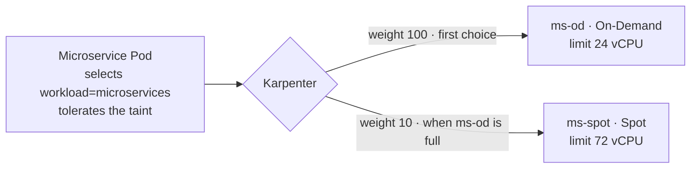

# Bước 2.3 — Mixed pool 1:3 {#step-23--mixed-pool-configure-and-measure-the-13-ratio}

mixed pool sử dụng hai NodePool là `ms-od` và `ms-spot`. Chúng ta sẽ xem cách cấu hình giới hạn capacity, sau đó chạy bài test với 1 node On-Demand và 3 node Spot.

**Thời gian:** khoảng 20 phút. **Chạy từ:** `$GITOPS_DIR`.

## Cấu hình capacity 1:3 {#how-the-ratio-is-built}



Hai NodePool dùng chung label `workload=microservices` và cùng taint. Khi các điều kiện phù hợp, weight cao hơn khiến Karpenter ưu tiên `ms-od`. Giới hạn CPU của `ms-od` là 24 vCPU, còn `ms-spot` là 72 vCPU.

Nếu dùng hết các limit này, capacity On-Demand : Spot là 24 : 72, tương ứng 1 : 3. Weight thể hiện mức ưu tiên; nó không chia số Pod hoặc số node theo phần trăm.

Khi tải thấp, mixed pool có thể chỉ có node On-Demand. Ngoài ra, hai loại node có thể có số vCPU khác nhau. Vì vậy, khi kiểm tra hãy ghi cả số node lẫn tổng vCPU của từng capacity type, thay vì chỉ đếm node.

## 1. Kiểm tra capacity hiện tại {#1-measure-the-pool-at-any-time}

```bash
kubectl --context eks-workload get nodes -l workload=microservices \
  -L karpenter.sh/nodepool,karpenter.sh/capacity-type,node.kubernetes.io/instance-type

kubectl --context eks-workload get nodes -l workload=microservices -o json | jq -r '
  [.items[] | {type: .metadata.labels["karpenter.sh/capacity-type"], cpu: (.status.capacity.cpu|tonumber)}]
  | group_by(.type) | .[] | "\(.[0].type): nodes=\(length) vCPU=\(map(.cpu)|add)"' \
  | tee "$EVIDENCE_DIR/pool2-capacity.txt"
```

## 2. Test tỷ lệ 1:3 {#2-prove-1--3-with-a-controlled-test}

Chạy bài test **trước khi deploy ứng dụng**, lúc mixed pool chưa có node. Bài test tạo 4 EC2 instance, mỗi instance 4 vCPU, và có phát sinh chi phí.

Tạm giới hạn instance size ở 4 vCPU và CPU limit của hai pool ở 4:12. Mục tiêu là **1 node On-Demand + 3 node Spot**.

```bash
kubectl --context eks-workload get nodes -l workload=microservices    # must be empty

kubectl --context eks-workload patch nodepool ms-od --type=json -p='[
  {"op":"add","path":"/spec/template/spec/requirements/-","value":{"key":"karpenter.k8s.aws/instance-cpu","operator":"In","values":["4"]}},
  {"op":"replace","path":"/spec/limits/cpu","value":"4"}]'
kubectl --context eks-workload patch nodepool ms-spot --type=json -p='[
  {"op":"add","path":"/spec/template/spec/requirements/-","value":{"key":"karpenter.k8s.aws/instance-cpu","operator":"In","values":["4"]}},
  {"op":"replace","path":"/spec/limits/cpu","value":"12"}]'
```

`examples/workshop/ratio-proof.yaml` tạo một Pod yêu cầu 3 vCPU, gán vào On-Demand. Mỗi Pod cần riêng một node 4 vCPU.

```bash
kubectl --context eks-workload apply -f "$GITOPS_DIR/examples/workshop/ratio-proof.yaml"
kubectl --context eks-workload rollout status deployment/workshop-ratio --timeout=10m

# remove the On-Demand pin and scale to four Pods
kubectl --context eks-workload patch deployment workshop-ratio --type=merge \
  -p '{"spec":{"replicas":4,"template":{"spec":{"nodeSelector":{"capacity":null}}}}}'
kubectl --context eks-workload rollout status deployment/workshop-ratio --timeout=10m
```

## Kiểm tra {#verify}

```bash
kubectl --context eks-workload get nodes -l workload=microservices \
  -L karpenter.sh/nodepool,karpenter.sh/capacity-type,node.kubernetes.io/instance-type \
  | tee "$EVIDENCE_DIR/pool2-ratio-test.txt"
```

**Kết quả:** 1 node từ `ms-od` (`on-demand`) và 3 node từ `ms-spot` (`spot`), mỗi node 4 vCPU, bốn Pod `Running`. Nếu không có capacity Spot, số node Spot ít hơn; ghi nhận kết quả thực tế thay vì sửa pool.

## 3. Khôi phục NodePool {#3-restore-the-pools}

```bash
kubectl --context eks-workload delete -f "$GITOPS_DIR/examples/workshop/ratio-proof.yaml"
kubectl --context eks-workload apply -f "$GITOPS_DIR/platform/nodepools/nodepool-2-ondemand.yaml"
kubectl --context eks-workload apply -f "$GITOPS_DIR/platform/nodepools/nodepool-2-spot.yaml"
kubectl --context eks-workload get nodepool ms-od ms-spot -o jsonpath='{range .items[*]}{.metadata.name}: {.spec.limits.cpu}{"\n"}{end}'
```

**Kết quả:** `ms-od: 24` và `ms-spot: 72`. Bốn node thực hành được hợp nhất và xóa trong vài phút.

**Tiếp theo:** [2.4 ARM64](arm64-validation)
