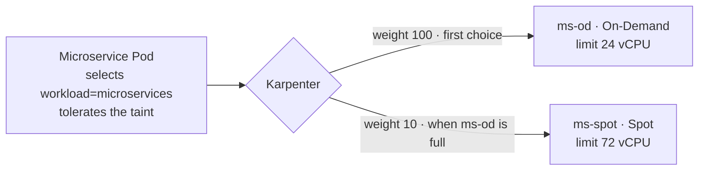

# Bước 2.3 — Mixed pool: cấu hình và đo tỷ lệ 1:3 {#step-23--mixed-pool-configure-and-measure-the-13-ratio}

:::info Tóm tắt bước thực hành
**Mục tiêu:** hiểu cách pool 2 triển khai On-Demand : Spot = 1 : 3 và chứng minh bằng bài thử có kiểm soát.
**Yêu cầu:** 2 (mixed pool). **Thời gian:** khoảng 20 phút. **Chạy từ:** `$GITOPS_DIR`.
:::

## Cách xây dựng tỷ lệ {#how-the-ratio-is-built}



- Hai NodePool gắn label `workload=microservices` và cùng taint cho node, nên Pod microservice có thể chạy trên cả hai.
- Karpenter ưu tiên **weight** cao hơn, nên 24 vCPU đầu tiên đến từ On-Demand, tạo capacity nền ổn định.
- Khi `ms-od` đạt **giới hạn CPU 24**, capacity mới đến từ `ms-spot`, tối đa **72 vCPU**.
- Khi dùng hết ngân sách: 24 vCPU On-Demand : 72 vCPU Spot = **1 : 3**.

Đây là **ngân sách capacity**, không phải số node Karpenter bắt buộc duy trì mọi lúc. Khi ít tải, toàn bộ capacity là On-Demand; tỷ lệ 1:3 xuất hiện khi pool mở rộng. Báo cáo rõ cách đo bằng vCPU hay node.

## 1. Đo pool tại thời điểm bất kỳ {#1-measure-the-pool-at-any-time}

```bash
kubectl --context eks-workload get nodes -l workload=microservices \
  -L karpenter.sh/nodepool,karpenter.sh/capacity-type,node.kubernetes.io/instance-type

kubectl --context eks-workload get nodes -l workload=microservices -o json | jq -r '
  [.items[] | {type: .metadata.labels["karpenter.sh/capacity-type"], cpu: (.status.capacity.cpu|tonumber)}]
  | group_by(.type) | .[] | "\(.[0].type): nodes=\(length) vCPU=\(map(.cpu)|add)"' \
  | tee "$EVIDENCE_DIR/pool2-capacity.txt"
```

## 2. Chứng minh 1 : 3 bằng bài thử có kiểm soát {#2-prove-1--3-with-a-controlled-test}

Chạy **trước khi** triển khai ShopNow, khi pool 2 chưa có node. Bài thử tạo bốn node 4 vCPU có tính phí.

Tạm giới hạn cả hai pool ở instance 4 vCPU và giảm ngân sách xuống 4 : 12, để trạng thái cuối mong đợi là đúng **1 node On-Demand + 3 node Spot**.

```bash
kubectl --context eks-workload get nodes -l workload=microservices    # must be empty

kubectl --context eks-workload patch nodepool ms-od --type=json -p='[
  {"op":"add","path":"/spec/template/spec/requirements/-","value":{"key":"karpenter.k8s.aws/instance-cpu","operator":"In","values":["4"]}},
  {"op":"replace","path":"/spec/limits/cpu","value":"4"}]'
kubectl --context eks-workload patch nodepool ms-spot --type=json -p='[
  {"op":"add","path":"/spec/template/spec/requirements/-","value":{"key":"karpenter.k8s.aws/instance-cpu","operator":"In","values":["4"]}},
  {"op":"replace","path":"/spec/limits/cpu","value":"12"}]'
```

`examples/workshop/ratio-proof.yaml` tạo một Pod yêu cầu 3 vCPU, gán vào On-Demand. Mỗi Pod cần riêng một node 4 vCPU.

```bash
kubectl --context eks-workload apply -f "$GITOPS_DIR/examples/workshop/ratio-proof.yaml"
kubectl --context eks-workload rollout status deployment/workshop-ratio --timeout=10m

# remove the On-Demand pin and scale to four Pods
kubectl --context eks-workload patch deployment workshop-ratio --type=merge \
  -p '{"spec":{"replicas":4,"template":{"spec":{"nodeSelector":{"capacity":null}}}}}'
kubectl --context eks-workload rollout status deployment/workshop-ratio --timeout=10m
```

## Kiểm chứng {#verify}

```bash
kubectl --context eks-workload get nodes -l workload=microservices \
  -L karpenter.sh/nodepool,karpenter.sh/capacity-type,node.kubernetes.io/instance-type \
  | tee "$EVIDENCE_DIR/pool2-ratio-test.txt"
```

**Kết quả mong đợi:** 1 node từ `ms-od` (`on-demand`) và 3 node từ `ms-spot` (`spot`), mỗi node 4 vCPU, bốn Pod `Running`. Nếu không có capacity Spot, số node Spot ít hơn; ghi nhận kết quả thực tế thay vì sửa pool.

## 3. Khôi phục pool {#3-restore-the-pools}

```bash
kubectl --context eks-workload delete -f "$GITOPS_DIR/examples/workshop/ratio-proof.yaml"
kubectl --context eks-workload apply -f "$GITOPS_DIR/platform/nodepools/nodepool-2-ondemand.yaml"
kubectl --context eks-workload apply -f "$GITOPS_DIR/platform/nodepools/nodepool-2-spot.yaml"
kubectl --context eks-workload get nodepool ms-od ms-spot -o jsonpath='{range .items[*]}{.metadata.name}: {.spec.limits.cpu}{"\n"}{end}'
```

**Kết quả mong đợi:** `ms-od: 24` và `ms-spot: 72`. Bốn node thử nghiệm được hợp nhất và xóa trong vài phút.

**Tiếp theo:** [2.4 ARM64](arm64-validation)
