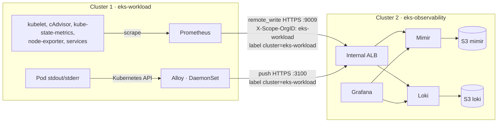

# Bước 4.0 — Centralized Observability {#step-40--centralized-observability-how-telemetry-flows}

:::info Nội dung thực hiện
**Mục tiêu:** nắm luồng Collect Metrics và Logs từ Cluster Workload sang Cluster Observability.
**Yêu cầu:** 8, 9. **Thời gian:** 5 phút đọc.
:::

| Luồng | Bên gửi (cluster 1) | Bên nhận (cluster 2) | Cách nhận biết dữ liệu cluster 1 |
|---|---|---|---|
| Metrics | Prometheus scrape cục bộ rồi `remote_write` | Mimir (tenant `eks-workload`) | Label `cluster="eks-workload"` |
| Logs | Alloy trên mọi node đọc log Pod | Loki | Label `cluster="eks-workload"` |

- Hai luồng dùng ALB nội bộ và TLS từ [bước 4.1](../platform-addons/cert-manager-and-internal-tls); traffic không rời VPC.
- Mimir và Loki dùng EBS cho dữ liệu cục bộ, đồng thời lưu dữ liệu dài hạn vào S3. Việc mất Workload Node không xóa dữ liệu đã gửi sang Cluster Observability.
- Grafana trong cluster 2 là nơi query cả hai. Prometheus riêng của cluster 2 chỉ theo dõi cluster 2.

## Các bước thực hiện {#steps-in-this-module}

1. [4.1 TLS và DNS nội bộ](../platform-addons/cert-manager-and-internal-tls) — đường kết nối.
2. [4.2 Metrics → Mimir](mimir-metrics-pipeline).
3. [4.3 Logs → Loki](loki-logging-pipeline).
4. [4.4 Grafana](grafana-dashboards).

Kết quả cần có: Grafana trên Cluster Observability query được metrics và logs **mới** từ Cluster Workload.

**Tiếp theo:** [4.1 TLS và DNS nội bộ](../platform-addons/cert-manager-and-internal-tls)
