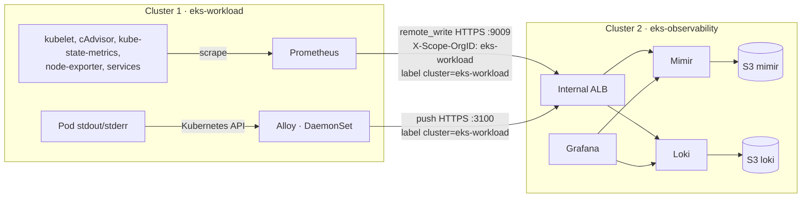

# Bước 4.0 — Centralized Observability {#step-40--centralized-observability-how-telemetry-flows}

Phần observability gồm hai luồng: Prometheus gửi metrics sang Mimir, còn Alloy gửi logs sang Loki. Chúng ta sẽ tìm hiểu vai trò của từng công cụ trước khi cấu hình kết nối giữa hai cluster.

**Thời gian:** 5 phút đọc.

## Metrics, logs và observability {#metrics-and-logs}

### Metrics và logs khác nhau ở đâu?

Metrics là các giá trị được ghi nhận theo thời gian, ví dụ CPU usage, memory hoặc số lần container restart. Chúng phù hợp để nhìn xu hướng và so sánh trạng thái trước/sau một thay đổi. Logs là các bản ghi do ứng dụng hoặc thành phần hệ thống phát ra, thường chứa chi tiết để tìm nguyên nhân lỗi.

Khi Product Service trả lỗi, bạn có thể xem metrics để biết lỗi bắt đầu lúc nào và có đi cùng tăng CPU hay restart không. Sau đó tìm logs trong cùng khoảng thời gian để đọc exception hoặc request bị lỗi. Hai loại dữ liệu bổ sung cho nhau.

### Vai trò của các công cụ

| Công cụ | Công việc trong workshop |
|---|---|
| Prometheus | Scrape metrics trên workload cluster và gửi samples qua remote_write |
| Mimir | Nhận, lưu và phục vụ query metrics trên observability cluster |
| Alloy | Thu thập Pod logs trên các node và gửi sang Loki |
| Loki | Lưu logs và phục vụ query theo label cùng nội dung cần tìm |
| Grafana | Query datasource và hiển thị metrics, logs, dashboard |
| S3 | Lưu dữ liệu dài hạn của Mimir và Loki |

Grafana là nơi xem dữ liệu, không phải nơi Prometheus và Alloy trực tiếp lưu toàn bộ dữ liệu thu thập. Một dashboard hiện `No data` có thể do query hoặc datasource, nhưng cũng có thể do chưa scrape hoặc chưa gửi được dữ liệu.

### Luồng dữ liệu giữa hai cluster

Trên cluster 1, Prometheus scrape target rồi remote_write sang Mimir. Alloy đọc Pod logs và push sang Loki. Cả hai luồng đi qua internal ALB trên cluster 2, dùng private DNS và TLS.

Labels như `cluster`, `namespace`, `pod` giúp chọn dữ liệu khi query. Workshop dùng `cluster="eks-workload"` để xác định dữ liệu từ cluster 1. Mimir còn dùng tenant `eks-workload`; tenant header phục vụ phân chia dữ liệu, không tự thay thế authentication.

### Cách kiểm tra luồng đã hoạt động

Pod receiver Ready hoặc Grafana mở được mới chỉ xác nhận một phần. Chúng ta cần tìm metric và log vừa tạo từ cluster 1 ở cluster 2. Điều này giúp phân biệt dữ liệu mới với dữ liệu cũ còn trong storage.

Workshop tập trung vào metrics và logs. Distributed tracing cần instrumentation cùng trace backend riêng; cài Grafana hoặc Alloy chưa tự tạo trace cho ứng dụng.

Đọc thêm: [Grafana Loki overview](https://grafana.com/docs/loki/latest/get-started/overview/).

| Luồng | Bên gửi (cluster 1) | Bên nhận (cluster 2) | Cách nhận biết dữ liệu cluster 1 |
|---|---|---|---|
| Metrics | Prometheus scrape cục bộ rồi `remote_write` | Mimir (tenant `eks-workload`) | Label `cluster="eks-workload"` |
| Logs | Alloy trên mọi node đọc log Pod | Loki | Label `cluster="eks-workload"` |

Hai luồng dùng internal ALB và TLS từ [bước 4.1](../platform-addons/cert-manager-and-internal-tls). Mimir và Loki lưu dữ liệu dài hạn trên S3, tách khỏi node của workload cluster.

Grafana trên cluster 2 query cả metrics và logs. Prometheus riêng của cluster 2 theo dõi các thành phần của chính cluster đó; nó không thay thế Prometheus đang scrape workload cluster.

## Các bước thực hiện {#steps-in-this-module}

1. [4.1 TLS và DNS nội bộ](../platform-addons/cert-manager-and-internal-tls) — đường kết nối.
2. [4.2 Metrics → Mimir](mimir-metrics-pipeline).
3. [4.3 Logs → Loki](loki-logging-pipeline).
4. [4.4 Grafana](grafana-dashboards).

Kết quả: Grafana trên observability cluster query được metrics và logs **mới** từ workload cluster.

**Tiếp theo:** [4.1 TLS và DNS nội bộ](../platform-addons/cert-manager-and-internal-tls)
