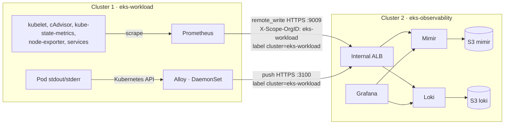

# Bước 4.0 — Observability tập trung: luồng telemetry {#step-40--centralized-observability-how-telemetry-flows}

:::info Tóm tắt bước thực hành
**Mục tiêu:** hiểu hai luồng chuyển metrics và logs từ cluster 1 sang cluster 2.
**Yêu cầu:** 8, 9. **Thời gian:** 5 phút đọc.
:::

| Luồng | Bên gửi (cluster 1) | Bên nhận (cluster 2) | Cách nhận biết dữ liệu cluster 1 |
|---|---|---|---|
| Metrics | Prometheus scrape cục bộ rồi `remote_write` | Mimir (tenant `eks-workload`) | Label `cluster="eks-workload"` |
| Logs | Alloy trên mọi node đọc log Pod | Loki | Label `cluster="eks-workload"` |

- Hai luồng dùng ALB nội bộ và TLS từ [bước 4.1](../platform-addons/cert-manager-and-internal-tls); traffic không rời VPC.
- Mimir và Loki giữ dữ liệu gần đây trên EBS rồi đẩy sang S3, nên dữ liệu tồn tại lâu hơn node của cả hai cluster.
- Grafana trong cluster 2 là nơi query cả hai. Prometheus riêng của cluster 2 chỉ theo dõi cluster 2.

## Các bước trong phần này {#steps-in-this-module}

1. [4.1 TLS và DNS nội bộ](../platform-addons/cert-manager-and-internal-tls) — đường kết nối.
2. [4.2 Metrics → Mimir](mimir-metrics-pipeline).
3. [4.3 Logs → Loki](loki-logging-pipeline).
4. [4.4 Grafana](grafana-dashboards).

Hoàn thành khi có thể query metric **mới** và dòng log **mới** của cluster 1 trong Grafana cluster 2.

**Tiếp theo:** [4.1 TLS và DNS nội bộ](../platform-addons/cert-manager-and-internal-tls)
