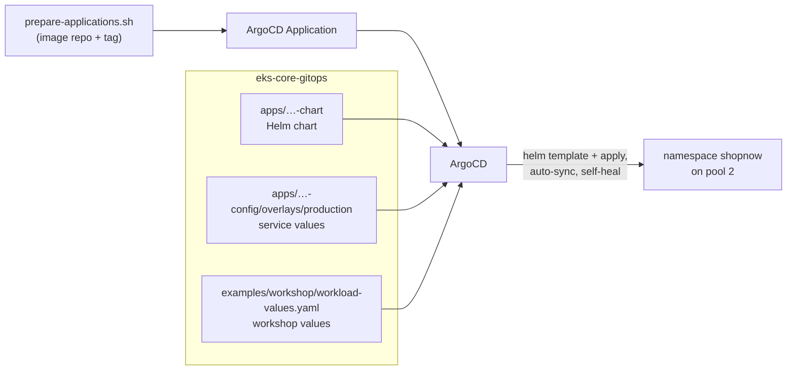

# Bước 3.2 — Triển khai microservices bằng ArgoCD {#step-32--deploy-the-microservices-with-argocd}

:::info Tóm tắt bước thực hành
**Mục tiêu:** ShopNow chạy trên pool 2; mọi service được ArgoCD triển khai và duy trì đồng bộ.
**Yêu cầu:** 3 (microservices trên pool 2), 7 (ArgoCD). **Thời gian:** khoảng 30 phút. **Chạy từ:** `$GITOPS_DIR`.
:::

## Cách triển khai một service {#how-a-service-gets-deployed}



Mỗi service là một ArgoCD **Application**, render Helm chart với ba tệp values theo thứ tự. Tệp cuối `workload-values.yaml` chứa yêu cầu workshop cho cả sáu backend:

```yaml
replicaCount: 2
persistence:            # requirement 4 — EFS volume at /data
  enabled: true
  storageClass: efs-sc
  size: 5Gi
  mountPath: /data
nodeSelector:           # requirement 3 — run on pool 2
  workload: microservices
tolerations:
  - key: workload
    operator: Equal
    value: microservices
    effect: NoSchedule
podDisruptionBudget:    # requirement 6
  enabled: true
  maxUnavailable: 1
```

Eureka (discovery) dùng thêm `discovery-values.yaml`: một replica và không có PDB vì cấu hình Eureka này không có peer replication.

Application dùng automated sync với `prune` và `selfHeal`: ArgoCD hoàn tác chỉnh sửa `kubectl` thủ công trên tài nguyên nó quản lý. Hãy thay đổi trong Git.

## 1. Tạo AppProject {#1-create-the-appproject}

```bash
kubectl --context eks-workload apply -f "$GITOPS_DIR/platform/addons/argocd/appproject-shopnow.yaml"
```

Project `shopnow` chỉ cho phép triển khai vào namespace `shopnow`.

## 2. Render Application {#2-render-the-applications}

Script điền Git URL, revision, ECR image repository và tag của bạn. Script chỉ ghi tệp; không apply hay push.

```bash
cd "$GITOPS_DIR"
bash examples/workshop/prepare-applications.sh
ls .workshop/applications
```

**Kết quả mong đợi:** chín tệp — `shopnow-database-services`, `discovery-server`, `config-server`, `product-service`, `cart-service`, `user-service`, `api-gateway`, `frontend` và `workshop-proof.json`.

## 3. Đăng nhập ArgoCD {#3-log-in-to-argocd}

Trong terminal riêng: `kubectl --context eks-workload -n argocd port-forward svc/argocd-server 8080:80`

```bash
argocd login localhost:8080 --plaintext --username admin \
  --password "$(kubectl --context eks-workload -n argocd get secret argocd-initial-admin-secret -o jsonpath='{.data.password}' | base64 --decode)"
```

## 4. Triển khai theo thứ tự phụ thuộc {#4-deploy-in-dependency-order}

Mỗi nhóm phải Healthy trước khi bắt đầu nhóm tiếp theo: service cần database, sau đó Eureka và config server.

```bash
A=.workshop/applications
deploy() { for app in "$@"; do kubectl --context eks-workload apply -f "$A/$app.yaml"; done
           for app in "$@"; do argocd app wait "$app" --sync --health --timeout 900; done; }

deploy shopnow-database-services                         # PostgreSQL, MySQL, Keycloak
deploy shopnow-discovery-server shopnow-config-server    # Eureka, Spring Cloud Config
deploy shopnow-product-service shopnow-cart-service shopnow-user-service shopnow-api-gateway
deploy shopnow-frontend
```

Khi backend khởi động, theo dõi Karpenter tạo node pool 2:

```bash
kubectl --context eks-workload get nodeclaims -w
```

Frontend là Argo Rollout blue-green, promote thủ công; lần triển khai đầu tiên chuyển Healthy trực tiếp. Các lần cập nhật sau chờ promote ([blue-green](blue-green-argo-rollouts)).

## Kiểm chứng — ArgoCD (yêu cầu 7) {#verify--argocd-requirement-7}

```bash
argocd app list -p shopnow | tee "$EVIDENCE_DIR/argocd-apps.txt"
```

**Kết quả mong đợi:** mọi Application `Synced` và `Healthy`, trỏ tới đúng repo và revision của bạn.

## Kiểm chứng — microservices trên pool 2 (yêu cầu 3) {#verify--microservices-on-pool-2-requirement-3}

```bash
kubectl --context eks-workload -n shopnow get pods -o json | jq -r '.items[]
  | select(.metadata.labels.app // "" | test("service|gateway|server"))
  | [.metadata.name, .spec.nodeName] | @tsv' \
| while IFS=$'\t' read -r pod node; do
    printf '%-60s %s\n' "$pod" "$(kubectl --context eks-workload get node "$node" \
      -o jsonpath='{.metadata.labels.karpenter\.sh/nodepool}/{.metadata.labels.karpenter\.sh/capacity-type}')"
  done | tee "$EVIDENCE_DIR/pool2-placement.txt"
```

**Kết quả mong đợi:** mọi backend Pod hiển thị `ms-od/on-demand` hoặc `ms-spot/spot`. Không Pod nào chạy trên node `infra`, `batch-spot` hoặc `arm64`.

## Kiểm chứng — ứng dụng hoạt động {#verify--the-application-works}

```bash
kubectl --context eks-workload -n shopnow port-forward svc/shopnow-api-gateway-service 5860:5860   # terminal 1
curl -fsS http://localhost:5860/product                                                           # terminal 2
kubectl --context eks-workload -n shopnow port-forward svc/shopnow-frontend-service 8082:80          # terminal 3
```

`/product` trả JSON; danh sách rỗng `[]` là bình thường với database mới. Mở http://localhost:8082 để xem cửa hàng.

| Triệu chứng | Kiểm tra |
|---|---|
| `ImagePullBackOff` | Image tag trong Application (`argocd app manifests <app> \| grep image:`); tag tồn tại trong ECR |
| Pod `Pending`, không có NodeClaim | Selector/toleration Pod so với label pool 2; log Karpenter |
| Backend `CrashLoopBackOff` khi khởi động | Database hoặc Eureka chưa sẵn sàng; `kubectl -n shopnow logs <pod>` |
| Application liên tục `OutOfSync` | `argocd app diff <app>`; loại tài nguyên không được AppProject cho phép |
| PVC `Pending` | Phần xử lý sự cố [bước 3.3](efs-persistent-volumes) |

## Thay đổi service về sau {#changing-a-service-later}

1. Sửa chart hoặc values trong fork `eks-core-gitops`, commit và push.
2. ArgoCD phát hiện commit và sync, hoặc chạy `argocd app sync <app>`.
3. Với image mới: build lại bằng `IMAGE_TAG` mới, chạy lại `prepare-applications.sh` và apply tệp Application thay đổi.

Để rollback, `git revert` commit rồi push; auto-sync áp dụng trạng thái trước. `argocd app rollback` bị từ chối khi bật auto-sync. `argocd app history <app>` hiển thị revision đang triển khai.

**Tiếp theo:** [3.3 Persistent volume EFS](efs-persistent-volumes)
