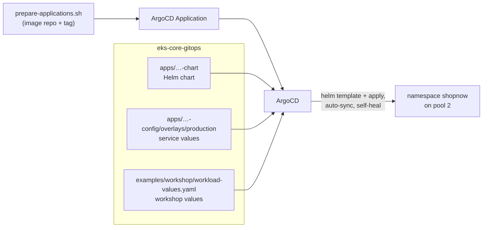

# Bước 3.2 — Deploy ShopNow với ArgoCD {#step-32--deploy-the-microservices-with-argocd}

Sau khi build image và chuẩn bị các NodePool, chúng ta sẽ triển khai ShopNow bằng ArgoCD. Database được triển khai trước, tiếp theo là các backend service và frontend.

**Thời gian:** khoảng 30 phút. **Chạy từ:** `$GITOPS_DIR`.

## GitOps, Helm và ArgoCD {#gitops-and-helm}

### Từ image đến ứng dụng đang chạy

Sau khi build, container image được push lên ECR. Image chỉ chứa những gì ứng dụng cần để chạy; Kubernetes vẫn cần biết số replica, port, biến môi trường, volume và nơi được phép schedule Pod. Những thông tin triển khai này nằm trong repo `eks-core-gitops`.

ArgoCD theo dõi cấu hình trong Git và so sánh với resource trên cluster. Khi sync, nó áp dụng phần khác biệt. Đây là cách chúng ta sử dụng GitOps trong workshop: thay cấu hình qua commit để có lịch sử và biết phiên bản nào đang được triển khai.

### Helm chart và values

Helm chart chứa template cho Deployment, Service, PVC và các resource khác. File values truyền các giá trị như image tag, replica hoặc cấu hình EFS vào template. Cùng một chart có thể triển khai nhiều service hoặc môi trường bằng values khác nhau.

Khi dùng chart trong ArgoCD, ArgoCD sử dụng Helm để render manifest rồi quản lý các resource đã render. Bạn không cần chạy `helm install` riêng cho từng Application. Các platform chart do Terraform cài lại là một trường hợp khác: chúng vẫn được quản lý qua `helm_release` trong Terraform.

### Application và AppProject

Một ArgoCD Application chỉ ra repo, revision, đường dẫn chart, values và cluster/namespace đích. Trong ShopNow, mỗi service có một Application riêng để theo dõi quá trình triển khai.

AppProject giới hạn phạm vi của các Application, chẳng hạn repo được đọc và namespace được triển khai. Project `shopnow` được dùng cho các ứng dụng trong namespace `shopnow`.

Hai trạng thái cần phân biệt là `Synced` và `Healthy`. `Synced` cho biết manifest đang khớp với cấu hình ArgoCD đã render. `Healthy` phản ánh tình trạng các resource. Một Application có thể đã sync nhưng Pod vẫn đang khởi động hoặc bị lỗi.

### Cập nhật và rollback

Khi có image mới, cập nhật image tag trong cấu hình Application/values. Việc chỉ push image lên ECR chưa làm ArgoCD đổi Deployment nếu desired state trong Git hoặc Application chưa đổi.

Với `selfHeal`, thay đổi trực tiếp trên resource có thể bị khôi phục theo cấu hình nguồn. Vì vậy, khi muốn giữ một thay đổi hoặc rollback, cập nhật nguồn cấu hình rồi sync. Các bước tiếp theo sẽ render Application và triển khai theo thứ tự dependency của ShopNow.

Đọc thêm: [Helm trong ArgoCD](https://argo-cd.readthedocs.io/en/stable/user-guide/helm/).

## Cấu trúc ArgoCD Application {#how-a-service-gets-deployed}



Mỗi service có một ArgoCD Application. ArgoCD render Helm chart bằng ba file values theo thứ tự khai báo. File cuối `workload-values.yaml` bổ sung cấu hình chung cho sáu backend: mixed pool, EFS, topology spread và PDB.

```yaml
replicaCount: 2
persistence:            # requirement 4 — EFS volume at /data
  enabled: true
  storageClass: efs-sc
  size: 5Gi
  mountPath: /data
nodeSelector:           # requirement 3 — run on pool 2
  workload: microservices
tolerations:
  - key: workload
    operator: Equal
    value: microservices
    effect: NoSchedule
podDisruptionBudget:    # requirement 6
  enabled: true
  maxUnavailable: 1
```

Discovery Server dùng thêm `discovery-values.yaml` với 1 replica và không có PDB. Eureka trong workshop chưa cấu hình peer replication.

Các Application bật auto-sync, `prune` và `selfHeal`. Khi cần thay cấu hình service, sửa trong Git rồi để ArgoCD sync. Nếu chỉ sửa bằng `kubectl`, self-heal có thể đưa resource về giá trị đang có trong Git.

## 1. Tạo AppProject {#1-create-the-appproject}

```bash
kubectl --context eks-workload apply -f "$GITOPS_DIR/platform/addons/argocd/appproject-shopnow.yaml"
```

AppProject `shopnow` giới hạn Application deploy vào namespace `shopnow`.

## 2. Render Application {#2-render-the-applications}

Script tạo Application manifest từ Git URL, revision, ECR Repository và image tag của bạn. Bước này chỉ render file; apply ở bước tiếp theo.

```bash
cd "$GITOPS_DIR"
bash examples/workshop/prepare-applications.sh
ls .workshop/applications
```

**Kết quả:** chín file — `shopnow-database-services`, `discovery-server`, `config-server`, `product-service`, `cart-service`, `user-service`, `api-gateway`, `frontend` và `workshop-proof.json`.

## 3. Đăng nhập ArgoCD {#3-log-in-to-argocd}

Trong terminal riêng: `kubectl --context eks-workload -n argocd port-forward svc/argocd-server 8080:80`

```bash
argocd login localhost:8080 --plaintext --username admin \
  --password "$(kubectl --context eks-workload -n argocd get secret argocd-initial-admin-secret -o jsonpath='{.data.password}' | base64 --decode)"
```

## 4. Deploy theo thứ tự {#4-deploy-in-dependency-order}

database cần sẵn sàng trước khi backend khởi động. Chúng ta sẽ triển khai lần lượt database, Discovery Server, Config Server, các service và frontend. Chờ nhóm hiện tại `Healthy` rồi mới chạy nhóm tiếp theo.

```bash
A=.workshop/applications
deploy() { for app in "$@"; do kubectl --context eks-workload apply -f "$A/$app.yaml"; done
           for app in "$@"; do argocd app wait "$app" --sync --health --timeout 900; done; }

deploy shopnow-database-services                         # PostgreSQL, MySQL, Keycloak
deploy shopnow-discovery-server shopnow-config-server    # Eureka, Spring Cloud Config
deploy shopnow-product-service shopnow-cart-service shopnow-user-service shopnow-api-gateway
deploy shopnow-frontend
```

Khi backend bắt đầu chạy, theo dõi Karpenter cấp node cho mixed pool:

```bash
kubectl --context eks-workload get nodeclaims -w
```

frontend là Argo Rollout blue-green, promote thủ công; lần triển khai đầu tiên chuyển Healthy trực tiếp. Các lần cập nhật sau chờ promote ([blue-green](blue-green-argo-rollouts)).

## Kiểm tra ArgoCD Application {#verify--argocd-requirement-7}

```bash
argocd app list -p shopnow | tee "$EVIDENCE_DIR/argocd-apps.txt"
```

**Kết quả:** mọi Application `Synced` và `Healthy`, trỏ tới đúng repo và revision của bạn.

## Kiểm tra microservices trên mixed pool {#verify--microservices-on-pool-2-requirement-3}

```bash
kubectl --context eks-workload -n shopnow get pods -o json | jq -r '.items[]
  | select(.metadata.labels.app // "" | test("service|gateway|server"))
  | [.metadata.name, .spec.nodeName] | @tsv' \
| while IFS=$'\t' read -r pod node; do
    printf '%-60s %s\n' "$pod" "$(kubectl --context eks-workload get node "$node" \
      -o jsonpath='{.metadata.labels.karpenter\.sh/nodepool}/{.metadata.labels.karpenter\.sh/capacity-type}')"
  done | tee "$EVIDENCE_DIR/pool2-placement.txt"
```

**Kết quả:** mọi backend Pod hiển thị `ms-od/on-demand` hoặc `ms-spot/spot`. Không Pod nào chạy trên node `infra`, `batch-spot` hoặc `arm64`.

## Kiểm tra ShopNow {#verify--the-application-works}

```bash
kubectl --context eks-workload -n shopnow port-forward svc/shopnow-api-gateway-service 5860:5860   # terminal 1
curl -fsS http://localhost:5860/product                                                           # terminal 2
kubectl --context eks-workload -n shopnow port-forward svc/shopnow-frontend-service 8082:80          # terminal 3
```

`/product` trả JSON; danh sách rỗng `[]` là bình thường với database mới. Mở http://localhost:8082 để xem cửa hàng.

| Triệu chứng | Kiểm tra |
|---|---|
| `ImagePullBackOff` | image tag trong Application (`argocd app manifests <app> \| grep image:`); tag tồn tại trong ECR |
| Pod `Pending`, không có NodeClaim | Selector/toleration Pod so với label pool 2; log Karpenter |
| backend `CrashLoopBackOff` khi khởi động | database hoặc Eureka chưa sẵn sàng; `kubectl -n shopnow logs <pod>` |
| Application liên tục `OutOfSync` | `argocd app diff <app>`; loại tài nguyên không được AppProject cho phép |
| PVC `Pending` | Phần xử lý sự cố [bước 3.3](efs-persistent-volumes) |

## Cập nhật Service {#changing-a-service-later}

1. Sửa chart hoặc values trong fork `eks-core-gitops`, commit và push.
2. ArgoCD phát hiện commit và sync, hoặc chạy `argocd app sync <app>`.
3. Với image mới: build lại bằng `IMAGE_TAG` mới, chạy lại `prepare-applications.sh` và apply file Application thay đổi.

Để rollback, revert commit cấu hình rồi push lên repo; auto-sync sẽ áp dụng lại phiên bản trước. Khi auto-sync đang bật, `argocd app rollback` không được phép. Bạn có thể xem các lần triển khai bằng `argocd app history <app>`.

**Tiếp theo:** [3.3 Persistent volume EFS](efs-persistent-volumes)
