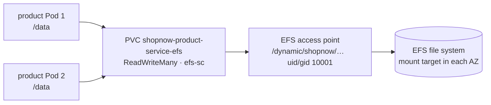

# Bước 3.3 — Persistent volume EFS {#step-33--persistent-volumes-on-efs}

Ở phần này, chúng ta sẽ xem cách Kubernetes cấp volume từ EFS, sau đó thử ghi và đọc file giữa hai replica. Cuối cùng, thay một Pod để kiểm tra file đã ghi còn tồn tại hay không.

**Thời gian:** khoảng 15 phút. **Chạy từ:** `$GITOPS_DIR`.

## PV, PVC, EBS và EFS {#storage-basics}

### Vì sao cần persistent volume?

Pod có thể bị thay khi rollout, drain node hoặc gặp sự cố. Nếu ứng dụng chỉ ghi vào filesystem của container, dữ liệu đó không được giữ lại khi container bị thay. Persistent volume tách phần lưu trữ khỏi vòng đời của Pod.

Trong Kubernetes, ứng dụng yêu cầu storage bằng PVC. PV thể hiện volume được cấp, còn StorageClass mô tả cách provision volume. CSI driver làm việc với hệ thống lưu trữ để cấp và mount volume cho Pod.

| Thành phần | Ví dụ trong workshop |
|---|---|
| StorageClass | `gp3` cho EBS, `efs-sc` cho EFS |
| PVC | Claim `<service>-efs` do chart backend tạo |
| PV | Volume được bind với PVC sau khi provision |
| CSI driver | EBS CSI hoặc EFS CSI tùy StorageClass |

### EBS và EFS được dùng ở đâu?

EBS cung cấp block storage gắn với EC2 trong một AZ. Workshop dùng volume `gp3` cho PostgreSQL, MySQL và một số công cụ lưu dữ liệu cục bộ. Với `ReadWriteOnce`, volume được mount đọc/ghi từ một node tại một thời điểm; access mode này không có nghĩa chỉ được phép có một Pod trên node đó.

EFS cung cấp filesystem có thể được mount từ nhiều node. Với `ReadWriteMany`, các replica của một service có thể đọc, ghi cùng thư mục dù nằm trên node khác nhau. Vì vậy EFS được dùng cho yêu cầu shared volume của microservices.

### EFS Access Point và quyền ghi

EFS CSI driver của workshop provision một Access Point cho mỗi PVC. StorageClass cấu hình UID/GID `10001`, nên user chạy trong container cần có quyền tương ứng để ghi vào thư mục mount.

Mount target cung cấp đường kết nối tới EFS trong các subnet. Nếu Pod bị mount timeout, kiểm tra mount target, DNS và security group cho NFS TCP 2049 trước khi đổi cấu hình ứng dụng.

### Bài thực hành sẽ kiểm tra điều gì?

Chúng ta ghi một file từ Product Pod thứ nhất và đọc từ replica thứ hai. Sau đó thay Pod rồi đọc lại file để kiểm tra dữ liệu được giữ trên volume.

Bài này không chuyển dữ liệu sản phẩm từ PostgreSQL sang EFS. Nó kiểm tra khả năng mount và dùng chung filesystem. Khi xóa PVC, cần xem reclaim policy và hành vi của CSI driver trước khi kết luận dữ liệu được giữ hay xóa; persistent volume không thay thế backup.

Đọc thêm: [Kubernetes Persistent Volumes](https://kubernetes.io/docs/concepts/storage/persistent-volumes/).

## Cấu trúc EFS storage {#how-storage-is-wired}



| Thành phần | Công cụ quản lý | Chi tiết |
|---|---|---|
| EFS file system + mount target | Terraform layer 20 | Một mount target mỗi workload subnet; mở NFS 2049 từ node |
| EFS CSI driver | EKS add-on, Pod Identity cho `efs-csi-controller-sa` | Tạo một access point cho mỗi PVC |
| StorageClass `efs-sc` | Terraform | `provisioningMode: efs-ap`, `uid/gid 10001`, `basePath /dynamic` |
| PVC `<service>-efs` | Từng backend chart (`pvc-efs.yaml`) | `ReadWriteMany`, mount tại `/data` |

Với `ReadWriteMany`, các replica của một service có thể mount cùng thư mục dù chạy trên node hoặc AZ khác nhau. Database của project app vẫn dùng volume EBS `gp3` riêng.

## 1. Kiểm tra EFS và PVC {#1-check-the-storage-layer}

```bash
kubectl --context eks-workload get storageclass efs-sc
kubectl --context eks-workload -n shopnow get pvc
aws efs describe-mount-targets \
  --file-system-id "$(terraform -chdir="$TF_DIR/20-cluster-workload" output -raw efs_file_system_id)" \
  --query 'MountTargets[].[AvailabilityZoneName,LifeCycleState]' --output table
```

**Kết quả:** sáu PVC `*-efs` ở trạng thái `Bound`, access mode `RWX`, class `efs-sc`; mỗi AZ có một mount target `available`.

## 2. Kiểm tra volume dùng chung {#2-shared-between-replicas}

Ghi file từ một Product Pod, sau đó đọc từ replica còn lại:

```bash
read -r WRITER READER < <(kubectl --context eks-workload -n shopnow get pods -l app=shopnow-product-service \
  --field-selector=status.phase=Running -o jsonpath='{.items[0].metadata.name} {.items[1].metadata.name}')

kubectl --context eks-workload -n shopnow exec "$WRITER" -- sh -c 'echo "efs-test $(date -u +%FT%TZ)" > /data/efs-test.txt'
kubectl --context eks-workload -n shopnow exec "$READER" -- cat /data/efs-test.txt
```

**Kết quả:** Pod thứ hai đọc được nội dung file vừa ghi từ Pod thứ nhất. Kiểm tra hai Pod nằm trên node khác nhau theo [bước 3.4](pod-placement) để thử shared volume giữa các node.

## 3. Kiểm tra dữ liệu sau khi thay Pod {#3-survives-pod-replacement}

```bash
kubectl --context eks-workload -n shopnow delete pod "$WRITER"
kubectl --context eks-workload -n shopnow rollout status deployment/shopnow-product-service-deployment --timeout=10m
NEW=$(kubectl --context eks-workload -n shopnow get pods -l app=shopnow-product-service -o jsonpath='{.items[0].metadata.name}')
kubectl --context eks-workload -n shopnow exec "$NEW" -- cat /data/efs-test.txt | tee "$EVIDENCE_DIR/efs-persistence.txt"
```

**Kết quả:** Pod mới đọc được file đã ghi trước khi thay Pod.

Xóa file test:

```bash
kubectl --context eks-workload -n shopnow exec "$NEW" -- rm /data/efs-test.txt
```

## 4. Tạo workload thực hành {#4-deploy-the-proof-workload}

Hai bài tiếp theo dùng thêm `workshop-proof` để thử placement và eviction trước khi thao tác trên ứng dụng. Workload này có ba replica dùng chung một PVC EFS, với PDB đặt `minAvailable: 2`.

```bash
kubectl --context eks-workload apply -f "$GITOPS_DIR/.workshop/applications/workshop-proof.json"
argocd app wait workshop-proof --sync --health --timeout 900
kubectl --context eks-workload -n shopnow get pods -l app=workshop-proof -o wide
```

## Troubleshooting {#troubleshooting}

| Triệu chứng | Kiểm tra |
|---|---|
| PVC `Pending` | `kubectl -n shopnow describe pvc <name>`; log EFS CSI controller; `fileSystemId` của StorageClass |
| Pod kẹt `ContainerCreating`, mount timeout | Security group cho phép TCP 2049 từ node SG; có mount target trong AZ của Pod |
| `Permission denied` khi ghi `/data` | User container phải là 10001, khớp uid/gid của access point |

**Tiếp theo:** [3.4 Phân bổ đều](pod-placement)
