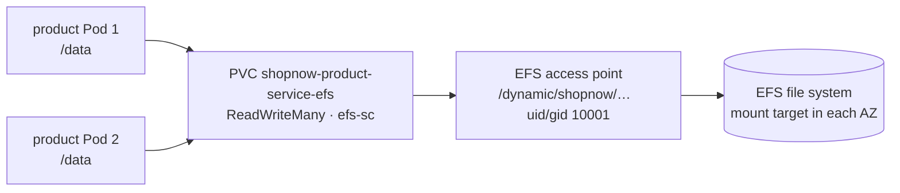

# Bước 3.3 — Persistent volume trên EFS {#step-33--persistent-volumes-on-efs}

:::info Tóm tắt bước thực hành
**Mục tiêu:** chứng minh microservices dùng volume EFS chia sẻ giữa các replica và giữ dữ liệu khi thay Pod.
**Yêu cầu:** 4. **Thời gian:** khoảng 15 phút. **Chạy từ:** `$GITOPS_DIR`.
:::

## Cách kết nối lưu trữ {#how-storage-is-wired}



| Thành phần | Công cụ quản lý | Chi tiết |
|---|---|---|
| EFS file system + mount target | Terraform lớp 20 | Một mount target mỗi workload subnet; mở NFS 2049 từ node |
| EFS CSI driver | EKS add-on, Pod Identity cho `efs-csi-controller-sa` | Tạo một access point cho mỗi PVC |
| StorageClass `efs-sc` | Terraform | `provisioningMode: efs-ap`, `uid/gid 10001`, `basePath /dynamic` |
| PVC `<service>-efs` | Từng backend chart (`pvc-efs.yaml`) | `ReadWriteMany`, mount tại `/data` |

`ReadWriteMany` cho phép mọi replica của một service, trên node hoặc AZ bất kỳ, mount cùng thư mục. Database vẫn dùng volume `gp3` (EBS) riêng.

## 1. Kiểm tra lớp lưu trữ {#1-check-the-storage-layer}

```bash
kubectl --context eks-workload get storageclass efs-sc
kubectl --context eks-workload -n shopnow get pvc
aws efs describe-mount-targets \
  --file-system-id "$(terraform -chdir="$TF_DIR/20-cluster-workload" output -raw efs_file_system_id)" \
  --query 'MountTargets[].[AvailabilityZoneName,LifeCycleState]' --output table
```

**Kết quả mong đợi:** sáu PVC `*-efs` ở trạng thái `Bound`, access mode `RWX`, class `efs-sc`; mỗi AZ có một mount target `available`.

## 2. Chia sẻ giữa các replica {#2-shared-between-replicas}

Ghi tệp từ một product Pod rồi đọc từ Pod còn lại:

```bash
read -r WRITER READER < <(kubectl --context eks-workload -n shopnow get pods -l app=shopnow-product-service \
  --field-selector=status.phase=Running -o jsonpath='{.items[0].metadata.name} {.items[1].metadata.name}')

kubectl --context eks-workload -n shopnow exec "$WRITER" -- sh -c 'echo "efs-test $(date -u +%FT%TZ)" > /data/efs-test.txt'
kubectl --context eks-workload -n shopnow exec "$READER" -- cat /data/efs-test.txt
```

**Kết quả mong đợi:** Pod đọc in ra dòng do Pod ghi tạo. Hai Pod nằm trên node khác nhau (xem [bước 3.4](pod-placement)), chứng minh volume được chia sẻ xuyên node.

## 3. Giữ dữ liệu khi thay Pod {#3-survives-pod-replacement}

```bash
kubectl --context eks-workload -n shopnow delete pod "$WRITER"
kubectl --context eks-workload -n shopnow rollout status deployment/shopnow-product-service-deployment --timeout=10m
NEW=$(kubectl --context eks-workload -n shopnow get pods -l app=shopnow-product-service -o jsonpath='{.items[0].metadata.name}')
kubectl --context eks-workload -n shopnow exec "$NEW" -- cat /data/efs-test.txt | tee "$EVIDENCE_DIR/efs-persistence.txt"
```

**Kết quả mong đợi:** cùng dòng dữ liệu, được đọc bởi Pod chưa tồn tại lúc ghi.

Xóa tệp thử nghiệm:

```bash
kubectl --context eks-workload -n shopnow exec "$NEW" -- rm /data/efs-test.txt
```

## 4. Triển khai workload kiểm chứng {#4-deploy-the-proof-workload}

Hai bước tiếp theo dùng `workshop-proof`: ba replica chia sẻ một EFS claim với PDB yêu cầu 2/3 replica. Workload này giúp kiểm thử placement và eviction mà không ảnh hưởng ShopNow.

```bash
kubectl --context eks-workload apply -f "$GITOPS_DIR/.workshop/applications/workshop-proof.json"
argocd app wait workshop-proof --sync --health --timeout 900
kubectl --context eks-workload -n shopnow get pods -l app=workshop-proof -o wide
```

## Xử lý sự cố {#troubleshooting}

| Triệu chứng | Kiểm tra |
|---|---|
| PVC `Pending` | `kubectl -n shopnow describe pvc <name>`; log EFS CSI controller; `fileSystemId` của StorageClass |
| Pod kẹt `ContainerCreating`, mount timeout | Security group cho phép TCP 2049 từ node SG; có mount target trong AZ của Pod |
| `Permission denied` khi ghi `/data` | User container phải là 10001, khớp uid/gid của access point |

**Tiếp theo:** [3.4 Phân bổ đều](pod-placement)
